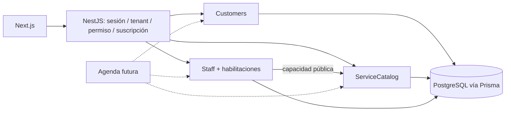

# TASK-09 — FEAT-003: Núcleo Operativo de Negocios

**Estado: B1–B10 completados.**
**Fecha:** 2026-10-14. **Base inspeccionada:** `9f391ad` (`team view rework`), árbol limpio al iniciar.  
**Goal:** persistir clientes, servicios, categorías y personal operativo aislados por organización, como base de Servicios/Turnero y de futuras verticales.  
**Architecture:** monolito modular NestJS; PostgreSQL sólo desde la API; contratos HTTP explícitos y frontend Next.js consumidor.  
**Tech Stack:** stack instalado, NestJS 12, Prisma 7.10, PostgreSQL, Next.js 16 y TypeScript; sin dependencias nuevas.  
**Spec:** este documento contiene diseño y plan; TASK-07 y TASK-08 son antecedentes cerrados, no planes a reejecutar.

## 1. Objetivo, alcance y estado real

### 1.1 Alcance autorizado de esta intervención

El usuario autorizó B1 el 2026-10-14; después autorizó B2–B4, B5 y todos los bloques posteriores en orden. B1 cubrió modelos Prisma, relaciones e integridad multi-tenant; B2 permisos/contexto/If-Match/auditoría; B3 API de clientes; B4 API de categorías/servicios y protección monetaria; B5 API básica de personal; B6 habilitaciones profesional–servicio; B7 Clientes web; B8 Servicios/categorías/asociaciones web; B9 Profesionales web y separación de Equipo; B10 validación cruzada focalizada y cierre documental. Las propuestas técnicas fuera de estos bloques siguen pendientes y no se consideran aprobadas por estas autorizaciones.

FEAT-003 propone CRUD mediante alta, consulta, edición, desactivación y reactivación de clientes, servicios y trabajadores; categorías y habilitaciones profesional–servicio; permisos de dominio; conexión de las pantallas correspondientes. El rediseño visual de Clientes y Servicios tendrá una revisión separada con Gemini Canvas; su integración funcional no depende de inventar ahora ese diseño.

Quedan fuera turnos persistidos/públicos, horarios, disponibilidad, ausencias, asignación automática efectiva, comisiones, ventas, productos, inventario, hotelería, promociones, cobros, importación, exportación masiva, fusión de clientes y vinculación de cuentas al personal. No migrar automáticamente datos de demostración ni interpretar Caja como ventas o pagos. No se afirma que el MVP esté validado: faltan piloto concreto, flujo observado y métrica.

### 1.2 Investigación y evidencia

Rutas relativas a la raíz del repositorio; el código prevalece sobre descripciones históricas.

| Fuente inspeccionada | Hallazgo y efecto sobre FEAT-003 |
| --- | --- |
| `.ai/context_snapshot.md`, `.ai/known_issues.md`, `docs/product/mvp.md` | FEAT-001/002 cerradas manualmente; operación local todavía ficticia. El segmento Servicios está elegido para explorar, sin piloto ni métrica acordados. |
| `docs/tasks/TASK-07-feat-001-authentication-onboarding.md` | Contrato y cierre de identidad, onboarding, sesiones, suscripción y aislamiento. Su Context describe el punto de partida histórico, no la API actual. |
| `docs/tasks/TASK-08-feat-002-organization-members-invitations.md` | Configuración, miembros e invitaciones reales. Su criterio 2 dice lectura de miembros para EMPLOYEE; los métodos de escritura efectivamente lo rechazan. |
| `api/prisma/schema.prisma` y migraciones | B1 agregó Customer, Service, StaffMember y categorías; la migración aditiva aplicada en Neon dev dejó cinco migraciones al día. B3 reutiliza Customer sin cambios de esquema. Organization conserva currency/timezone/country; User es global y OrganizationMember es acceso por tenant. |
| `api/src/app.module.ts`, `identity/identity.module.ts` | Módulos actuales: Database, Identity, Organizations, Subscriptions. CSRF y Session son guards globales; CSRF está registrado primero. |
| `api/src/organizations/{tenant.guard,organizations.controller,organizations.service,organizations.dto,organizations.module}.ts` | TenantGuard obtiene el tenant de `params.id`. B2 agrega una matriz cerrada para permisos operativos y deniega permisos desconocidos; B3 la usa en los endpoints de clientes. Settings y miembros tienen reglas propias, distintas del guard comercial. |
| `api/src/{app.config.ts,common/errors.ts,common/transaction.ts,subscriptions/subscription.policy.ts}` | Prefijo `/api`, body 16 KiB, no-store, validación estricta sin coerción implícita; ApiError saneado; TransactionContext existente; todos los roles tienen acceso comercial base sujeto a suscripción. |
| `app/src/lib/api/{contracts,api-client,browser,errors}.ts` | Axios same-origin con cookies y timeout; helpers CSRF para POST/PATCH/DELETE, sin helper PUT. Lista cerrada de códigos de error: extenderla junto con la API. |
| `app/src/app/(app)/app/{servicios,clientes,equipo}/page.tsx` | Cada página comprueba `guardPage("business")`; esto no decide todavía permisos operativos específicos. |
| `app/src/features/workspace/{services-screen,clients-screen,workspace-provider,local-source,types,section-ui}.tsx/ts` | Servicios y Clientes cargan arrays locales completos; búsqueda en memoria. Servicios sólo alta/nombre/duración/descripción. Clientes alta/ficha, exige contacto y email localmente único. No hay edición, archivo ni paginación real. |
| `app/src/features/workspace/team-screen.tsx` | Equipo ya usa API de miembros/invitaciones, roles OWNER/ADMIN/EMPLOYEE, revocación y protección del último OWNER. No usa el equipo operativo local. |
| `app/src/features/access/access-provider.tsx`, `components/layout/app-navigation.tsx` | Contexto y providers se reinician por usuario/organización; preservar cancelación de peticiones y desmontaje comercial. Sidebar actual etiqueta Equipo y lo ubica en Gestión. |
| `api/test/harness.ts`, configs Vitest, `docs/development/testing.md` | Hay suites separadas unitarias, integración y HTTP. El harness permite opt-in a Neon dev compartido y sólo comprueba un mínimo de tres migraciones: no prueba por sí solo que exista el esquema nuevo. Su teardown requiere ampliarse antes de crear fixtures operativos. |
| `docs/tasks/`, `docs/architecture/decisions/`, AGENTS.md | TASK-01 a TASK-08 ocupadas; TASK-09 disponible. ADR-001 a ADR-006 ocupados. Convención de tarea Markdown con Goal, Context, bloques, aceptación y verificación. Snapshot y known_issues se actualizan al cerrar trabajo documental. |

Discrepancias identificadas en la investigación inicial y ya corregidas documentalmente: known_issues describía Equipo como local y modules mantenía identidad en validación. La política monetaria ya tiene aprobados decimal exacto y ausencia de conversión automática; se definieron Decimal(12,2), confirmación de cambio y bloqueo ante datos monetarios existentes; sus verificaciones ejecutables pertenecen a la implementación futura. No reabrir FEAT-001/002 por esas diferencias.

### 1.3 Alternativas consideradas

| Alternativa | Ventaja | Coste / decisión |
| --- | --- | --- |
| **Customer + Staff compartidos; Service Catalog especializado** | Nombres claros y reutilización entre verticales sin condicionar Comercio a agenda | Recomendada. Contratos públicos de módulo y FK tenant-aware suficientes. |
| Contact/Party genérico con múltiples roles | Podría reunir proveedores, huéspedes y clientes | Hoy agrega roles, uniones y permisos sin caso validado. Posponer; migrar desde Customer cuando haya evidencia. |
| Un catálogo universal de productos, servicios y habitaciones | Aparente uniformidad | Mezcla duración, stock y recursos; obliga a campos opcionales y reglas ambiguas. Rechazada. |

### 1.4 Decisiones de producto aprobadas — 2026-10-14

La aprobación de estos puntos modifica el contrato de diseño; por sí sola no autoriza implementación. B1 fue autorizado por separado el 2026-10-14, limitado a modelos, relaciones e integridad multi-tenant; después el usuario autorizó B2 y B3 según este contrato.

1. EMPLOYEE puede consultar clientes, servicios y profesionales, y crear/editar clientes. No administra servicios, precios ni profesionales.
2. StaffMember permanece separado de OrganizationMember; la vinculación con una cuenta Nuari es opcional y explícita. No crea ni concede acceso automáticamente.
3. La arquitectura debe permitir, en features futuras y opcionales por organización, registrar ventas y servicios realizados desde móviles, fichar entrada/salida y obtener estadísticas de ventas, actividad y asistencia por empleado. Las capacidades deben poder configurarse sin promover EMPLOYEE a ADMIN.
4. Los futuros registros distinguirán al profesional que realizó el trabajo del usuario que cargó la operación.
5. EMPLOYEE no obtiene por defecto acceso a gastos, cierres de caja ni reportes financieros generales.
6. Ventas, asistencia, reportes, configuración de capacidades y vinculación de cuentas no se implementan ahora; sólo se documentan sus dependencias.

Decisiones adicionales cerradas por producto:

7. Notas de clientes internas, visibles para OWNER y ADMIN; EMPLOYEE no accede por defecto a notas sensibles. En este corte se trata todo el campo notes como interno, sin inventar una clasificación por nota.
8. Archivo de clientes mediante desactivación lógica, sin eliminación del historial. OWNER y ADMIN pueden archivar/reactivar; EMPLOYEE sólo crea/edita datos de clientes y no modifica su estado.
9. Datos básicos del personal visibles; información sensible restringida a OWNER y ADMIN. El directorio básico incluye identificación, nombre, estado y habilitaciones; contactos y vínculo con usuario quedan en la ficha administrativa.
10. Duplicados: advertir por correo o teléfono dentro del tenant, sin bloqueo automático ni fusión.
11. Moneda/precios: usar decimal exacto y no realizar conversión automática al cambiar moneda. No reinterpretar importes existentes; el mecanismo de confirmación y bloqueo queda definido en el cierre técnico siguiente.
12. Selección de profesional configurable por servicio.
13. Duración admitida: entero entre **5 y 720 minutos**, inclusive.
14. Clientes y Servicios mantienen sus rutas actuales; profesionales operativos se gestionan en una sección independiente de los accesos.

Cierre de decisiones técnicas de la misma feature:

15. Precios de la primera vertical en Decimal(12,2), sin floats ni redondeo silencioso de entrada.
16. Cambio efectivo de moneda con confirmación explícita; no convertir automáticamente y bloquear si hay datos monetarios persistidos hasta definir una migración explícita.
17. Modos CUSTOMER_CHOICE, AUTO_ASSIGN y NO_ASSIGNMENT. Sugerir CUSTOMER_CHOICE sólo si hay profesionales habilitados y activos para ese servicio; en su ausencia exigir elección explícita, sin asumir NO_ASSIGNMENT.
18. Modalidad inicial presencial (IN_PERSON); preparar el límite de dominio para una ampliación futura a remoto, sin habilitarla en FEAT-003.
19. Archivo/reactivación de clientes sólo OWNER/ADMIN; EMPLOYEE conserva consulta, creación y edición sin gestión de estado.
20. Profesionales operativos en /app/profesionales, etiqueta Profesionales; /app/equipo se mantiene para miembros con acceso. Clientes y Servicios conservan sus rutas.

Las decisiones anteriores ya no requieren otra aprobación de producto. El resto del documento sigue siendo el diseño técnico revisable y debe validarse al implementar; B1 está aplicado en el alcance y ambiente registrados en la sección 12, y B2 implementa los helpers indicados sin endpoints. Piloto, métricas, retención y funcionalidades futuras conservan sus pendientes. Las autorizaciones de B1/B2 no autorizan otros bloques.

## 2. Arquitectura de dominio y límites

| Módulo | Propiedad y capacidades | Dependencias permitidas |
| --- | --- | --- |
| Identity | User, credenciales, sesiones y tokens | Infraestructura existente; no crea clientes ni trabajadores |
| Organizations | Organization, OrganizationMember, invitaciones, tenant y política de permisos | Identity y Subscriptions actuales |
| Customers (nuevo, compartido) | Customer; CRUD privado, búsqueda y candidatos duplicados | Organizations, acceso comercial, Database |
| ServiceCatalog (nuevo, Servicios) | Service, ServiceCategory; duración, precio y selección de profesional | Organizations, acceso comercial, Database |
| Staff (nuevo, compartido) | StaffMember y habilitación StaffService; datos laborales básicos | Organizations, ServiceCatalog mediante capacidad pública, Database |
| Appointments/Availability (futuros) | Reserva, ocupación, horarios y asignación efectiva | Capacidades autorizadas de Customers, Staff y ServiceCatalog |
| Sales, Products/Inventory, Hospitality (futuros) | Venta/pago separados; producto/stock; estadía/recurso | Customers, Organization y Staff cuando corresponda; modelos propios |

El personal básico puede existir en cualquier vertical; su habilitación para un servicio es una capacidad especializada. Alojar StaffService en StaffModule por ahora, sin crear otro módulo puente ni un repositorio genérico. Los handlers de asociaciones bajo `/services/:serviceId/staff` viven en StaffModule, que importa ServiceCatalog; ServiceCatalog **no importa Staff**. El detalle de servicio carga sus profesionales por ese endpoint separado. Evita un ciclo entre módulos y N+1 en listados: cargar asociaciones al abrir el detalle, sin una petición por tarjeta.

Cada módulo controla sus escrituras. Exportar sólo capacidades necesarias: por ejemplo `ServiceCatalogService.requireService(ctx, serviceId, tx?)` y `StaffService.listForService(ctx, serviceId, query)`. Devuelven proyecciones explícitas, no clientes Prisma ni repositorios. Los casos de uso reciben TenantContext y pueden recibir el TransactionContext vigente; una sola transacción local para una operación compuesta. Usar DatabaseModule y PrismaService existentes, imports ESM `.js`, DTOs y mappers por dominio. No crear buses, CQRS, microservicios ni unidades de trabajo genéricas.



## 3. Modelos Prisma y restricciones del catálogo

El esquema de esta sección quedó implementado en B1 y se aplica mediante `20261014140000_operational_catalog`; conservar generator, datasource y migraciones anteriores. Prisma 7.10 valida las relaciones compuestas con `organizationId`. Los endpoints y el resto de contratos de esta tarea siguen propuestos y no implementados.

```prisma
enum ServicePricingType {
  FIXED
  FROM
  ON_REQUEST
}

enum StaffSelectionMode {
  CUSTOMER_CHOICE
  AUTO_ASSIGN
  NO_ASSIGNMENT
}

enum ServiceModality {
  IN_PERSON
}

model Customer {
  id              String       @id @default(uuid()) @db.Uuid
  organizationId  String       @db.Uuid
  name            String       @db.VarChar(150)
  phone           String?      @db.VarChar(30)
  phoneNormalized String?      @db.VarChar(30)
  email           String?      @db.VarChar(254)
  notes           String?      @db.VarChar(4000)
  active          Boolean      @default(true)
  version         Int          @default(1)
  createdAt       DateTime     @default(now()) @db.Timestamptz(3)
  updatedAt       DateTime     @updatedAt @db.Timestamptz(3)
  organization    Organization @relation(fields: [organizationId], references: [id], onDelete: Restrict, onUpdate: Restrict)

  @@unique([organizationId, id])
  @@index([organizationId, active, createdAt, id])
  @@index([organizationId, email])
  @@index([organizationId, phoneNormalized])
}

model ServiceCategory {
  id             String       @id @default(uuid()) @db.Uuid
  organizationId String       @db.Uuid
  name           String       @db.VarChar(100)
  nameKey        String       @db.VarChar(100)
  active         Boolean      @default(true)
  sortOrder      Int          @default(0)
  version        Int          @default(1)
  createdAt      DateTime     @default(now()) @db.Timestamptz(3)
  updatedAt      DateTime     @updatedAt @db.Timestamptz(3)
  organization   Organization @relation(fields: [organizationId], references: [id], onDelete: Restrict, onUpdate: Restrict)
  services       Service[]

  @@unique([organizationId, id])
  @@unique([organizationId, nameKey])
  @@index([organizationId, active, sortOrder, id])
}

model Service {
  id                 String             @id @default(uuid()) @db.Uuid
  organizationId     String             @db.Uuid
  name               String             @db.VarChar(150)
  nameKey            String             @db.VarChar(150)
  description        String?            @db.VarChar(2000)
  durationMinutes    Int
  pricingType        ServicePricingType @default(ON_REQUEST)
  price              Decimal?           @db.Decimal(12, 2)
  currency           String             @db.VarChar(3)
  categoryId         String?            @db.Uuid
  active             Boolean            @default(true)
  sortOrder          Int                @default(0)
  staffSelectionMode StaffSelectionMode
  modality           ServiceModality    @default(IN_PERSON)
  version            Int                @default(1)
  createdAt          DateTime           @default(now()) @db.Timestamptz(3)
  updatedAt          DateTime           @updatedAt @db.Timestamptz(3)
  organization       Organization       @relation(fields: [organizationId], references: [id], onDelete: Restrict, onUpdate: Restrict)
  category           ServiceCategory?   @relation(fields: [organizationId, categoryId], references: [organizationId, id], onDelete: Restrict, onUpdate: Restrict)
  staffLinks         StaffService[]

  @@unique([organizationId, id])
  @@unique([organizationId, nameKey])
  @@index([organizationId, active, sortOrder, id])
  @@index([organizationId, categoryId, active])
}

model StaffMember {
  id             String       @id @default(uuid()) @db.Uuid
  organizationId String       @db.Uuid
  name           String       @db.VarChar(150)
  email          String?      @db.VarChar(254)
  phone          String?      @db.VarChar(30)
  active         Boolean      @default(true)
  userId         String?      @db.Uuid
  version        Int          @default(1)
  createdAt      DateTime     @default(now()) @db.Timestamptz(3)
  updatedAt      DateTime     @updatedAt @db.Timestamptz(3)
  organization   Organization @relation(fields: [organizationId], references: [id], onDelete: Restrict, onUpdate: Restrict)
  user           User?        @relation(fields: [userId], references: [id], onDelete: Restrict, onUpdate: Restrict)
  serviceLinks   StaffService[]

  @@unique([organizationId, id])
  @@unique([organizationId, userId])
  @@index([organizationId, active, name, id])
}

model StaffService {
  organizationId String      @db.Uuid
  staffMemberId  String      @db.Uuid
  serviceId      String      @db.Uuid
  createdAt      DateTime    @default(now()) @db.Timestamptz(3)
  staffMember    StaffMember @relation(fields: [organizationId, staffMemberId], references: [organizationId, id], onDelete: Restrict, onUpdate: Restrict)
  service        Service     @relation(fields: [organizationId, serviceId], references: [organizationId, id], onDelete: Restrict, onUpdate: Restrict)

  @@id([organizationId, staffMemberId, serviceId])
  @@index([organizationId, serviceId, staffMemberId])
}
```

Añadir sólo relaciones inversas a los modelos vigentes:

```prisma
// Dentro de Organization:
customers         Customer[]
serviceCategories ServiceCategory[]
services          Service[]
staffMembers      StaffMember[]

// Dentro de User:
staffProfiles     StaffMember[]
```

### 3.1 Restricciones e índices

- UUID, organizationId y timestamps los fija el backend. Tenant, IDs y createdAt son inmutables. Las FK compuestas requieren los UNIQUE `(organizationId,id)` aunque id ya sea globalmente único; permiten a futuras reservas/ventas referenciar cliente/servicio/personal sin cruzar tenants.
- Service.category usa la misma organizationId. `categoryId = null` significa sin categoría; conservar organizationId. Evitar SET NULL sobre la relación compuesta porque podría intentar limpiar el tenant requerido. La API desvincula sólo categoryId. StaffService hereda su pertenencia mediante ambas FK compuestas; no necesita otra FK redundante a Organization.
- PK de StaffService impide duplicar una habilitación. El índice inverso sirve para listar por servicio; la PK ya sirve para listar servicios por trabajador. Sin UUID redundante ni configuración JSON.
- UNIQUE tenant/nameKey en servicios y categorías, incluyendo inactivos: ante un nombre archivado ofrecer reactivación. `nameKey = nombre.trim().normalize('NFC').toLowerCase()` con lowercase independiente del locale; no quitar acentos ni colapsar nombres diferentes. El backend calcula y actualiza nameKey, que nunca acepta del cliente. No hacer únicos los nombres del personal.
- Customer.email y phoneNormalized **no son únicos**: familias comparten contacto. Normalización e índices sirven para detectar candidatos, no para identificar globalmente personas. No índice sobre notas.
- UNIQUE `(organizationId,userId)` permite muchas filas con userId nulo en PostgreSQL y a lo sumo una ficha vinculada a la misma cuenta por tenant. No implica que exista una membresía activa; eso requiere el caso de uso futuro de vinculación. El campo queda siempre null en FEAT-003.
- CHECK SQL versionados: `version >= 1`; longitudes no vacías para nombres; `sortOrder BETWEEN 0 AND 1000000`; `durationMinutes BETWEEN 5 AND 720`; `currency ~ '^[A-Z]{3}$'`; precio nulo sólo para ON_REQUEST y obligatorio/no negativo para FIXED/FROM. Acotar también a `price <= 9999999999.99` para excluir NaN y valores fuera de rango. Usar paréntesis completos para que la lógica SQL no acepte NULL por accidente.
- Ejemplo de CHECK monetario: `(pricingType = 'ON_REQUEST' AND price IS NULL) OR (pricingType IN ('FIXED','FROM') AND price IS NOT NULL AND price >= 0 AND price <= 9999999999.99)`. El control de escala por moneda es adicional en API. Las limitaciones no expresables por Prisma quedan en SQL revisado, con nombres y pruebas, sin modificar migraciones históricas.
- DELETE/UPDATE de identidades de dominio usan RESTRICT. La API no expone borrado físico de cliente/servicio/categoría/personal. Quitar una habilitación borra sólo la fila StaffService; una reserva futura referenciará las entidades, nunca esa fila mutable.

Las restricciones compuestas siguen las capacidades de [Prisma para claves compuestas](https://docs.prisma.io/docs/orm/prisma-client/special-fields-and-types/working-with-composite-ids-and-constraints). La validación concreta del schema y sus SQL queda en B1 con la versión instalada.

## 4. Reglas de negocio

### 4.1 Clientes y privacidad

Customer es una persona o contraparte comercial del tenant, independiente de User. Reservas y ventas futuras podrán usar customerId opcional o requerido según su propio flujo; no crear historial vacío ni acoplar Customer a Appointment. Una persona atendida por dos negocios genera dos fichas privadas sin sincronización ni resolución global por email/teléfono.

Nombre obligatorio; teléfono y email pueden faltar ambos. Esto cambia deliberadamente la regla de la maqueta. Teléfono: conservar presentación, aceptar dígitos, espacios, `+`, `-` y paréntesis, 7–15 dígitos y máximo 30 caracteres; phoneNormalized conserva sólo dígitos y un `+` inicial si existe. No inferir código de país ni afirmar equivalencia E.164 a partir de un número local. Extensiones y parsing internacional avanzado quedan fuera. Email: trim/lowercase, formato válido, máximo 254; no eliminar alias `+` ni puntos.

Detección no bloqueante: buscar coincidencia exacta de email normalizado o phoneNormalized dentro del tenant, incluyendo inactivos, con `excludeId` al editar. Ofrecer revisar ficha/reactivar o continuar; nunca fusionar ni rechazar automáticamente. Nombres similares son sólo resultados de búsqueda, no prueba de duplicación. Concurrencia puede crear duplicados: es aceptado expresamente para no imponer falsa unicidad; creación por timeout no se reintenta automáticamente.

Decisión aprobada: las notas son internas y visibles para OWNER/ADMIN; EMPLOYEE no tiene acceso por defecto. La propuesta de implementación mantiene todo notes como texto plano sin HTML y su escritura restringida por customers:notes a OWNER/ADMIN. EMPLOYEE ve datos mínimos de contacto para operación, sin notas. No incluir notas en listados, búsqueda, logs ni candidatos duplicados. No publicar directorio ni autocomplete anónimo. Dejar política de retención/anonymización para una tarea específica antes de operar con clientes reales; inactivar no equivale a eliminar datos personales.

### 4.2 Servicios, precio y moneda

- Duración entera aprobada de **5–720 minutos**, inclusive. La maqueta actual valida 5–480; FEAT-003 deberá ampliar esa cota a 720 sin conservar el límite local antiguo. No duración cero, fracciones ni días de hotelería.
- `FIXED`: importe exacto, incluso cero para gratuito. `FROM`: importe informativo mínimo, mostrar «Desde …» y no tratarlo como cotización cerrada. `ON_REQUEST`: price null, mostrar «Consultar»; no confundirlo con gratis.
- Precisión aprobada: PostgreSQL `numeric(12,2)` y Prisma.Decimal para los precios de esta primera vertical. Request/response monetarios son strings decimales, nunca JSON number, parseFloat ni cálculos con Number. Aceptar formato canónico sin signo, exponentes, coma ni separadores de miles: hasta 10 dígitos enteros, sin ceros iniciales salvo `0`, hasta 2 decimales. Rechazar exceso de escala **antes** de escribir: PostgreSQL puede redondear al convertir a numeric con escala declarada. Ver [tipos numéricos de PostgreSQL](https://www.postgresql.org/docs/current/datatype-numeric.html).
- En el catálogo, ARS/UYU/BRL/MXN/COP/PEN admiten hasta 2 decimales; CLP exige fracción nula (se acepta la representación .00 de la respuesta para permitir su edición sin cambio de valor). La columna tiene escala máxima de 2; ampliar esa precisión en otra vertical requerirá una migración explícita. No definir todavía impuestos, redondeo de totales, FX ni contabilidad. Serializar price con dos decimales, por ejemplo `"12500.00"`; la UI lo presenta según moneda. `"0.00"` es válido; `null` no es cero.
- `Service.currency` la copia el backend de Organization.currency al crear. No es un input ni permite precios multimoneda por servicio. La API retorna código explícito además del precio. Las siete configuraciones regionales vigentes siguen siendo la autoridad: no afirmar soporte mundial por guardar ISO/IANA.
- **Cambio regional seguro aprobado:** derivar primero la moneda efectiva del nuevo country/currency y comparar con el valor vigente leído en transacción. Un cambio sin efecto no exige confirmación. Si existe cualquier importe persistido del tenant, responder 409 CURRENCY_CHANGE_REQUIRES_MIGRATION aun si se confirmó. En FEAT-003 cuenta cualquier Service.price no nulo, incluido cero y servicios inactivos. Clientes, categorías y servicios ON_REQUEST con price null no son datos monetarios. Ventas/pagos/caja persistidos futuros deberán extender este mismo bloqueo mediante capacidades de sus módulos; las demos locales no son persistencia monetaria real.
- Si no hay importes existentes, exigir confirmCurrencyChange=true en PATCH de organización para cualquier cambio monetario efectivo, también si es consecuencia de cambiar country sin enviar currency. Omitir la confirmación o enviar false da 400 VALIDATION_ERROR con fieldErrors.confirmCurrencyChange. La confirmación nunca habilita convertir o reinterpretar importes ni elude el bloqueo. Validar además las reglas regionales vigentes.
- Con confirmación y ausencia de importes, actualizar Organization.currency y la moneda descriptiva de sus servicios sin precio dentro de una sola transacción; esos servicios mantienen price null y reciben incremento de version/updatedAt. No es conversión monetaria. Bloquear Organization tanto al cambiar moneda como al crear/editar Service y leer configuración fresca después del lock; de otro modo una primera fijación de precio concurrente podría escapar al bloqueo. No tocar históricos ni crear una herramienta de migración monetaria en esta feature.
- Categoría opcional, privada al tenant, plana; sin jerarquías ni taxonomía global. No asignar nuevas relaciones a categoría inactiva. Archivarla conserva servicios y nombres históricos; no desactiva servicios automáticamente ni impide editar otros campos de un servicio ya asociado. Se puede quitar la categoría o elegir una activa.
- Modalidad inicial aprobada: IN_PERSON. El atributo delimita una ampliación futura a REMOTE mediante migración/contrato específico; no ofrecer remoto ni admitirlo en DTO de FEAT-003. No crear links de videollamada, domicilios, desplazamientos ni reservas remotas ahora.
- Edición/desactivación no borra nada. Una reserva/venta futura deberá conservar snapshots de nombre, duración, precio/tipo de precio y moneda al confirmarse; modificar catálogo no reescribe condiciones históricas. Variaciones por profesional, vigencias de precio y promociones serán modelos/reglas futuras explícitos, no campos JSON ni descuentos anticipados.

### 4.3 Personal y habilitaciones

StaffMember es personal operativo; no tiene rol de acceso ni contraseña. Crear, editar, activar o desactivar no crea User, OrganizationMember, invitación, sesión ni correo. Email/teléfono opcionales y no únicos; mantener nombres homónimos. No derivar userId por coincidencia de email.

userId nullable reserva una referencia explícita futura. DTO de alta/edición de FEAT-003 rechaza userId y la respuesta administrativa lo muestra null. La futura vinculación necesitará una operación independiente autorizada, cuenta verificada, membresía ACTIVE de esa misma organización, confirmación explícita de identidad, unicidad transaccional y auditoría; nunca enumerar usuarios globales. Revocar acceso no debe desactivar ni borrar la ficha laboral. Una vinculación jamás será autorización por sí misma.

StaffService sólo expresa «puede realizar». Crear requiere servicio y personal activos y del mismo tenant. Quitar/añadir es idempotente en el estado de la relación; no crear campos de overrideDuration, overridePrice, enabled ni comisiones. Si aparece el caso real, ampliar la entidad con migración y restricciones. La existencia de fila expresa habilitación hoy.

Desactivar servicio o profesional conserva relaciones para historial/reactivación y permite quitarlas. La elegibilidad futura exige **servicio activo + profesional activo + relación existente**. Reactivar recupera esas habilitaciones; mostrarlo antes de confirmar. Desactivar al último habilitado está permitido y advierte que el servicio queda sin personal elegible; no inventar disponibilidad ni convertir automáticamente a NO_ASSIGNMENT.

### 4.4 Selección de profesional y agenda futura

Decisión aprobada: configuración **por servicio**, con CUSTOMER_CHOICE, AUTO_ASSIGN y NO_ASSIGNMENT. CUSTOMER_CHOICE sólo es sugerencia predeterminada cuando existen habilitaciones de ese servicio hacia personal activo del mismo tenant. Sin personal habilitado exigir una selección explícita; no inferir AUTO_ASSIGN ni NO_ASSIGNMENT. No evaluar horarios ni disponibilidad en esta comprobación.

No poner un @default(CUSTOMER_CHOICE) incondicional en Prisma. La creación de Service ocurre antes de sus StaffService en los endpoints actuales; por eso el alta de esta feature exige staffSelectionMode explícito. El administrador puede elegir expresamente CUSTOMER_CHOICE o AUTO_ASSIGN aun sin habilitaciones y recibe aviso de configuración incompleta para agenda futura. NO_ASSIGNMENT también exige elección explícita. No agregar estado borrador, asociaciones inline ni otro flujo sólo para fabricar un default.

En edición, omitir staffSelectionMode conserva el valor guardado; no sobrescribir una elección previa al agregar, quitar o desactivar personal. La sugerencia condicional corresponde a formularios sin selección previa y no a recalcular servicios existentes. Se conserva sin herencia organizacional en este corte; una futura configuración global requiere su propio contrato.

| Modo | Intención futura del cliente | Tratamiento futuro |
| --- | --- | --- |
| CUSTOMER_CHOICE | Selecciona profesional concreto o «Cualquiera disponible» | Concreto debe estar habilitado y disponible; cualquiera habilita asignación automática entre elegibles |
| AUTO_ASSIGN | No elige profesional | El backend selecciona uno habilitado y disponible según política futura; no acepta un staffMemberId impuesto |
| NO_ASSIGNMENT | El servicio no requiere profesional | No elegir ni asignar; una reserva tendrá profesional null. Tener habilitaciones guardadas no cambia el modo |

«Cualquiera disponible» es una intención de asignación, **no** un StaffMember ficticio ni NO_ASSIGNMENT. No persistir un ID `any` ni reutilizar `null` sin modo explícito en el futuro contrato de reserva. Si no hay personal elegible/disponible, CUSTOMER_CHOICE y AUTO_ASSIGN no ofrecen cupos; no inventan un profesional. NO_ASSIGNMENT no significa capacidad infinita: su capacidad o recurso deberá definirse antes de habilitarlo públicamente.

FEAT-003 sólo guarda configuración y habilitaciones; puede haber servicios activos sin personal y se informa esa situación al administrador. No promete reservabilidad. La futura agenda deberá cruzar servicio, duración efectiva, habilitación, jornada laboral, ausencias, reservas existentes y zona IANA del negocio; además resolver DST/ambigüedad horaria, capacidad sin profesional, selección justa, exclusión de dobles reservas y confirmación concurrente transaccional. Esas son dependencias de una feature de agenda, no trabajo de FEAT-003.

### 4.5 Dependencias futuras: operación móvil, ventas, asistencia y reportes

**Dirección de producto aprobada; funcionalidades fuera de FEAT-003.** Su habilitación será opcional por Organization. Habilitar una función para un negocio y autorizar a una membresía son controles separados: una función habilitada no concede por sí sola permisos a todos los EMPLOYEE. La API futura deberá verificar sesión, tenant, capacidad efectiva y habilitación organizacional/comercial cuando corresponda. La matriz base deberá evolucionar mediante capacidades específicas por membresía, manteniendo el rol EMPLOYEE; no conceder ADMIN para registrar una operación o fichar.

| Feature futura | Dependencias que deberá resolver |
| --- | --- |
| Ventas y servicios realizados desde móviles | Customers, ServiceCatalog y Staff; autorización explícita para registrar, consultar o corregir operaciones y sus importes; interfaz móvil. Un servicio realizado, una venta y un pago siguen siendo conceptos distintos. No asumir cobro, caja, sincronización offline ni inventario por registrar trabajo. |
| Asistencia / fichaje de entrada y salida | Staff y vínculo explícito a identidad cuando el flujo sea de autoservicio; diferenciar sujeto del fichaje y actor, validar tenant y autorización para registrar por otro, timestamps inequívocos y zona del negocio, correcciones trazables. No equiparar membresía a presencia laboral. |
| Estadísticas por empleado | Fuentes de ventas, trabajo realizado y asistencia, con definiciones de métricas y proyecciones autorizadas. Definir acceso propio/equipo, detalle versus agregados y visibilidad de importes; una capacidad operativa no concede reportes financieros generales. |

En el contrato futuro de cada registro, **quién realizó el trabajo** será una referencia tenant-aware a StaffMember y **quién lo registró** será el actor autenticado User, con contexto de OrganizationMember para autorización y trazabilidad. Son roles independientes: una recepción puede cargar trabajo de un profesional sin cuenta; el empleado puede registrar trabajo propio o ajeno sólo si la capacidad futura lo permite. Obtener el actor del servidor, nunca confiar en un actorUserId enviado por el cliente ni inferir al ejecutante a partir del usuario de sesión.

Los nombres conceptuales performedByStaffMemberId y recordedByUserId ilustran esa diferencia; **no son campos nuevos de FEAT-003**. Si una venta contiene servicios de distintos profesionales, la feature de ventas deberá atribuir ejecución por línea o registro de trabajo, sin forzar un único profesional para toda la venta. Cambiar o revocar un vínculo usuario–personal no debe reatribuir historial. Reportes de productividad se basarán en el ejecutante; auditoría de carga se basará en el actor; asistencia tendrá su propio sujeto/actor. Las reglas de anulación, edición y corrección histórica pertenecen a esas features.

Antes de implementar esas capacidades se deberán aprobar quién las configura, su granularidad, defaults seguros, acceso propio/equipo, registro por terceros, métricas, privacidad y políticas de corrección. Gastos, cierres de caja y reportes financieros generales permanecerán denegados por defecto a EMPLOYEE y requerirán autorización explícita y separada si se decide habilitarlos. La navegación demo de Caja y el permiso business:access actual no prueban autorización financiera.

Esta preparación establece límites y dependencias: no agregar ahora tablas de asistencia/ventas, flags de organización, grants configurables, endpoints, dashboards, rutas móviles ni campos especulativos a los modelos de la sección 3.

## 5. Permisos y autorización

La membresía de acceso no determina si alguien es profesional; una persona puede ser ambas, una o ninguna. EMPLOYEE no recibe permisos de gestión por existir como trabajador ni puede gestionar su ficha por una futura vinculación.

| Capacidad (aprobación de producto y propuestas detalladas a continuación) | OWNER | ADMIN | EMPLOYEE |
| --- | --- | --- | --- |
| `customers:read`: listar/ficha/contacto/candidatos | Sí | Sí | Sí, sin notas por defecto — aprobado |
| `customers:create`: alta de clientes | Sí | Sí | Sí — aprobado |
| `customers:update`: editar datos de clientes | Sí | Sí | Sí — aprobado |
| `customers:archive`: activar/desactivar clientes conservando historial | Sí — aprobado | Sí — aprobado | No — aprobado |
| `customers:notes`: notas internas (escritura según propuesta técnica) | Sí | Sí | Sin acceso por defecto — aprobado |
| `services:read`: servicios y categorías | Sí | Sí | Sí |
| `services:manage`: catálogo, precios, categorías, modos y estados | Sí | Sí | No |
| `staff:read`: directorio básico y habilitaciones | Sí | Sí | Sí; sin datos sensibles — aprobado |
| `staff:manage`: ficha completa, contactos, CRUD y habilitaciones | Sí | Sí | No |
| Miembros/roles/invitaciones/slug | Reglas FEAT-002 | Reglas FEAT-002 | Lectura permitida por API actual; sin escrituras |
| Vincular cuentas al personal | Fuera de FEAT-003 | Fuera de FEAT-003 | Fuera de FEAT-003 |
| Gastos, cierres de caja y reportes financieros generales futuros | A definir en su feature | A definir en su feature | Sin acceso por defecto — aprobado |

Están aprobadas la consulta de los tres dominios y el alta/edición de clientes por EMPLOYEE, sin administración de servicios/precios/personal, sin notas sensibles por defecto y con datos sensibles del personal sólo para OWNER/ADMIN. También está aprobada la desactivación lógica sin perder historial. Archivo/reactivación está aprobado sólo para OWNER/ADMIN; no extenderlo a EMPLOYEE por interpretar «editar clientes». Consultar en 10 los riesgos y pendientes ajenos a este cierre. Las capacidades futuras se documentan en 4.5, sin implementación de permisos configurables ahora.

Orden conceptual: sesión válida → TenantGuard (membresía ACTIVE) → PermissionGuard → BusinessAccessGuard → caso de uso. Globalmente CSRF sigue ejecutándose antes de Session conforme al bootstrap existente; ningún endpoint nuevo es público ni queda exceptuado de CSRF por cambiar método HTTP. Todas las lecturas operativas, incluidos candidatos, requieren suscripción; no trasladar ese guard a endpoints administrativos existentes.

Ampliar RequirePermission a un union cerrado y PermissionGuard a una matriz exhaustiva con denegación ante permiso desconocido. Exigir metadata de permiso en los controladores nuevos y probar que cada handler la tiene; conservar business:access y contratos previos. La API decide y filtra campos: ocultar botones en React no protege notas ni contactos del personal.

Evolución compatible aprobada como dirección de arquitectura: capacidades configurables por OrganizationMember y habilitación opcional por Organization para operación móvil, ventas, asistencia y estadísticas, sin elevar EMPLOYEE a ADMIN. Crear/editar clientes ya integra el permiso base aprobado de EMPLOYEE y no depende de una futura capacidad de recepción. El diseño concreto de configuración y sus defaults por función requieren aprobación en las features futuras; conservar denegación por defecto, sin un permiso global de «empleado hace todo». No crear ahora ACL, roles configurables, grants por fila ni flags nuevos.

## 6. Contratos API

### 6.1 Convenciones comunes y DTOs

Rutas siguientes relativas a **`/api/organizations/:id`**, donde `:id` es la organización candidata que TenantGuard ya entiende. Los IDs de recurso se llaman customerId, serviceId, categoryId y staffMemberId: no reutilizar `:id` para otra entidad. No introducir cabecera de tenant alternativa ni confiar en el tenant seleccionado en sesión.

JSON directo como contratos vigentes, sin un wrapper universal `{success,data}`. Timestamps ISO-8601 UTC; IDs UUID; opcionales ausentes en input se conservan al editar y `null` limpia sólo campos anulables. Strings opcionales vacíos después de trim se guardan null; nombres vacíos se rechazan. PATCH debe contener al menos un campo editable. Rechazar null en booleanos, enums, enteros y nombre: no usar IsOptional de forma que omita esa validación. Campos desconocidos/body y query no admitidos devuelven 400. Flags booleanos son booleanos JSON, sin coerción de `"false"`.

```text
BaseDTO = {id, organizationId, active, version, createdAt, updatedAt}
CustomerSummaryDTO = BaseDTO + {name, phone:string|null, email:string|null}
CustomerDetailDTO = CustomerSummaryDTO + {notes?:string|null}
  // notes presente para OWNER/ADMIN; ausente para EMPLOYEE, nunca "oculto" sólo en UI
ServiceCategoryDTO = BaseDTO + {name, sortOrder}
ServiceDTO = BaseDTO + {name, description:string|null, durationMinutes,
  pricingType, price:string|null, currency, categoryId:UUID|null,
  sortOrder, staffSelectionMode, modality}
StaffSummaryDTO = BaseDTO + {name}
StaffDetailDTO = StaffSummaryDTO + {email:string|null, phone:string|null, userId:UUID|null}
StaffServiceDTO = {organizationId, serviceId, staffMemberId, createdAt,
  staff:{id,name,active}, service:{id,name,active}}
Page<T> = {items:T[], pageInfo:{limit,offset,hasMore,nextOffset:number|null,windowLimitReached:boolean}}
```

Listados usan `limit=25` por defecto, 1–100; `offset=0`, 0–10000. Enteros query decimales estrictos, sin arrays, exponentes, negativos ni strings parciales. Leer limit+1 y devolver máximo limit. hasMore indica filas adicionales; nextOffset sólo se devuelve si hay más y offset+limit <=10000. Si hay más fuera de esa ventana, devolver nextOffset null y windowLimitReached true; la UI pide acotar filtros, sin truncar silenciosamente resultados. En el resto de casos windowLimitReached es false. No calcular total por defecto. `q` trim, 1–100 si se envía; omitir vacío desde UI. `status=active|inactive|all`, default active. Filtros inválidos devuelven 400. Los detalles pueden consultar inactivos del propio tenant.

Orden fijo: clientes por createdAt DESC, id DESC; servicios/categorías por sortOrder ASC, id ASC; personal por name ASC, id ASC; relaciones por createdAt ASC, staffMemberId ASC o serviceId ASC según colección. No exponer sort arbitrario. Cambiar filtro reinicia offset. Una categoría/personal de otro tenant usada como filtro se resuelve tenant-aware y devuelve el mismo 404 que un ID inexistente.

### 6.2 DTOs de escritura y validaciones

| Input | Campos permitidos y defaults |
| --- | --- |
| CreateCustomerDto | name 1–150 tras trim; phone/email opcionales; notes opcional hasta 4000; active siempre true en alta |
| UpdateCustomerDto | Subconjunto de name, phone, email, notes, active; requiere customers:update; notes exige además customers:notes y active exige además customers:archive, incluso si se envían con igual valor |
| CreateServiceCategoryDto | name 1–100; sortOrder entero 0–1000000 opcional default 0 |
| UpdateServiceCategoryDto | name, sortOrder, active opcionales |
| CreateServiceDto | name 1–150; description opcional hasta 2000; durationMinutes entero 5–720; pricingType default ON_REQUEST; price string/null según tipo; categoryId UUID/null; sortOrder default 0; staffSelectionMode explícito obligatorio en el alta actual; modality sólo IN_PERSON, default IN_PERSON |
| UpdateServiceDto | Subconjunto de campos de alta + active; validar conjunto final persistido, no sólo campos enviados; cambiar a ON_REQUEST exige price null en resultado |
| CreateStaffMemberDto | name 1–150; email/phone opcionales con las cotas de clientes |
| UpdateStaffMemberDto | name, email, phone, active opcionales; userId está prohibido |
| PutStaffServiceDto | Body vacío `{}`; IDs exclusivamente desde ruta validada; requiere ambos activos |

active=true en toda alta, version=1 backend. En los DTOs operativos nuevos nunca aceptar organizationId, id, currency, version, nameKey, phoneNormalized, timestamps, rol, membershipId ni userId en body. La extensión administrativa de confirmación monetaria se describe aparte. price/pricingType son coherentes por validación cruzada. Mantener límite 16 KiB; no añadir endpoints batch que lo eludan.

Extensión puntual del contrato vigente de PATCH /api/organizations/:id: añadir confirmCurrencyChange?:boolean a UpdateOrganizationDto y al cliente web. No es un permiso ni una nueva moneda, sino confirmación de un cambio efectivo; true es obligatorio si no hay importes y se pretende cambiar currency directa o indirectamente por country. Si hay cambio efectivo con datos monetarios el resultado siempre es 409; un PATCH sin cambio efectivo de moneda no se bloquea por esos datos ni exige confirmación. Mantener las demás reglas de OWNER/ADMIN/EMPLOYEE de FEAT-002.

### 6.3 Endpoints y permisos

| Método / ruta | Permiso | Respuesta / comportamiento |
| --- | --- | --- |
| GET `/customers` | customers:read | 200 Page<CustomerSummaryDTO>; q en nombre/email/teléfono, status |
| GET `/customers/duplicate-candidates` | customers:read | 200 `{items:CustomerSummaryDTO[],hasMore:boolean}` máximo 10; email y/o phone obligatorios, excludeId UUID opcional; incluye inactivos, sin notas |
| POST `/customers` | customers:create (+ customers:notes si se envía notes) | 201 CustomerDetailDTO + ETag; no bloquea coincidencias |
| GET `/customers/:customerId` | customers:read | 200 CustomerDetailDTO + ETag; proyección de notas por permiso |
| PATCH `/customers/:customerId` | customers:update (+ customers:notes si se envía notes; + customers:archive si se envía active) | 200 CustomerDetailDTO + ETag; incluye activar/desactivar |
| GET `/service-categories` | services:read | 200 Page<ServiceCategoryDTO>; q nombre, status |
| POST `/service-categories` | services:manage | 201 ServiceCategoryDTO + ETag |
| GET `/service-categories/:categoryId` | services:read | 200 ServiceCategoryDTO + ETag |
| PATCH `/service-categories/:categoryId` | services:manage | 200 ServiceCategoryDTO + ETag |
| GET `/services` | services:read | 200 Page<ServiceDTO>; q nombre/descripción, status, categoryId, staffSelectionMode |
| POST `/services` | services:manage | 201 ServiceDTO + ETag; moneda derivada bajo lock; staffSelectionMode explícito en alta sin habilitaciones |
| GET `/services/:serviceId` | services:read | 200 ServiceDTO + ETag |
| PATCH `/services/:serviceId` | services:manage | 200 ServiceDTO + ETag; permite desactivar y reactivar |
| GET `/staff` | staff:read | 200 Page<StaffSummaryDTO>; q nombre, status, serviceId; nunca contactos en listado |
| POST `/staff` | staff:manage | 201 StaffDetailDTO + ETag; userId null, sin credenciales |
| GET `/staff/:staffMemberId` | staff:manage | 200 StaffDetailDTO + ETag; ficha completa administrativa |
| PATCH `/staff/:staffMemberId` | staff:manage | 200 StaffDetailDTO + ETag |
| GET `/services/:serviceId/staff` | services:read + staff:read | 200 Page<StaffServiceDTO>; status filtra estado del personal, default active; sin calcular disponibilidad |
| PUT `/services/:serviceId/staff/:staffMemberId` | staff:manage + services:manage | 200 `{association:StaffServiceDTO,serviceVersion}` + ETag del servicio; crea o confirma relación |
| DELETE `/services/:serviceId/staff/:staffMemberId` | staff:manage + services:manage | 200 `{serviceVersion}` + ETag del servicio; sólo retira habilitación, nunca persona/servicio |
| GET `/staff/:staffMemberId/services` | staff:read + services:read | 200 Page<StaffServiceDTO>; status filtra servicios, default active |

La ausencia de acceso EMPLOYEE por defecto a notas sensibles está aprobada; el contrato trata todo notes como interno. El permiso de archivo/reactivación y la desactivación lógica están aprobados sólo para OWNER/ADMIN. POST de EMPLOYEE omite notes y active; PATCH admite sus datos autorizados sin permitir colar cambios administrativos en un body mixto. Si contiene un campo que exige una capacidad ausente, rechazar toda la operación con 403 PERMISSION_DENIED, sin actualizaciones parciales. La respuesta del alta/edición también respeta la proyección sin notas.

Registrar la ruta estática duplicate-candidates antes del detalle UUID. Los candidatos usan la misma normalización que persistencia, búsquedas OR exactas y orden id ASC, sin devolver qué organización ajena contiene coincidencias. No incluir email/phone en telemetría o access logs de query; revisar la configuración de logging antes del uso real.

PUT/DELETE de asociación se protegen con la versión del **Service**, no la del trabajador. Es la única escritura expuesta para esa relación; no duplicar mutadores inversos ni recibir arrays de reemplazo que borren asociaciones por omisión.

Ejemplos:

```http
POST /api/organizations/{id}/services
X-CSRF-Token: <token>
Content-Type: application/json

{"name":"Corte de pelo","durationMinutes":40,"pricingType":"FIXED","price":"12500.00","staffSelectionMode":"CUSTOMER_CHOICE"}

HTTP/1.1 201 Created
ETag: "1"
// DTO de servicio: price="12500.00", currency="ARS", version=1; demás campos completos
```

```http
PATCH /api/organizations/{id}/customers/{customerId}
If-Match: "3"
X-CSRF-Token: <token>
Content-Type: application/json

{"active":false}

HTTP/1.1 200 OK
ETag: "4"
// DTO completo actualizado; no borrado físico
```

### 6.4 Errores y precondiciones

Conservar `{code,message,fieldErrors?:Record<string,string[]>}` y saneamiento de ApiExceptionFilter; no exponer SQL, nombres de constraints o valores ajenos.

| HTTP / código | Regla |
| --- | --- |
| 400 VALIDATION_ERROR | UUID/query/enum/longitud/decimal inválido; campo extra, null prohibido, If-Match mal formado |
| 401 UNAUTHENTICATED | Sesión ausente/expirada/revocada |
| 403 CSRF_INVALID / PERMISSION_DENIED / SUBSCRIPTION_REQUIRED | Seguridad actual; no reinterpretar como listado vacío |
| 404 ORGANIZATION_NOT_FOUND | Tenant inexistente, ajeno o membresía inactiva, igual que ahora |
| 404 CUSTOMER_NOT_FOUND / SERVICE_NOT_FOUND / SERVICE_CATEGORY_NOT_FOUND / STAFF_MEMBER_NOT_FOUND | Recurso inexistente o de otro tenant; mismo mensaje por tipo, sin revelar existencia |
| 409 SERVICE_NAME_TAKEN / SERVICE_CATEGORY_NAME_TAKEN | Unicidad normalizada, incluyendo inactivos; errores P2002 mapeados por constraint conocida |
| 409 RELATED_ENTITY_INACTIVE | Intento de nueva asociación/categoría a entidad inactiva |
| 409 CURRENCY_CHANGE_REQUIRES_MIGRATION | Cambio monetario efectivo con datos monetarios existentes, incluidos precio cero e inactivos; confirmación no lo elude |
| 412 VERSION_CONFLICT | If-Match válido pero versión obsoleta; recargar y conciliar, sin sobrescribir |
| 428 PRECONDITION_REQUIRED | PATCH o mutación de asociación sin If-Match |
| 429 RATE_LIMITED | Si interviene RateLimiter, conservar Retry-After; no inventar cuotas comerciales |
| 500 INTERNAL_ERROR / 503 SERVICE_UNAVAILABLE | Saneamiento y problemas de infraestructura existentes |

Todas las mutaciones sobre entidades existentes requieren `If-Match: "<version>"` (entero positivo), incluso archivo/reactivación y asociaciones. No cambiar esta regla en endpoints FEAT-001/002. DTO devuelve version; GET/POST/PATCH individuales retornan ETag. Version corresponde al recurso de la ruta, excepto asociación, donde corresponde al servicio padre y se devuelve serviceVersion. No ETag para páginas.

Verificar primero sesión/tenant/permiso/suscripción; luego existencia tenant-aware, precondición y regla de negocio. PATCH compara e incrementa versión en un único UPDATE con where organizationId+id+version y retorna estado confirmado; 0 actualizaciones tras existencia comprobada produce 412. Una edición enviada con valores iguales puede incrementar versión. No usar updatedAt como token por su resolución temporal.

PUT existente y DELETE ausente, con versión vigente, son no-op y conservan versión; con versión antigua retornan 412. La relación se valida dentro de transacción bloqueando Service y, para crear, StaffMember; sólo incrementar Service.version al cambiar relaciones. Quitar permite entidades inactivas. Detalle de servicio devuelve la versión que cubre catálogo y habilitaciones. No reintentar automáticamente PATCH/POST/DELETE/PUT por timeout: conciliar por GET. Sólo repetir tras CSRF_INVALID, que ocurre antes del caso de uso, usando los helpers actuales y un helper PUT equivalente nuevo.

## 7. Multi-tenancy, concurrencia y evolución

**Tenant:** cada caso de uso recibe `{userId,organizationId,membershipId,role}` resuelto por API. Todas las lecturas, conteos auxiliares, búsquedas, filtros, updates y deletes incluyen organizationId. No usar findUnique({id}) sin scope ni aceptar connect por ID desnudo para category/personal/servicio. Las FK compuestas protegen también escrituras que olviden validar la relación. El usuario global vinculado no pertenece al tenant: no usarlo como bypass de membresía.

**Paginación:** offset acotado para el primer catálogo administrativo: admite orden manual por sortOrder y es más sencillo que cursores con claves de orden editables. No hay listados operativos paginados hoy cuya compatibilidad romper. Orden con desempate id; sin garantía de snapshot entre páginas ante cambios concurrentes. Al guardar, refrescar desde offset 0 para evitar duplicaciones/saltos de UI. Si offset profundo o latencia medida lo justifican, introducir cursor opaco con filtro/orden vinculados al cursor y contrato explícito; no simular que el offset escala sin límites.

**Búsqueda:** inicialmente Prisma contains/insensitive y consultas parametrizadas dentro del tenant, limitadas; tratar `%` y `_` como texto literal, escapándolos si el operador genera LIKE. No prometer búsqueda sin acentos. Los B-tree sirven para tenant/filtros/orden y coincidencia de contacto, no aceleran por sí solos `%texto%`. Medir con EXPLAIN (ANALYZE, BUFFERS) en datos sintéticos del entorno de pruebas; para catálogos grandes evaluar índices de prefijo o pg_trgm/GIN mediante migración aprobada, ponderando tamaño y coste de escritura. Sin Elasticsearch ni extensiones ahora.

**Concurrencia:** versiones optimistas para formularios; UNIQUE resuelve carreras de nombres; FK resuelve cruces. Transacción para relaciones y registro de auditoría administrativa mínima (acción, IDs, campos cambiados, sin notas/email/phone/precios completos). Reutilizar OrganizationAuditLog mediante capacidad pública pequeña de Organizations que acepte TransactionContext, no copiar datos sensibles a metadata. No crear un sistema de auditoría nuevo ni loguear todas las lecturas.

La creación/edición de servicios y el cambio de moneda bloquean Organization mediante SELECT FOR UPDATE parametrizado en su transacción y leen configuración fresca; esto cubre también fijar el primer precio de un servicio antes sin importe. Orden si hay varios locks: Organization (si corresponde) → Service → StaffMember; múltiples filas de la misma tabla ordenadas por UUID. Crear habilitación bloquea padres y verifica activos después del lock. Desactivar no borra relaciones y sólo necesita la actualización/versionado del recurso. Los futuros cambios que requieran otra estrategia deben conservar ese orden. Reintentos de conflictos transitorios de DB acotados, sólo de la transacción completa sin efectos externos, y nunca para VERSION_CONFLICT.

La membresía se revalida en cada request por TenantGuard; la propuesta no promete cancelar una operación ya autorizada y en vuelo si se revoca en paralelo. Las siguientes peticiones deben denegarse. No cachear permisos como autorización permanente. RLS sigue pospuesto; no sustituye scope explícito ni tests con dos organizaciones.

**Evolución:** migraciones aditivas; enums definidos para casos presentes; constraints SQL versionados; no tocar migraciones aplicadas. Timestamps UTC e IANA en Organization, sin fechas locales de navegador en reglas de negocio. UI traduce labels, API conserva códigos. No introducir país global en User ni compartir PII entre tenants. Futuras reservas/ventas guardan snapshots monetarios/temporales y FK compuestas a estas entidades; no se crean ahora.

## 8. Frontend: requerimientos para integración y rediseño

### 8.1 Reutilización y límites

Conservar AppShell, navegación responsive, paleta menta/azul, tipografía, espaciado y componentes de `section-ui.tsx`; reutilizar CollectionState/FormField cuando sus estados sean suficientes, UI primitives y ApiError/fieldErrors. La identidad visual y los layouts de Gemini Canvas se revisarán después; este contrato describe comportamiento, sin imponer tablas o tarjetas nuevas.

No ampliar WorkspaceSource como una interfaz universal que siga devolviendo arrays enteros. Introducir clientes/adaptadores tipados por dominio bajo `app/src/features/{customers,service-catalog,staff}/`, usando `lib/api/browser.ts`/api-client y contratos públicos. Sustituir sólo Servicios y Clientes por persistencia real; conservar fuentes locales de agenda/caja como demostración explícita. TeamScreen continúa con membresías; TeamMember local no se convierte en StaffMember ni migra a User.

Cancelar solicitudes y descartar respuestas antiguas por usuario/organizationId y filtros; no mostrar un segundo el catálogo de otro tenant al cambiar contexto. No reutilizar drafts, selección, páginas o notas del negocio anterior. El preflight web mejora UX; la API debe autorizar cada request sin necesitar ese preflight.

### 8.2 Comportamiento requerido

- Clientes: listado paginado real, búsqueda por nombre/contacto, estado activo/inactivo/todos, ficha y alta/edición disponibles también para EMPLOYEE; contacto opcional, aviso no bloqueante de candidatos; notas sólo para permiso correspondiente. Menú contextual según permisos: EMPLOYEE puede crear/editar datos autorizados; desactivar/reactivar está aprobado sólo para OWNER/ADMIN. Archivo con confirmación y explicación de conservación del historial. No ofrecer fusión automática.
- Servicios: listado paginado, búsqueda, filtros categoría/estado/modo; nombre, descripción, duración, precio con «Desde»/«Consultar»/«Gratis», moneda, categoría, orden, modalidad presencial y modo de selección; edición y archivo/reactivación. En detalle, profesionales habilitados con activos/inactivos distinguibles y selector para asociar/quitar sin mostrar membresías de acceso. Para consultar por profesional usar su colección `/staff/:staffMemberId/services`; no agregar dependencia inversa de ServiceCatalog hacia Staff. Sin texto «disponible» que sugiera agenda calculada.
- Categorías: gestión simple dentro de Servicios, alta/edición/orden/archivo/reactivación; asignación opcional; conservar categoría archivada en un servicio existente con aviso.
- Personal: listado mínimo para EMPLOYEE; administrador puede abrir ficha, crear/editar/archivar/reactivar, gestionar habilitaciones y ver contactos. Aclarar «Esta ficha no crea acceso a Nuari». Sin invitar por crear ficha ni vincular cuentas en este corte.
- Distinguir «Todavía no hay registros», «No hay resultados para estos filtros», loading inicial, refresh, error recuperable, permiso insuficiente, suscripción vencida, sesión vencida y conflicto 412. No tratar fallo de red como vacío ni borrar formulario tras un error.
- Validar en campo, mostrar errores de API y conservar entrada; guardar sólo tras confirmación backend. Bloquear doble submit. Ante timeout de creación, informar resultado incierto y revisar listado antes de repetir. Para PATCH/relación usar version leída y If-Match; ante 412 conservar borrador y ofrecer recargar/conciliar, sin retry silencioso.
- Búsqueda con debounce y cancelación; restablecer paginación al cambiar filtros. Presentación de decimales mediante utilidades que conserven precisión, sin aritmética financiera Number ni reutilizar amountCents local de Caja.
- Teclado, labels, foco de diálogo, feedback aria-live y acciones accesibles en móvil. Ocultar acciones según permisos sin depender de ello para proteger datos.

Al crear un servicio, presentar elección explícita del modo de asignación porque todavía no tiene habilitaciones; no preseleccionar CUSTOMER_CHOICE por haber trabajadores activos sin relación con ese servicio. Si el formulario se usa en un contexto con habilitados y sin elección previa, sugerir CUSTOMER_CHOICE. Mostrar únicamente modalidad presencial. En Configuración, solicitar confirmación del cambio efectivo de moneda y advertir que no se convierte ningún importe; ante 409 mantener los valores guardados y explicar que hace falta una migración explícita. Tras un cambio permitido, refrescar los catálogos para recoger moneda y versiones nuevas.

### 8.3 Navegación operativa

Navegación aprobada: mantener `/app/clientes` y `/app/servicios`; agregar `/app/profesionales`, etiqueta **Profesionales**, como sección operativa independiente. Se propone ubicarla en el grupo Turnero junto a Servicios, preservando AppShell. El modelo interno sigue llamándose StaffMember. `/app/equipo` conserva URL y etiqueta Equipo para miembros con acceso; su encabezado debe explicar ese alcance. Configuración continúa enlazando ahí y `/app/configuracion/miembros` sigue redirigiendo con guardia. No convertir Equipo en personal operativo ni exigir renombrarlo para implementar esta decisión.

Toda ruta nueva incluye guardPage("business") server-side y render sin campos administrativos si no tiene permiso; las llamadas backend vuelven a comprobar permiso. Mantener desmontaje por vencimiento y revocación. No crear un segundo lugar para administrar accesos.

## 9. Plan de implementación por bloques

**Global Constraints:** Prisma 7; API única autoridad de negocio/DB; Organization límite tenant; no turnos/ventas/Comercio/Hotelería ahora; sin nuevas dependencias; sin cambios de estética anticipados. B1 fue aplicado en Neon dev; B2 no agregó endpoints ni migraciones; B3 implementa sólo API de clientes y no modifica esquema. B1–B10 están autorizados secuencialmente para el entorno indicado por los criterios de cada bloque; esto no autoriza otros ambientes ni propuestas pendientes. No hacer commits automáticos. Cada bloque deja un diff revisable y registra archivos, decisiones, pruebas y limitaciones en Implementation/Verification Results de esta tarea.

**Review Focus:** contacto compartido no bloqueado (B3); notas/contactos de personal no filtrados al empleado (B2/B3/B6); cambio implícito de moneda vía país y carrera con alta de servicio (B4); asociaciones con IDs de otro tenant y archivo simultáneo (B6); respuesta tardía del tenant anterior y edición obsoleta (B7–B9). Cada caso tiene una prueba asignada abajo.

Secuencia: B0 → B1 → B2 → B3/B4 → B5 → B6 → B7 → B8 → B9 → B10. B3 y B4 no dependen entre sí, pero se recomienda ejecución secuencial breve para reducir contexto. Ningún bloque debe montar endpoints sin guards ni desplegar frontend con capacidades parciales anunciadas como terminadas.

### B0 — Aprobar contrato y habilitar ambiente de trabajo

- **Objetivo:** cerrar sólo decisiones pendientes de sección 10, conservar las de 1.4 ya aprobadas y comprobar próximo número de tarea/ADR, branch y diff antes de implementar.
- **Archivos:** esta tarea, ADR-007 propuesto, `.ai/context_snapshot.md`; inspección de `api/test/harness.ts`, configuraciones y guías locales Next indicadas por app/AGENTS.md.
- **Dependencias:** autorización humana de implementación y destino de pruebas/migración explícito. No inferir permiso DB de credenciales existentes o de comandos autorizados para tareas anteriores.
- **Aceptación:** alcance/matriz/precios/navegación aceptados; registrar ajustes al contrato antes del primer cambio. Distinguir DB aislada para pruebas de Neon dev para aplicación posterior.
- **Riesgo:** convertir una propuesta en decisión vigente o usar opt-in compartido de tests sin revisarlo.
- **Prueba focalizada:** inventario read-only de estado/versiones y plan de verificación; no tests de producto por cambiar sólo documentación.

### B1 — Esquema aditivo, restricciones e integridad multi-tenant

- **Objetivo:** cinco modelos nuevos, tres enums y relaciones inversas sin alterar identidad existente; migración revisable y reproducible.
- **Archivos de este alcance:** `api/prisma/schema.prisma`, nueva carpeta `api/prisma/migrations/<timestamp>_operational_catalog/`, `docs/architecture/data-model.md`, ADR-007, esta tarea, `.ai/context_snapshot.md` y `.ai/known_issues.md`. El harness y las pruebas de integración PostgreSQL se difieren: no forman parte de la autorización expresa de este bloque acotado.
- **Dependencias:** autorización expresa de B1 recibida el 2026-10-14; destino Neon `dev` identificado en `.env` y contrastado con TASK-07. Conservar migraciones anteriores.
- **Aceptación:** Prisma validate/generate con versión instalada; SQL incluye FK compuestas, UNIQUE/CHECK; migración aditiva aplicada a Neon dev. Despliegue desde cero, harness y pruebas negativas directas de constraints en DB desechable quedan pendientes porque no estaban en la autorización de B1.
- **Riesgo:** campos de FK compartidos, nullables, precio redondeado por DB y teardown que toque datos ajenos. Si Prisma exige ajuste de sintaxis, conservar ambas FK compuestas en SQL y documentar representación sin perder integridad.
- **Pruebas focalizadas:** inserción directa cruza categoría/servicio o staff/servicio de dos tenants → FK falla; relación repetida → UNIQUE; precios inválidos → CHECK; múltiples userId null válidos; misma cuenta dos fichas en mismo tenant → UNIQUE; mismo nombre en tenants distintos válido; rollback no deja filas parciales.
- [x] Validar/generar el cliente con Prisma instalado y ejecutar typecheck del backend.
- [x] Comprobar estado de migraciones antes y después; generar e inspeccionar SQL y confirmar que no elimina ni altera datos existentes.
- [x] Aplicar sólo a la rama Neon `dev` identificada, tras confirmar que el diff era aditivo. No extender a staging/producción.
- [x] Registrar las verificaciones ejecutadas. El harness y pruebas directas de constraints quedan pendientes; no se ejecutaron suites completas ni Playwright.

### B2 — Permisos explícitos y convenciones de concurrencia

- **Objetivo:** dar soporte a la matriz sin debilitar business:access ni endpoints existentes.
- **Archivos:** `api/src/organizations/tenant.guard.ts`, nuevo `organization-permissions.ts` y tests; `api/src/organizations/organizations.module.ts`, capacidad pública mínima de auditoría en OrganizationsService; helper de precondición bajo `api/src/common/` con tests; `api/src/common/errors.ts` sólo si requiere mapeo concreto.
- **Interfaces:** `Permission` union; `hasPermission(role,permission):boolean`; `parseIfMatch(value):number`; TenantContext explícito; auditoría que recibe tx y metadata sin PII. Decorador permite requisitos conjuntos para asociaciones.
- **Dependencias:** B1; business:access conserva política actual.
- **Aceptación:** permiso desconocido deniega; EMPLOYEE puede consultar los tres dominios y crear/editar clientes, sin administrar servicios/precios/personal. La matriz y el decorador permiten requisitos conjuntos; los handlers de Customers en B3 declaran metadata y validan las capacidades de campo; los endpoints posteriores también deberán declararlas. El helper distingue header ausente (428) de formato inválido (400); B3 aplica 412 para versiones obsoletas. No implementar capacidades futuras configurables.
- **Riesgo:** guard actual deja pasar cadenas nuevas; autorización sólo decorativa; ampliar sin querer endpoints administrativos al gate comercial.
- **Pruebas focalizadas:** tabla de los tres roles para cada capacidad; permiso desconocido; If-Match ausente/malformado/antiguo; business:access y suscripción siguen iguales. B3 verifica metadata, CSRF y gate comercial en la API de clientes; los demás controladores deberán tener sus pruebas.
- [x] Escribir pruebas de matriz/precondición primero, implementar cambios mínimos y ejecutar la verificación focalizada: 43 pruebas en 4 archivos.

### B3 — API de clientes

- **Objetivo:** CRUD privado, proyección de notas, normalización, búsqueda y candidatos no bloqueantes.
- **Archivos nuevos:** `api/src/customers/{customers.module,customers.controller,customers.service,customers.dto,customers.mapper}.ts`, DTO/service specs, `api/test/customers.integration-spec.ts`; registrar módulo en `api/src/app.module.ts`.
- **Interfaces:** contratos sección 6; casos de uso siempre reciben TenantContext; mappers Summary/Detail diferenciados. No exportar consultas globales por contacto.
- **Dependencias:** B1/B2.
- **Aceptación:** alta sólo con nombre; contactos compartidos permitidos; candidato ajeno nunca aparece; EMPLOYEE crea/edita datos autorizados y recibe proyección sin notas conforme al default aprobado. Desactivación lógica conserva historial; el permiso de archivo/reactivación está cerrado sólo para OWNER/ADMIN. PATCH versionado.
- **Riesgo:** conservar validación local antigua, fuga de notas en un mapper o candidatos globales.
- **Pruebas focalizadas:** dos tenants con mismo contacto; candidatos activos/inactivos/excludeId; ni email ni teléfono; actualización nula versus omitida; EMPLOYEE crea/edita nombre y contactos con éxito y no recibe notas en GET/POST/PATCH; notes sin capacidad devuelve 403 conforme al default aprobado; active sin capacidad y bodies mixtos devuelven 403 sin cambios parciales conforme al permiso aprobado; permisos/CSRF/suscripción en HTTP; dos PATCH con misma versión → uno 200 y otro 412; búsqueda literal con `%`/`_`.
- [x] Escribir primero pruebas focalizadas, implementar y ejecutar sólo las suites de Customers afectadas.

### B4 — Categorías, servicios y protección monetaria

- **Objetivo:** catálogo persistente y precios exactos sin reinterpretación regional.
- **Archivos nuevos:** `api/src/service-catalog/{service-catalog.module,service-catalog.service,services.controller,services.dto,services.mapper,service-categories.controller,service-categories.dto}.ts` y specs; `api/test/service-catalog.integration-spec.ts`. Modificar `api/src/app.module.ts` y el camino de cambio efectivo de moneda de `api/src/organizations/organizations.service.ts` + spec.
- **Interfaces:** ServiceCatalogService.requireService(ctx,id,tx?); DTOs sección 6 y confirmCurrencyChange en UpdateOrganizationDto; consultas públicas acotadas a proyecciones. Organizations puede comprobar existencia de servicios sólo para el invariante de moneda dentro de su transacción, sin importar ServiceCatalog ni crear dependencia circular; documentar esa consulta puntual.
- **Dependencias:** B1/B2. La protección de moneda es parte indispensable de este bloque, no un endurecimiento opcional posterior.
- **Aceptación:** categorías tenant-aware; Decimal(12,2) y precio string con dos decimales; FIXED/FROM/ON_REQUEST y escala por moneda; nombres únicos; modo de asignación explícito al crear, sin default DB; sólo IN_PERSON; confirmación y bloqueo monetario consistentes, con actualización atómica de metadata en servicios sin precio.
- **Riesgo:** conversiones a Number, DB redondeando input inválido, cambio de country implícito, validación con organización stale obtenida antes del lock.
- **Pruebas focalizadas:** duración 5 y 720 aceptada, 4/721/fracciones rechazadas; cero vs null; máximo 9999999999.99 admitido, 10000000000 y escala de tres decimales rechazados antes de DB; precio como JSON number/exponente/coma rechazado; CLP con fracción no nula rechazado; categoría ajena/inactiva; nombre concurrente → 409; cambiar moneda o country con servicio de precio cero/inactivo → 409 aun confirmado; sólo servicios sin precio y sin confirmación → 400; sin importes y confirmado → moneda actualizada atómicamente; carrera con alta o primer precio → nunca moneda inconsistente. Alta sin modo y con trabajadores sin habilitación → 400; elección explícita sin habilitados admitida con aviso; edición conserva modo; REMOTE rechazado en este corte.
- [x] Escribir casos monetarios y de concurrencia, implementar catálogo y guard de moneda en transacción, ejecutar sólo esas suites y regresión focalizada de settings.

### B5 — API de personal básico

- **Objetivo:** fichas laborales sin acceso implícito.
- **Archivos nuevos:** `api/src/staff/{staff.module,staff.controller,staff.service,staff.dto,staff.mapper}.ts`, specs y `api/test/staff.integration-spec.ts`; registrar en AppModule.
- **Interfaces:** StaffSummaryDTO para directorio; StaffDetailDTO sólo staff:manage; contratos sin userId editable.
- **Dependencias:** B1/B2; puede prepararse después de B3/B4 para mantener secuencia breve.
- **Aceptación:** crear sin contactos/cuenta; no cambia cantidad de User/Member/Invitation/Session; homónimos permitidos, userId siempre null; archivo y edición versionados.
- **Riesgo:** reutilizar TeamInput local o invitar por email involuntariamente.
- **Pruebas focalizadas:** independencia de credenciales; body userId/role rechazado; contactos de ficha no aparecen en listado EMPLOYEE; detalle administrativo denegado; aislamiento y update obsoleto.
- [x] Escribir casos de independencia/proyección, implementar CRUD y ejecutar suites Staff: integración 1/1 PASS en Neon dev; typecheck y lint PASS.

### B6 — Habilitaciones profesional–servicio

- **Objetivo:** relación muchos a muchos segura y observable desde ambos lados.
- **Archivos nuevos:** `api/src/staff/{staff-services.controller,staff-services.service}.ts` y specs; importar ServiceCatalogModule desde StaffModule; `api/test/staff-services.integration-spec.ts`.
- **Interfaces:** StaffServiceDTO y endpoints sección 6; servicio padre versiona sus asociaciones; DELETE no modifica versión del trabajador.
- **Dependencias:** B4/B5 y B2.
- **Aceptación:** Max/Juan/Pedro pueden realizar Corte, y cada uno varios servicios; FK impide mezcla de organizaciones aun por SQL directo; PUT/DELETE no-op idempotentes con versión vigente; archivo conserva relaciones y reactivación recupera habilitación.
- **Riesgo:** ciclos de módulos, actualizaciones perdidas, confundir habilitación con disponibilidad, carreras al inactivar.
- **Pruebas focalizadas:** ambos sentidos de tenant ajeno; repetición PUT/DELETE; 412 ante versión vieja; desactivar trabajador mientras se asocia → serialización coherente y sin habilitación nueva a trabajador observado inactivo; retirar relación con recurso inactivo permitido; ningún DTO de relación incluye contacto ni User.
- [x] Escribir pruebas reales de FK/locks/HTTP, implementar caso transaccional y ejecutar sólo relaciones y pruebas afectadas de servicio/personal: integración 2/2 PASS en Neon dev; typecheck y lint PASS.

### B7 — Contratos web y Clientes real

- **Objetivo:** reemplazar origen local de Clientes preservando layout actual y estados.
- **Archivos:** `app/src/lib/api/{contracts,browser,errors}.ts` + tests (códigos nuevos y helper PUT con CSRF); nuevo adaptador/contratos bajo `app/src/features/customers/`; `app/src/features/workspace/clients-screen.tsx`, ruta clientes y specs; desacoplar Clientes de WorkspaceSource sin cambiar Caja/Agenda.
- **Dependencias:** B3 y contrato API de B2; no importar tipos Prisma.
- **Aceptación:** persistencia tras recarga/login, paginación/estado/búsqueda reales, edición/archivo/duplicados; contacto opcional; EMPLOYEE puede crear y editar clientes, con notas/archivo y demás acciones según la matriz aprobada; If-Match y 412 manejados; ningún seed local se envía a API.
- **Riesgo:** mezcla de fuentes, response antigua de otro tenant, lista parcial tratada como dataset completo.
- **Pruebas focalizadas:** clientes con y sin contacto, candidatos no bloqueantes, error conserva borrador, EMPLOYEE con alta/edición habilitadas y sin acceso por defecto a notas y sin controles de archivo conforme al permiso aprobado; cambio de tenant durante request y respuesta tardía descartada; timeout POST sin retry automático; web/api errores nuevos reconocidos.
- [x] Escribir pruebas de interacción, integrar adaptador y ejecutar suites Customers, contratos y guardas afectadas: 29/29 PASS en 5 archivos; typecheck y lint PASS.

### B8 — Servicios y categorías reales

- **Objetivo:** integrar catálogo, precio y habilitaciones sin acometer rediseño Canvas.
- **Archivos:** adaptador bajo `app/src/features/service-catalog/`; `app/src/features/workspace/services-screen.tsx`, ruta servicios y tests; eliminar dependencia local de Servicios de WorkspaceSource sólo cuando no queden consumidores.
- **Dependencias:** B4/B6/B7.
- **Aceptación:** filtros/páginas, CRUD y categorías; strings monetarios intactos; modo/modalidad; profesionales asociados desde detalle, con aviso si no hay elegibles, sin afirmar disponibilidad. Mensaje claro cuando Configuración bloquea cambio de moneda; actualizar `organization-settings-screen.tsx` y prueba de ese error.
- **Riesgo:** N+1, pérdida de precisión al adaptar UI, usar trabajadores demo de agenda como fichas reales.
- **Pruebas focalizadas:** Desde/Consultar/Gratis, categoría inactiva conservada, asociación con If-Match del servicio y 412, cambio monetario sin confirmar/confirmado sin importes/bloqueado con importes; alta sin modo no se envía, selección explícita sin habilitados y edición conserva modo; ausencia de peticiones por cada tarjeta.
- [x] Escribir pruebas de presentación/contrato, integrar y ejecutar suites de Servicios/Categorías/Settings afectadas: 35/35 PASS en 5 archivos; typecheck y lint PASS.

### B9 — Profesionales y separación de navegación

- **Objetivo:** gestionar personal en su ruta independiente, preservando Equipo como accesos.
- **Archivos nuevos:** `app/src/app/(app)/app/profesionales/page.tsx`, pantalla/adaptador bajo `app/src/features/staff/` y tests. Modificar `app/src/components/layout/app-navigation.tsx`, pruebas mobile/private-pages, y etiqueta/encabezado de TeamScreen sólo para aclarar accesos.
- **Dependencias:** B5/B6/B7.
- **Aceptación:** alta/edición/archivo/contactos/habilitaciones con permisos; no cuentas nuevas; ruta protegida server-side; enlace desktop/móvil; `/app/equipo` y redirect legado conservados.
- **Riesgo:** UX confunde ADMIN con profesional, habilitar gestión sólo con guardPage comercial o formularios que retienen tenant previo.
- **Pruebas focalizadas:** crear ficha no invita; EMPLOYEE sólo directorio mínimo; cambiar tenant descarta ficha/borrador; navegación y redirect de miembros; Teams existente sigue usando API de accesos.
- [x] Escribir pruebas de separación y navegación, implementar y ejecutar suites Staff, Team y rutas afectadas. Pruebas web focalizadas: 44/44 PASS en 5 archivos; typecheck y lint PASS; integración Staff contra Neon dev autorizado `ep-shiny-firefly-b6z1ay37`: 1/1 PASS.

### B10 — Validación cruzada y cierre documental

- **Objetivo:** demostrar el flujo completo sin repetir suites enteras en cada bloque.
- **Archivos:** nuevo `app/e2e/operational-catalog.spec.ts`; tests HTTP focalizados `api/test/operational-catalog.e2e-spec.ts`; `docs/architecture/{modules,data-model,multi-tenancy}.md`, ADR-007 (aceptación sólo tras decisión), esta tarea, `.ai/{context_snapshot,known_issues}.md`, guías testing/setup si cambian comandos.
- **Dependencias:** B1–B9.
- **Aceptación:** dos tenants, roles distintos, recarga/relogin, archivo/reactivación, asociación, revocación y suscripción vencida; no regresión de FEAT-001/002; matriz y contrato revisados contra diff. Manual desktop/móvil/teclado con layout preservado; registrar pendientes visuales Canvas sin fingir implementación.
- **Riesgo:** cleanup defectuoso, validación sólo con mocks o declarar lista toda la agenda porque el catálogo persiste.
- **Pruebas focalizadas:** un flujo browser build/start para alta cliente/servicio/personal → asociación → recarga → cambio tenant → denegación; validar 401/403/404/412; mantener smoke SSR sin sesión y un caso revocación/vencimiento. No reejecutar todos los flujos de recuperación/email si no cambiaron.
- [x] Validación focalizada B10: Playwright build/start 2/2 PASS y API HTTP E2E 1/1 PASS en Neon dev autorizado; cubre SSR privado, alta/persistencia/relogin, aislamiento entre dos tenants, rol EMPLOYEE, falta de membresía, permisos, asociación, If-Match, archivo/reactivación y vencimiento de suscripción. `migrate deploy` confirmó 5 migraciones y ninguna pendiente; no se aplicaron migraciones.
- [x] Builds de API y web terminaron correctamente dentro del stack Playwright. Typecheck y lint focalizados de ambos proyectos ejecutados al cierre; ver los resultados bajo Implementation/Verification Results. Diff y documentación revisados, sin commit automático.

### 9.1 Comandos focalizados para la implementación futura

Ejemplos desde `api/`, con TEST_DATABASE_URL/TEST_DIRECT_URL explícitas a DB autorizada y preparada. No copiarlos para ejecutarlos durante la tarea documental. No invocar db:migrate:dev/deploy contra el `.env` de desarrollo por defecto.

```text
npm test -- src/organizations/organization-permissions.spec.ts
npm test -- src/customers/customers.service.spec.ts src/customers/customers.dto.spec.ts
npm run test:integration -- test/customers.integration-spec.ts
npm run test:integration -- test/service-catalog.integration-spec.ts
npm run test:integration -- test/staff.integration-spec.ts test/staff-services.integration-spec.ts
npm run test:e2e -- test/operational-catalog.e2e-spec.ts
```

Desde `app/`, tests Vitest de los archivos realmente modificados; los nuevos adaptadores tendrán pruebas junto al módulo correspondiente. En B10: `npx playwright test e2e/operational-catalog.spec.ts` con harness autorizado build/start. `npm run lint`, `npm run typecheck`, `npm run build` en cada proyecto al cierre; repetir antes sólo ante una interfaz transversal o problema concreto. En B1 se ejecutaron Prisma validate/generate, typecheck y migración a Neon dev; la prueba de despliegue desde cero y los casos negativos de constraints quedan pendientes para una DB desechable.

Cada agente necesita leer sólo AGENTS.md, snapshot, invariantes/sección de contrato y su bloque con archivos concretos. Primero prueba del comportamiento que falta, luego implementación mínima, prueba focalizada y diff. No duplicar investigación completa, suites totales, instalaciones o auditorías de dependencias no modificadas. No prometer duración fija de 10 minutos para un bloque con migración o concurrencia; dividirlo si su diff pierde revisabilidad.

## 10. Decisiones cerradas, detalles técnicos pendientes y riesgos

| Decisión o riesgo | Estado y siguiente paso |
| --- | --- |
| Permisos base de EMPLOYEE | **Aprobado:** consultar clientes, servicios y profesionales; crear/editar clientes; no administrar servicios/precios/profesionales ni acceder por defecto a gastos, cierres o reportes financieros generales. |
| Notas de clientes | **Aprobado:** internas, visibles para OWNER/ADMIN; EMPLOYEE sin acceso por defecto a notas sensibles. Todo notes se trata como interno en este corte, sin clasificación adicional. |
| Archivo de clientes | **Aprobado:** desactivación lógica sin perder historial; OWNER/ADMIN archivan/reactivan, EMPLOYEE sólo consulta/crea/edita datos y no modifica estado. |
| Privacidad del personal | **Aprobado:** datos básicos visibles e información sensible restringida a OWNER/ADMIN. El directorio usa identificación/nombre/estado/habilitaciones; contactos y vínculo a usuario permanecen en ficha administrativa. |
| Personal e identidad | **Aprobado:** StaffMember separado de OrganizationMember, vínculo opcional y explícito con cuenta Nuari. Implementar el vínculo sigue fuera de FEAT-003. |
| Duplicados | **Aprobado:** advertencia por correo o teléfono, sin bloqueo automático ni fusión; no UNIQUE de contactos. La normalización limitada no prueba identidad global. |
| Moneda y precios | **Aprobado:** Decimal(12,2), sin conversión automática, confirmación explícita del cambio efectivo y bloqueo ante importes persistidos hasta definir migración. Incluye precios cero/inactivos y cambios implícitos por país. Sin importes, sincronizar metadata de moneda de los servicios sin precio bajo transacción y versiones. FIXED/FROM/ON_REQUEST se mantienen como diseño del catálogo sujeto a revisión. |
| Selección de profesional | **Aprobado:** CUSTOMER_CHOICE, AUTO_ASSIGN, NO_ASSIGNMENT por servicio. Default CUSTOMER_CHOICE sólo con personal habilitado/activo; sin él, elección explícita. El alta actual no tiene habilitaciones, por lo que exige modo. No default DB incondicional ni recálculo al editar. Disponibilidad/asignación/capacidad pertenecen a agenda futura. |
| Duración | **Aprobado:** entero entre 5 y 720 minutos inclusive; sustituye la cota anterior propuesta de 480. |
| Navegación | **Aprobado:** Clientes y Servicios conservan rutas; `/app/profesionales` usa etiqueta Profesionales, y `/app/equipo` se mantiene para miembros con acceso. La ubicación visual dentro de AppShell se concreta en integración sin mezclar dominios. |
| Modalidad del servicio | **Aprobado:** presencial inicial, IN_PERSON; remoto queda como extensión futura y no se expone en FEAT-003. |
| Operación futura por empleado | **Dirección aprobada:** funciones opcionales por organización, capacidades sin elevar rol y ejecutante distinto del actor. Sus features resolverán granularidad, configuración, acceso propio/equipo, registro por terceros, métricas, privacidad y correcciones. Sin implementación ahora. |
| Piloto, flujo y métrica | Siguen abiertos; el núcleo técnico no selecciona negocio ni demuestra adopción. Confirmarlos antes de cerrar agenda pública. |
| Retención y privacidad | La visibilidad de notas y datos de personal ya está cerrada. Retención/anonymización sigue pendiente antes de usar datos de terceros; no compartir PII entre negocios. |
| Migración y entornos | B1 autorizado por el usuario el 2026-10-14 para la rama Neon `dev` identificada como `ep-shiny-firefly-b6z1ay37`, sólo si el SQL revisado es aditivo. No tocar otros ambientes. |
| Validación del diseño técnico | Las decisiones técnicas seleccionadas de 1.4 están cerradas. B1 validó y aplicó modelos, índices y FK/UNIQUE/CHECK del alcance autorizado; faltan pruebas negativas directas en DB desechable. Las precondiciones de API, transacciones y otros mecanismos fuera de B1 conservan su diseño revisable; esto no certifica rendimiento ni aprueba propuestas restantes. |
| Frontend local y Canvas | Integración funcional incremental sin importar demos; rediseño Canvas se revisa antes de aplicarse. Agenda/Caja siguen locales. |

ADR-007 registra las decisiones de producto y las decisiones técnicas seleccionadas de 1.4 como cerradas. No volver a presentar precisión, cambio monetario, modos/default, presencial, archivo o rutas como decisiones abiertas. El resto del diseño mantiene revisión técnica, y piloto/métrica/retención y features futuras conservan sus pendientes. No reemplaza ADR-001/003/005/006 ni autoriza ejecución.

## 11. Criterios de aceptación de FEAT-003

- [ ] Customer, ServiceCategory, Service, StaffMember y StaffService persistidos con UUID, tenant, estados, fechas e índices/constraints revisados; Prisma 7 conservado.
- [ ] Datos y relaciones de dos organizaciones aislados en GET, búsqueda, filtros, candidatos, PATCH y asociación; SQL directo no puede cruzar padres tenant-aware.
- [ ] Clientes admiten sólo nombre, contactos opcionales y compartidos; duplicados advierten sin bloqueo ni fusión; notas privadas nunca salen en la proyección EMPLOYEE ni búsqueda.
- [ ] Servicios incluyen duración entera 5–720 inclusive, precio Decimal(12,2)/nullable según tipo y strings HTTP de dos decimales, moneda derivada, categoría, orden, modalidad y selección de personal; API nunca acepta floats monetarios ni silenciosamente redondea input.
- [ ] Cambio de moneda directo o implícito por país exige confirmación y se bloquea con cualquier importe persistido, incluso cero/inactivos. Sin importes, sincroniza moneda de servicios sin precio y versiones; las carreras con alta/primer precio no dejan inconsistencias.
- [ ] El alta exige modo explícito sin habilitaciones; no existe default Prisma incondicional ni cambio de modo por editar personal. Modalidad inicial sólo IN_PERSON; REMOTE queda futuro.
- [ ] Crear/desactivar/reactivar profesional no crea/revoca identidades ni membresías. userId no editable y sin vinculación automática por correo.
- [ ] Muchos a muchos funcional en ambos sentidos; asociación idempotente con versión vigente, sin overrides especulativos ni profesional ficticio «Cualquiera».
- [ ] Archivo/reactivación preserva entidades/relaciones; no borrados físicos de catálogo/clientes/personal ni reescritura de historial. No se implementan reservas/snapshots históricos vacíos.
- [ ] OWNER/ADMIN/EMPLOYEE cumplen matriz en backend: EMPLOYEE consulta los tres dominios y crea/edita clientes, sin administrar servicios/precios/profesionales; notas sin acceso por defecto y archivo sólo OWNER/ADMIN según decisiones aprobadas. Permiso desconocido deniega; CSRF, sesión, membresía y suscripción protegen endpoints nuevos. No regresión de accesos de FEAT-001/002.
- [ ] Se conservan documentadas las dependencias futuras de ventas móviles, asistencia y estadísticas, con habilitación por organización, capacidades sin promoción a ADMIN, ejecutante distinto del actor y finanzas generales denegadas por defecto; no se agregan sus modelos, endpoints ni UI en FEAT-003.
- [ ] Mutaciones concurrentes de edición no pierden cambios: If-Match/412/428 y versiones de relaciones comprobados por tests de comportamiento.
- [ ] Clientes/Servicios/Profesionales consumen API real con paginación/filtros, edición, archivo y estados; recarga conserva datos; cambio de tenant descarta respuestas/borradores previos; UI y navegación accesibles coherentes con Nuari.
- [ ] `/app/equipo` sigue administrando accesos reales, separado de `/app/profesionales`; redirect legado y layout preservados. Agenda/Caja continúan identificables como demostración local.
- [ ] Pruebas focalizadas de reglas, constraints PostgreSQL, HTTP y flujo browser ejecutadas y registradas, junto con lint/typecheck/build del conjunto final; no PASS inventados ni bases compartidas usadas sin autorización.
- [ ] Documentación/ADR/snapshot/known_issues reflejan comportamiento realmente implementado, límites y siguiente paso; aprobación de producto y validación manual registradas.

## 12. Implementation y Verification Results

**Implementation:** B1 agregó Customer, ServiceCategory, Service, StaffMember y StaffService, enums, relaciones inversas, índices y constraints tenant-aware en Prisma y la migración aditiva `20261014140000_operational_catalog`. StaffMember queda separado de OrganizationMember y userId nullable sin creación de membresías. B2 agregó la matriz de permisos, TenantContext, If-Match y auditoría operacional acotada. B3 implementó la API tenant-aware de clientes, paginación, duplicados y proyecciones por rol. B4 implementó categorías/servicios con versionado y precios exactos Decimal(12,2), además del bloqueo transaccional de cambios monetarios. B5 implementó StaffModule con directorio básico y ficha administrativa restringida; mutaciones versionadas, sin creación de cuentas/membresías y auditoría sin valores de contacto. B6 implementó lecturas de habilitaciones en ambos sentidos y PUT/DELETE con permisos conjuntos, locks en orden Service → StaffMember, If-Match de Service, no-op idempotentes y conservación de relaciones al archivar. B7 agregó contratos de error y cliente web tipado para Clientes, helper PUT con reintento exclusivo de CSRF_INVALID y PATCH con If-Match. `ClientsScreen` consulta páginas, búsqueda y estado a la API; permite alta/edición/archivo/reactivación según rol, advierte duplicados sin bloquear, oculta notas/archivo a EMPLOYEE y descarta respuestas tardías tras cambio de tenant. Clientes quedó fuera de WorkspaceSource. B8 integra servicios, categorías y habilitaciones desde APIs con filtros/páginas, CRUD, strings de precio sin coerción a Number, elección explícita de modalidad de asignación y asociaciones cargadas sólo al abrir el detalle. Configuración solicita confirmación antes de un cambio monetario; ante `CURRENCY_CHANGE_REQUIRES_MIGRATION` conserva el formulario y explica que los importes requieren migración explícita. B9 agrega `/app/profesionales` con guardia server-side y navegación independiente de `/app/equipo`. OWNER/ADMIN administran fichas y contactos opcionales mediante operaciones versionadas; EMPLOYEE ve el directorio mínimo sin detalle/contactos. El detalle administrativo muestra servicios habilitados; la modificación de habilitaciones sigue en Servicios. La pantalla de profesionales no crea cuentas, vínculos, membresías ni invitaciones. La clave de usuario/tenant reinicia formularios y selecciones ante cambio de contexto. B10 agregó Playwright de flujo build/start y E2E HTTP contra la API para verificar aislamiento, persistencia, roles, revocación y suscripción en endpoints reales. El flujo de navegador crea cliente/servicio/profesional, asocia y recarga, inicia sesión de nuevo y cambia entre dos organizaciones. La Agenda sigue consumiendo la fuente local demo. B2–B9 no modificaron el esquema ni crearon migraciones.

**Verificación:** B1: `npx prisma validate`, `npm run db:generate`, `npm run typecheck` — PASS; `npx prisma migrate deploy` aplicó sólo la migración aditiva `20261014140000_operational_catalog` a Neon dev `ep-shiny-firefly-b6z1ay37`, y `npx prisma migrate status` confirmó 5 migraciones aplicadas. B2: 43 pruebas focalizadas en 4 archivos, typecheck y lint — PASS. B3: integración Customers 5/5 y DTO/normalización 6/6, typecheck y lint — PASS. B4: Prisma validate/generate, typecheck/lint, unitarias focalizadas 57/57 en 4 archivos e integración ServiceCatalog 3/3 — PASS; migraciones al día. B5: integración Staff 1/1, typecheck y lint — PASS. B6: integración StaffService 2/2, typecheck y lint — PASS. B7: pruebas web focalizadas de Clientes, contratos y fuentes protegidas — 29/29 PASS en 5 archivos; typecheck y lint — PASS. B8: pruebas web focalizadas de catálogo, asociaciones, moneda y Agenda demo — 35/35 PASS en 5 archivos; typecheck y lint — PASS. B9: pruebas web focalizadas de profesionales, transporte API, navegación móvil, Equipo y rutas — 44/44 PASS en 5 archivos; typecheck y lint focalizado — PASS; integración `test/staff.integration-spec.ts` contra Neon dev `ep-shiny-firefly-b6z1ay37` — 1/1 PASS. Las suites de integración B3–B6 y B9 usaron exclusivamente esa base de desarrollo autorizada con fixtures propios y limpieza. B2–B9 no crearon migraciones. No se ejecutaron suites completas ni Playwright. El despliegue desde cero y pruebas directas de constraints en DB desechable siguen pendientes.

**Verificación B10 (2026-10-14):** Playwright `e2e/operational-catalog.spec.ts` build/start — 2/2 PASS; API `test/operational-catalog.e2e-spec.ts` — 1/1 PASS en Neon dev `ep-shiny-firefly-b6z1ay37`. Cubre ruta privada sin sesión; registro/verificación/onboarding de fixture; persistencia de Cliente, Servicio, Profesional y asociación tras recarga/relogin; cambio a segundo tenant sin exponer datos; en HTTP, proyección EMPLOYEE, denegaciones 401/403/404/412, revocación y suscripción vencida. `prisma migrate deploy` indicó 5 migraciones encontradas y ninguna pendiente; no hubo cambios de esquema en B10. `npm run build` de Next.js y NestJS concluyeron dentro del harness; lint y typecheck de ambos proyectos — PASS. No se ejecutaron suites completas ni Playwright fuera de este archivo.

**Verificación documental:** rutas, numeración, enlaces relativos, campos/DTOs, matriz y responsabilidad revisados contra el diff. Sin revisión manual de diseño visual/Canvas en desktop/móvil ni recorrido manual de teclado; quedan para la pasada visual separada acordada. El navegador E2E valida funcionalidad en la configuración desktop estándar. Despliegue desde cero y prueba directa de constraints en una base desechable siguen pendientes. Piloto/métrica, retención y propuestas técnicas futuras no se aprobaron ni implementaron.
**Próximo paso:** revisión visual separada de Canvas y definir el piloto y su métrica antes de declarar validado el MVP. FEAT-003 B1–B10 completados dentro de su alcance; ventas, asistencia, reportes y configuración de capacidades siguen fuera de esta tarea.
