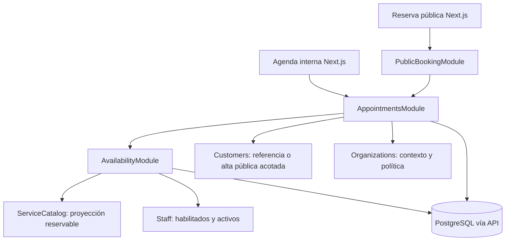

# TASK-10 — FEAT-004: Agenda, Disponibilidad y Turnero

**Estado: personalización y seis decisiones de 1.5 aprobadas; once reglas de dominio de 1.6 propuestas para aprobación final; B1 no iniciado.**  
**Fecha:** 2026-10-14. **Base inspeccionada:** `662198d`, rama `dev`, árbol limpio al iniciar.  
**Goal:** reemplazar la agenda demo por reservas internas y públicas, con disponibilidad real, aislamiento por organización y protección transaccional contra solapamientos.  
**Architecture:** monolito modular NestJS, Prisma 7 y PostgreSQL como autoridad; Next.js consume contratos HTTP mediante el transporte same-origin vigente.  
**Tech Stack:** stack instalado en `api/package.json` y `app/package.json`; sin instalar dependencias durante esta planificación.  
**Spec:** este documento reúne diseño, alternativas y bloques de implementación propuestos. No autoriza ejecución, migraciones, consultas a la DB, pruebas ni commits.

## 1. Alcance, evidencia y límites

### 1.1 Encargo y éxito esperado

Diseñar una agenda de servicios presenciales para negocios pequeños. Una persona del negocio puede crear, consultar, reprogramar, cancelar y cerrar turnos. Un cliente puede reservar públicamente sin cuenta Nuari. Un horario sólo se ofrece si cabe la duración completa del servicio en la jornada del negocio y del profesional, descontando excepciones y ocupaciones. Dos peticiones concurrentes nunca pueden confirmar reservas incompatibles para el mismo profesional.

El caso de barbería es un escenario de aceptación, **no identifica al piloto del MVP**. La selección del negocio real, el registro manual reemplazado, período y métrica siguen pendientes en [MVP](../product/mvp.md). Esta planificación anticipada no declara validado el MVP ni habilita implementación.

Capacidad aprobada en 1.5: una reserva simultánea por servicio sin profesional; recursos y capacidad configurable quedan para una ampliación futura. El resto del recorte propuesto sigue sujeto a aprobación: un servicio, un cliente y cero o un profesional por reserva; duración tomada del catálogo al crear y congelada después. Sin reservas grupales, varios servicios, buffers, recursos compartidos, lista de espera, recurrencia de reservas, sobreventa autorizada, pagos, señas, comisiones, fichaje ni notificaciones obligatorias en la propuesta inicial. Se conservan fronteras para ampliarlos por migración y contrato propios.

### 1.2 Inspección y entidades reutilizables

| Fuente / entidad existente | Evidencia y consecuencia |
| --- | --- |
| [TASK-09](TASK-09-feat-003-operational-catalog.md), [ADR-007](../architecture/decisions/ADR-007-operational-core.md), `api/prisma/schema.prisma` | FEAT-003 B1–B10 completados. Reutilizar el catálogo real, sin duplicarlo ni ejecutar sus bloques nuevamente. |
| `Organization` | Tenant; ya tiene `timezone`, `country`, `currency`, `slug` y datos públicos del negocio. Sin entidad Branch hoy. |
| `Customer` | Cliente del tenant, contactos opcionales, `active`, `version`; contactos no únicos. No es User y no tiene credenciales. |
| `Service`, `ServiceCategory` | Duración entera 5–720, `Decimal(12,2)`, moneda, activo, versión, modalidad `IN_PERSON` y modo explícito. Categoría sólo organiza presentación. |
| `StaffMember`, `StaffService` | Ficha laboral independiente del acceso; habilitación por servicio y FK compuestas tenant-aware. `userId` opcional no se usa para inferir permisos ni actor. |
| `User`, `OrganizationMember`, `Subscription` | Identidad, membresía activa/rol y gate comercial. Una cuenta no es un cliente ni un profesional automáticamente. |
| `api/src/organizations/{tenant.guard,organization-permissions,organizations.service}.ts` | Contexto con userId/organizationId/membershipId/role; matriz cerrada. TenantGuard obtiene la organización de `params.id`; no reutilizarlo para visitas públicas fingiendo membresía. |
| `api/src/{customers,staff,service-catalog}/*.module.ts` | Customers y Staff no exportan hoy sus servicios. ServiceCatalog exporta `requireService(ctx,id,tx?)`; devuelve registro interno, no una proyección pública de reservabilidad. Diseñar capacidades explícitas nuevas, sin saltarse estos límites. |
| `api/src/staff/staff-services.service.ts`, catálogo y configuración | Habilitaciones bloquean Service antes de StaffMember; catálogo/configuración usan Organization FOR UPDATE. El protocolo nuevo debe convivir con ese orden. |
| `api/src/common/{clock,transaction,if-match,rate-limiter,csrf,errors}.ts` | Reutilizar Clock, TransactionContext, ETag/If-Match y rate limiter persistido; error de exclusión necesita traducción específica. |
| `api/src/identity/{session.guard,public.decorator}.ts`, `common/csrf.guard.ts` | `@Public()` omite identidad; **no omite CSRF**. CSRF ya soporta contexto anónimo. Mantener origin exacto y mismo origen. |
| `OrganizationAuditLog` | Requiere actorUserId. No sirve para un actor público sin cambiar su significado; no crear un usuario técnico para simularlo. |
| `app/src/features/appointments/{types,demo-source,demo-provider,agenda-screen,appointment-panel}.*` | Demo con fecha/hora strings, staff obligatorio y sólo scheduled/cancelled. Su contrato y cálculo local de conflictos no son contratos de backend. No migrar fixtures ni copiar la duración actual para reinterpretar turnos históricos. |
| [overview](../architecture/overview.md), [modules](../architecture/modules.md), [data-model](../architecture/data-model.md), [multi-tenancy](../architecture/multi-tenancy.md), ADR-003/005/006 | Monolito modular, SQL sólo en API, filtros explícitos, RLS pospuesto, autenticación propia y proxy same-origin. Public booking exige documentar una capacidad pública acotada como extensión de la resolución privada de tenant. |
| [testing](../development/testing.md), `api/test/harness.ts` | Pruebas DB necesitan PostgreSQL real autorizado; ampliar teardown y preflight de esquema antes de agregar fixtures. Las credenciales existentes no autorizan esta tarea a tocar la base. |
| `docs/tasks/` y `docs/architecture/decisions/` | TASK-10 fue verificado disponible en la planificación inicial. ADR-008 registra personalización; ADR-009 se verificó disponible y registra las seis decisiones aprobadas en 1.5. Ninguno autoriza implementar la feature. |

`PROPOSAL-appointments-persistence.md` es un borrador anterior con título TASK-08/FEAT-002 que colisiona con la tarea de membresías y propone recrear catálogo y Caja. Se marca como sustituido; no constituye una autorización ni una fuente de contratos actuales.

### 1.3 Invariantes

- Cada fila operativa tiene organizationId. UUID ajeno devuelve 404 en endpoints privados; FK compuestas rechazan cruces también por SQL directo.
- Membresía activa + permiso efectivo + suscripción vigente en operaciones privadas. La API vuelve a comprobarlos; ocultar un botón no autoriza.
- Público: tenant resuelto por publicación de slug, capacidad específica de reservar y suscripción; sin acceso al directorio de clientes, agenda interna ni contactos de profesionales.
- Todos los intervalos son **[inicio, fin)**. 16:00–16:30 y 16:30–17:00 son compatibles. Diferente hora de inicio no implica ausencia de solapamiento.
- Turno, servicio realizado, venta y pago permanecen separados. Completar un turno no crea venta ni pago.
- Archivar catálogo/personal/clientes no elimina ni cancela reservas existentes. Impide nuevas reservas con esas referencias; el negocio debe resolver las futuras por reprogramación/cancelación explícita.
- La disponibilidad es una lectura orientativa. Sólo una transacción confirmada concede el horario; no hay holds al seleccionar ni al abrir formularios.

### 1.4 Personalización aprobada — 2026-10-14

El usuario confirmó que las reglas del turnero serán configurables **por Organization desde el lanzamiento**: intervalo de inicio 15 minutos por defecto y opciones exclusivas 5/10/15/30; anticipación mínima 120 minutos configurable; cancelación hasta 120 minutos antes del turno por defecto, configurable; horizonte 60 días configurable con límites validados; selección de profesional según Service.staffSelectionMode; reservas públicas sin cuenta Nuari obligatoria. No posponer estas configuraciones a una fase posterior ni sustituirlas por constantes globales.

Esta aprobación incluye separar duración del servicio e intervalo de inicio, definir límites seguros y preservar reservas confirmadas al cambiar configuración, manteniendo aislamiento, exclusión de superposiciones y manejo temporal. Los límites técnicos y la semántica de conservación se detallan en 5.1/5.1.1; su representación de datos sigue siendo diseño sin implementar. Registro arquitectónico: [ADR-008](../architecture/decisions/ADR-008-scheduling-personalization.md).

Esta aprobación de personalización no aprueba por sí sola otras decisiones: las seis aprobaciones posteriores se registran separadamente en 1.5. No autoriza B1, migraciones, cambios de DB o frontend. B0 tiene avances documentales, pero su cierre sigue pendiente.

### 1.5 Seis decisiones aprobadas por confirmación expresa — 2026-10-14

El usuario confirmó «Si apruebo» después de consultar explícitamente si aprobaba las seis recomendaciones de la imagen para registrarlas sólo en documentación, sin iniciar B1. Registrar su alcance exacto en [ADR-009](../architecture/decisions/ADR-009-scheduling-core-decisions.md):

| Punto | Aprobado |
| --- | --- |
| 1. Capacidad sin profesional | Una reserva simultánea por servicio inicialmente. Recursos y capacidad configurable son evolución futura, no implementación actual. |
| 2. Estados | CONFIRMED, COMPLETED, CANCELLED y NO_SHOW. Sin PENDING en este corte. |
| 3. Asignación automática | Distribución equilibrada entre profesionales disponibles, con desempate determinista. El criterio concreto de carga diaria/UUID de 5.3 es una propuesta técnica, no una aprobación adicional inferida. |
| 4. Empleados | Pueden crear, reprogramar y cancelar turnos internos. No pueden modificar horarios generales ni políticas del negocio. No se les concede por esta aprobación completar, marcar ausencia, gestionar publicación ni omitir reglas. |
| 5. Público | Sin cuenta obligatoria; nombre y al menos un contacto obligatorios; gestión por enlace seguro; sin recuperación automática si no existe un canal verificable. |
| 6. Tiempo e integridad | UTC + IANA, tratamiento explícito de cambios de horario y restricciones PostgreSQL que impidan reservas incompatibles. Mantener aislamiento multi-tenant. |

La aprobación no incluye composición de calendarios, excepciones comerciales/internas, permisos adicionales, parámetros criptográficos/TTL, matching de clientes, algoritmo DST específico, bloqueo de cambio de zona, extensión/locks concretos ni ambientes. No reabrir los seis principios aprobados: distinguirlos de esos detalles pendientes. B1 y cualquier ejecución siguen sin autorización.

### 1.6 Cierre de dominio — once propuestas para aprobación final

**Estado: PROPUESTAS, no aprobadas.** La nueva instrucción del usuario solicita revisar y registrar estas once reglas antes de B1, sin código, Prisma, migraciones ni commits. Conserva las aprobaciones previas de 1.4/1.5; sus ampliaciones y las recomendaciones de precisión siguientes esperan aprobación final. Este encargo sustituye la intención anterior de iniciar: no hay trabajo de implementación autorizado en curso. No volver a pedir elección de worktree/DB para completar esta revisión documental.

| Regla propuesta por el usuario | Compatibilidad con TASK-10 y ADR-008/009 |
| --- | --- |
| R1. Una reserva contiene un cliente, un servicio y cero o un profesional. | Compatible con las FK y snapshots propuestos; cierra la cardinalidad pendiente D1 si se aprueba. Se conserva el cupo uno por servicio NO_ASSIGNMENT aprobado en ADR-009; cero profesional no significa asignación pendiente ni capacidad ilimitada. |
| R2. CONFIRMED, COMPLETED, CANCELLED y NO_SHOW, con transiciones controladas y correcciones auditadas. | Lista ya aprobada en ADR-009. **Cambia la propuesta anterior:** estados finales eran incorregibles y se excluían correcciones históricas. Proponer vía administrativa separada, auditada y sin saltar constraints (7.2/7.4). |
| R3. Disponibilidad desde horarios del negocio/profesional, descansos, excepciones, ausencias y reservas existentes. | Compatible con BUSINESS ∩ STAFF, pausas como huecos de jornada y excepciones de sección 4. Para NO_ASSIGNMENT usar BUSINESS y ocupación del cupo del servicio. No crear un StaffMember ficticio. |
| R4. Cambios de calendario no cancelan confirmadas; identifican afectadas y requieren resolución explícita. | Compatible con 4.2 y no retroactividad de ADR-008. Recomendar rechazar el cambio con 409 e IDs privados hasta resolver turnos y reintentarlo; no aplicar un cierre que deje turnos incompatibles sin resolución. |
| R5. OWNER/ADMIN administran reservas/excepciones; EMPLOYEE crea/cancela/reprograma internos dentro de reglas normales, sin políticas. Completar/NO_SHOW inicialmente sólo OWNER/ADMIN. | Compatible con las tres acciones aprobadas en ADR-009. Precisa quién completa/no-show: proponer denegación fija para EMPLOYEE en el corte inicial, sin flags que puedan habilitarlo. Administrar excepciones no equivale a sobreventa ni a saltar integridad. |
| R6. CUSTOMER_CHOICE muestra habilitados/disponibles; Cualquiera reparte según cantidad de reservas asignadas en el día, con desempate determinista. | Compatible con equilibrio de ADR-009; **sustituye** la fórmula propuesta de minutos reservados por número de reservas. La fecha/estados contados y desempate se precisan abajo y en 5.3; ninguna fórmula estaba aprobada antes. |
| R7. OWNER/ADMIN consultan todas; EMPLOYEE consulta agenda operativa sin datos sensibles ni reportes financieros generales. | Compatible con privacidad de FEAT-003 y cierra alcance equipo/propio si se aprueba. «Todas» significa dentro del tenant autorizado, nunca global. Precisar campos operativos en 11.3, sin revocar permisos del catálogo previamente aprobados ni conceder reportes. |
| R8. Público optativo, sin cuenta, antiabuso y enlaces seguros/revocables; no fusionar automáticamente coincidencias ambiguas. | Compatible con ADR-008/009. Publicación opt-in y revocación explícita amplían el detalle previo. La propuesta de crear Customer separado en público cumple la ausencia de fusión; un contacto no verifica identidad ni autoriza acceder a otra ficha. |
| R9. Despublicar o vencer suscripción no invalida por sí solo enlaces de consulta/cancelación de confirmadas. | Compatible con la excepción comercial ya propuesta en 10.2, aún no aprobada en ADR-008/009. No elimina expiry, revocación, cutoff ni el requisito de CONFIRMED para cancelar. No habilita nuevas reservas/reprogramación ni abre la agenda privada. |
| R10. UTC e IANA; rechazar horas inexistentes, desambiguar repetidas y restringir cambio de zona con reservas futuras. | Compatible con principios de ADR-008/009. **Corrige** desplazamiento automático de límites inexistentes de jornada que antes proponía sección 6. Precisar límites recurrentes y alcance de bloqueo de zona sin reinterpretar confirmadas. |
| R11. Integridad PostgreSQL y transacciones anti-solapamiento, con conflictos controlados. | Compatible con ADR-009 y sección 8. FK tenant-aware, EXCLUDE y transacciones siguen diseño propuesto, sin validación ejecutada ni autorización de migrar. Correcciones, cancelación, asignación y reprogramación deben seguir el mismo contrato. |

Las once reglas son compatibles con las **decisiones aceptadas** de ADR-008/009. Las tres diferencias anteriores afectan recomendaciones de TASK-10, no decisiones aceptadas que haya que revocar. Los apartados de implementación que siguen se alinean con estas nuevas propuestas, conservando su condición de no aprobados.

#### 1.6.1 Precisiones imprescindibles para una aprobación sin ambigüedad

| ID | Decisión adicional / recomendación propuesta para ratificar junto con R1–R11 |
| --- | --- |
| E1. Transiciones y correcciones | Crear CONFIRMED; cierre/NO_SHOW manual por OWNER/ADMIN desde endAt; cancelación ordinaria de CONFIRMED. Estados finales cierran acciones ordinarias, pero una corrección administrativa separada puede cambiar estado, con motivo, If-Match y evento inmutable before/after (7.4). No editar cliente/servicio/horario ni crear ventas/pagos mediante esa corrección. Definir restauración de canceladas sin saltar disponibilidad. |
| E2. Conteo de reparto | Contar reservas cuyo **inicio cae en el día local del destino**, todos los servicios y asignaciones SPECIFIC/ANY del profesional, estados CONFIRMED/COMPLETED/NO_SHOW, excluyendo CANCELLED y la reserva que se reprograma. Elegir menor cantidad y desempatar UUID ascendente. Una que cruza medianoche cuenta una vez en el día de inicio. ANY al reprogramar recalcula; sólo conserva al profesional si resulta elegido por la misma regla. Evitar conteos obsoletos concurrentes además de impedir solapamientos (5.3). |
| E3. Reglas internas y campos operativos | Falta fijar si internos heredan anticipación/horizonte públicos. Recomendación mantenida como propuesta: interno desde now hasta 365 días locales; sin anticipación pública, pero con jornada/habilitación/conflictos y cutoff congelado para cancelar/reprogramar. EMPLOYEE no omite esas reglas; excepción de cutoff OWNER/ADMIN sólo si se aprueba explícitamente, con motivo. Agenda EMPLOYEE: nombre de cliente, servicio/profesional, horarios, estado y versión; sin contactos snapshot, notas, motivos privados, auditoría detallada ni agregados financieros. No modificar la proyección/permisos ya aprobados de Customers por esta feature. |
| E4. Vida del enlace y excepción comercial | Proponer token sólo para una reserva, revocable por OWNER/ADMIN, válido para consulta hasta endAt+7 días; cancelar sólo CONFIRMED y dentro de cutoff congelado. Despublicar/vencer no cambia por sí solo hash, versión ni expiración; revocación/expiry sí invalidan. Reprogramación exige publicación/suscripción vigentes. Mantener alta pública de Customer separada sin matching/fusión y sin recuperación automática sin canal verificable. Criptografía/antiabuso de secciones 11/14 son detalles técnicos a verificar, no otra aprobación de acceso general. |
| E5. DST y cambio de zona | Rechazar una entrada manual inexistente y omitir candidatos inexistentes. Si un extremo de jornada recurrente cae en un hueco de una fecha, no desplazarlo: ese tramo no abre, informar incidencia y pedir override explícito. Horas repetidas del cliente requieren instante/offset inequívoco; para extremos de jornada, proponer inicio temprano/fin tardío como política declarada, con elección alternativa explícita por override. Bloquear cambio de zona, incluso vía country, con CONFIRMED futuras/en curso (`endAt > now`); sin ellas, no reinterpretar reglas locales existentes sin revisión explícita. Mantener el bloqueo conservador con reglas configuradas hasta definir esa revisión; los calendarios vacíos no bloquean por sí solos. |

Estos cinco puntos son precisiones de dominio para que el contrato sea ejecutable, no un pedido de aprobación de infraestructura. La selección de runtime temporal, extensión y ambiente se verifica al autorizar el bloque correspondiente; piloto/métrica y retención/privacidad son condiciones de validación/lanzamiento. No mezclar esas comprobaciones con la aprobación final del dominio ni comenzar B1 al entregar este documento.

## 2. Decisiones y alternativas

La personalización de 1.4 y las seis decisiones delimitadas en 1.5 están **aprobadas**. Las once reglas/precisiones de 1.6 y el resto de las recomendaciones nuevas siguen como **propuestas para aprobación final**. No reabrir modos, duración 5–720, privacidad ni separación StaffMember/OrganizationMember ya aprobados en FEAT-003.

| Tema | Recomendación | Alternativas evaluadas y motivo |
| --- | --- | --- |
| Dominio | Appointment con servicio único y snapshots; calendarios separados | AppointmentItem y recursos genéricos agregan complejidad sin piloto que justifique múltiples servicios. Se pueden introducir después conservando el ID de la reserva. |
| Disponibilidad | Calcular intervalos libres por recurso y luego generar inicios | Persistir todos los slots demanda regeneración/invalidation por cada cambio; consultar slot × profesional × día crea N+1. Ninguno se recomienda. |
| Doble reserva | EXCLUDE GiST sobre rango UTC, más transacción y locks de reglas | UNIQUE(inicio,profesional) no detecta solapamientos; check-then-insert falla en carreras. Sólo SERIALIZABLE exige reintentos y disciplina de todos los escritores, sin expresar tan directamente la invariante. |
| Sin profesional | **Aprobado:** cupo exclusivo por servicio, capacidad uno. Jornada del negocio sigue propuesta | Infinito es incorrecto. Pool de recursos/capacidad N demanda otra definición; un único cupo para toda la organización mezclaría servicios independientes. Si comparten silla/sala/equipo real, este corte no los modela y no deben publicarse bajo esta suposición. |
| Estados | **Aprobado:** CONFIRMED, COMPLETED, CANCELLED, NO_SHOW; sin PENDING | PENDING requeriría otra decisión sobre motivo, TTL, rechazo, expiración y capacidad; no equipararlo a impago. Detalles de transición se proponen en 7.2. |
| Asignación automática | **Aprobado:** equilibrio y desempate determinista. R6 propone menor cantidad diaria de reservas, luego UUID | Reemplaza la recomendación anterior por minutos; no estaba aprobada. No optimiza minutos trabajados ni promete equidad histórica. |
| Concurrencia | READ COMMITTED con locks de reglas y exclusión final | Lock de toda Organization por reserva sería simple pero serializa negocios completos; locks en memoria no cubren varias instancias. No usar Redis ni locks de sesión con pooling. |
| Tiempo | Zona IANA, reglas locales y reservas como instantes UTC | Offset fijo por país y Date con zona del servidor fallan ante DST y viajes. No materializar meses de instantes para una regla semanal. |
| Público | **Aprobado:** sin cuenta, nombre/contacto obligatorios, enlace seguro y sin recuperación automática sin canal verificable | Matching de contactos, publicación, parámetros de token y verificación concreta siguen propuestos. Exigir cuenta o prometer recuperación sin canal verificable contradice la aprobación. |
| Extensibilidad | Contratos en proceso y transacciones locales | Microservicios, CQRS, motor RRULE universal, bus distribuido y outbox sin consumidor no son necesarios ahora. |

[ADR-008](../architecture/decisions/ADR-008-scheduling-personalization.md) registra personalización y [ADR-009](../architecture/decisions/ADR-009-scheduling-core-decisions.md) las seis decisiones de 1.5. ADR-003 distingue la futura capacidad pública acotada de la membresía privada; no concede acceso administrativo al visitante. La arquitectura/implementación restante sigue propuesta.

## 3. Arquitectura modular y contratos internos

Appointments coordina mutaciones y es dueño de reservas, eventos y submissions idempotentes. Availability es dueño de calendarios, reglas temporales y cálculo; no crea reservas. PublicBooking ofrece controladores/proyecciones públicas y resuelve el contexto publicado, delegando la misma operación de reserva. No contiene una segunda lógica de conflictos.



Para evitar ciclos, un pequeño `SchedulingReadModule` exporta exclusivamente las proyecciones `loadBusyIntervals(scope,resources,window,tx)`, `listFutureBookingsForCalendar(scope,calendarId,tx)` y `assertTimeZoneChangeAllowed(scope,tx)`. Importa sólo DatabaseModule; no importa Organizations, Availability ni Appointments. Es una interfaz pública de lectura autorizada entre estos dominios, con consultas tenant-aware y formas de datos cerradas, sin exportar repositorios ni crear vistas persistidas, eventos o infraestructura CQRS. Appointments es dueño de escrituras de reservas; Availability de escrituras de calendarios. Ambos usan esa proyección y llaman al motor puro con `{service, calendars, busyIntervals, window, now}`. Organizations usa la misma proyección acotada para bloquear cambios de zona en su transacción. Así Availability no importa AppointmentsModule y Organizations no importa AvailabilityModule. PublicBooking importa Appointments, nunca al revés.

Capacidades nuevas, con nombres orientativos fijados para los bloques:

| Propietario | Interfaz pública propuesta |
| --- | --- |
| Organizations | `resolvePublishedBooking(slug, tx?) -> PublishedBookingContext`; `requireSchedulingPolicy(scope, tx) -> SchedulingPolicy`; lock compartido de Organization y política. No fabricar TenantContext con userId ficticio. Este resolver publicado sirve a altas/availability, no como gate obligatorio de consulta/cancelación por enlace en R9. |
| ServiceCatalog | `getBookableService(scope, serviceId, tx, {lock}) -> BookableService`; incluye activo, duración, modo, nombre y versión. Para contexto público exige publicación. |
| Staff | `listEligibleStaff(scope, serviceId, tx) -> StaffBookingProjection[]`; `lockBookingStaff(scope, sortedIds, tx)`; sólo IDs/nombres/activos y relación. Exportar estas capacidades explícitas. |
| Customers | `requireBookingCustomer(ctx, id, tx, {lock})`; `createGuestBookingCustomer(publishedScope, input, tx) -> {id,name,phone,email}`. Sin búsqueda pública, reactivación, edición de clientes existentes ni notas. |
| Availability | `loadCalendarInputs(scope, ids, window, tx, {lock})`; `computeAvailability(input) -> Slot[]`; `assertFits(input, startAt, durationMinutes)`; `replaceWeeklyWindows`, `replaceDayOverride`, `createTimeOff` con control de impactos. |
| SchedulingRead | Proyecciones de ocupación, impacto de calendario y bloqueo de zona enumeradas arriba; recibe scope ya autorizado y TransactionContext. Nunca modifica los dominios que consulta. |
| Appointments | `createInternal(ctx, command, idempotencyKey)`; `createPublic(publishedScope, command, idempotencyKey)`; `reschedule(actor, id, command, version)`; `transition(actor,id,target,version)`. |
| PublicBooking | Propuesta R9: `resolveManagedAppointment(slug, token, tx) -> ManagedAppointmentContext`, valida secreto/revocación/expiry y tenant/reserva sin exigir publicación/suscripción vigentes para consulta/cancelación; otras acciones no se derivan de ese contexto. |

`BookingScope = {organizationId}` es un valor **interno**, sólo construido por guards/casos de uso autorizados. La variante `PublishedBookingContext` acredita publicación y sólo habilita operaciones públicas enumeradas; nunca satisface permisos privados. Para R9, `ManagedAppointmentContext` acredita una capacidad de una única reserva, sin reutilizar el gate de publicación para consulta/cancelación; reprogramación verifica vigencia/publicación aparte. No tratar un token válido como permiso de tenant completo. El motor puro no autoriza. Mantener DTOs separados público/privado y no aceptar scope, estado, duración, precio ni actor enviados por el cliente.

Archivos propuestos: `api/src/availability/{availability.module,calendar.controller,calendar.service,calendar.dto,availability-engine,time-zone-adapter,scheduling-read.module,scheduling-read.service}.ts`; `api/src/appointments/{appointments.module,appointments.controller,appointments.service,appointments.repository,appointments.dto,appointments.mapper,appointment-transitions,booking-submissions}.ts`; `api/src/public-booking/{public-booking.module,public-booking.controller,public-booking.service,public-booking.dto,management-token}.ts`. Dividir por responsabilidad, sin repositorio genérico. Registrar módulos en `api/src/app.module.ts` sólo durante implementación autorizada.

## 4. Horarios recurrentes, excepciones y ausencias

### 4.1 Calendarios y precedencia

Un calendario BUSINESS por organización y, para reservar con profesional, un calendario STAFF explícito por StaffMember. No crear jornadas por defecto al dar de alta personal ni inferirlas de una membresía. Calendario sin ventanas = sin disponibilidad. Para NO_ASSIGNMENT se usa sólo BUSINESS.

1. Regla semanal local: weekday ISO 1=lunes…7=domingo, minutos desde medianoche, múltiples intervalos por día (09:00–13:00 y 15:00–19:00). Inicio 0–1439, fin 1–1440, inicio < fin; sin superposiciones en la misma jornada. Ventanas contiguas se fusionan al calcular.
2. Override de fecha local reemplaza **toda** la jornada semanal de ese calendario para ese día. Cero ventanas = cerrado/feriado; ventanas explícitas = apertura extraordinaria o jornada distinta. No hay herencia ambigua ni dos overrides para la misma fecha.
3. La jornada efectiva del profesional es la intersección BUSINESS ∩ STAFF. Un override de STAFF no abre un día cerrado en BUSINESS.
4. TimeOff resta intervalos UTC: vacaciones, ausencia parcial, corte de servicio, cierre del negocio. Puede abarcar varios días. Motivo interno no se publica. Solapamientos entre ausencias son válidos y se fusionan al calcular.
5. Se restan reservas bloqueantes para el recurso correspondiente y se aplica anticipación/horizonte.

El turno completo debe caber en un intervalo libre continuo; no atraviesa almuerzo ni cierre. Turnos que cruzan medianoche se admiten sólo cuando ambos días están explícitamente abiertos y sus intervalos UTC son contiguos. Para carga de jornadas nocturnas, registrar dos ventanas en días sucesivos; no interpretar `22:00–02:00` como una ventana invertida. Feriados son fechas explícitas; no consultar proveedores de feriados ni inferirlos por país.

### 4.2 Cambios con turnos existentes

Cambiar una regla semanal, override o ausencia requiere If-Match del calendario padre y transacción. Con el calendario bloqueado en exclusiva, buscar reservas CONFIRMED futuras o en curso (`endAt > now`) afectadas y validar su cabida completa bajo las reglas nuevas. Esta validación de impacto comprueba cobertura de jornada/ausencias, sin exigir nuevamente grilla, anticipación, horizonte o cutoff actuales a reservas ya confirmadas (5.1.1). Si alguna queda fuera de la cobertura nueva, devolver `409 SCHEDULE_HAS_BOOKINGS`, cantidad y muestra acotada de IDs **sólo a usuarios autorizados**; ningún cambio parcial. No se cancelan silenciosamente.

Para reglas semanales el rango de impacto incluye **todas** las reservas futuras, aunque estén fuera del horizonte público; procesar por páginas si corresponde, sin truncar la validación. Cierres de fecha/ausencias buscan sólo su rango. Resolver primero las reservas y repetir el cambio; no ofrecer override de seguridad. Cambios de horarios no reinterpretan el pasado. No se versionan temporadas futuras en el primer corte; una apertura futura puntual usa overrides de fecha.

La carrera creación vs cierre debe tener dos resultados posibles: cierre gana y reserva se rechaza, o reserva gana y cierre devuelve conflicto. Nunca confirmar un turno que quedó fuera de una regla confirmada previamente.

## 5. Motor de disponibilidad

### 5.1 Política configurable aprobada y límites técnicos

Valores por organización desde el lanzamiento, conforme a 1.4. Defaults no son restricciones fijas para todos los negocios. Contrato numérico definido para la implementación futura:

| Parámetro | Default / valores admitidos / unidad |
| --- | --- |
| slotStepMinutes | **15**; whitelist exacta **5, 10, 15, 30 minutos**. No aceptar 20, 60 ni otros valores. |
| publicMinNoticeMinutes | **120**; entero **0–43.200 minutos** (máximo 30 días transcurridos). Nuevo inicio >= now + anticipación. Cero permite reservar sin anticipación, nunca en el pasado. |
| publicMaxAdvanceDays | **60**; entero **1–365 días de calendario local**. Última fecha de inicio admitida inclusiva = hoy local + N. Cero/no acotado no se admite. |
| publicCancelNoticeMinutes | **120**; entero **0–43.200 minutos**. Cancelar si inicio original - now >= límite congelado en la reserva y now < inicio original. Cero permite cancelar hasta antes de comenzar, no después. |

Los minutos son enteros JSON seguros: rechazar negativos, fracciones, strings numéricos, null, booleanos, valores no finitos y enteros fuera de rango, sin coerción, redondeo ni clamp. En PATCH omitir conserva; null no restaura default. Aplicar whitelist/rangos en DTO y CHECK de PostgreSQL durante implementación autorizada. Validar el cuerpo completo y actualizar atómicamente con versión, sin cambios parciales. Los máximos acotan aritmética y generación; el límite de siete días por consulta sigue independiente del horizonte de hasta 365 días.

Las unidades no se mezclan: anticipación/cancelación son minutos transcurridos; horizonte son fechas en la zona IANA del negocio. No convertir el horizonte a `N * 24 horas` ni usar un offset fijo. Los límites se validan independientemente: una combinación admitida puede no producir cupos (por ejemplo, anticipación 30 días y horizonte 1 día, o jornadas cerradas). Mostrar advertencia de rango sin cupos, sin reducir anticipación, ampliar horizonte, cambiar configuración ni inventar disponibilidad. El motor intersecta todas las reglas.

**Duración ≠ intervalo de inicio.** `Service.durationMinutes` sigue siendo entero 5–720 conforme a FEAT-003 y determina `endAt = startAt + duración`. slotStepMinutes sólo determina inicios candidatos sobre la grilla local anclada a medianoche. No exigir igualdad ni divisibilidad entre ambos. Ejemplo: duración 25 minutos con intervalo 15 admite candidato 16:00 que ocupa hasta 16:25; 16:15 se descarta por solapamiento y 16:30 puede ofrecerse si las demás reglas lo permiten. La grilla jamás reduce la ocupación al tamaño de un slot.

La selección sigue **el modo del servicio**, no un override global de la organización; equilibrio con desempate determinista aprobado, detalles de específico/cualquiera y métrica concreta de 5.3 pendientes. Reservar públicamente no exige User, credenciales ni membresía. Nombre/contacto y gestión por enlace seguro están aprobados; verificación, publicación y parámetros de gestión siguen con sus decisiones abiertas.

Fuera de la aprobación de personalización permanecen las propuestas de operación interna desde now hasta 365 días locales sin mínimo público y aplicación del cutoff a reprogramación. La revisión R5/E3 propone EMPLOYEE siempre dentro de reglas normales, sin override de cutoff; cualquier excepción temporal OWNER/ADMIN requiere definición final y motivo, nunca omitir jornada/habilitación/solapamiento. No tratar esas excepciones como aprobadas por la personalización ni ofrecer un flag para habilitarlas a EMPLOYEE en el corte inicial.

### 5.1.1 Cambios de configuración y reservas confirmadas

- PATCH sólo modifica SchedulingSettings del tenant e incrementa su versión; no ejecuta actualizaciones masivas sobre Appointment. Cambiar un default no reemplaza el valor ya guardado por una organización.
- Un turno confirmado mantiene ID, estado, cliente, servicio, profesional, startAt/endAt, duración, zona y condiciones de cancelación vigentes al confirmarlo. No se redondea a la nueva grilla, cancela, libera ni marca inválido al reducir horizonte o aumentar anticipación/cutoff. Cambiar el modo del servicio tampoco reasigna reservas existentes.
- Guardar en la reserva los cuatro valores temporales y la versión de política aplicada (campos propuestos en 9.1). Para cancelar una reserva existente, evaluar **su snapshot de publicCancelNoticeMinutes**, aunque luego cambie settings. No es necesario versionar toda la tabla de políticas ni reconstruir defaults históricos.
- Disponibilidad nueva y nuevas confirmaciones usan configuración actual leída bajo lock en backend; una consulta previa no la congela. Si el nuevo paso ya no admite el inicio seleccionado, rechazar la nueva creación con conflicto/validación sin afectar reservas confirmadas. Las ocupaciones existentes se descuentan por sus intervalos UTC reales, aunque su inicio esté fuera de la grilla actual.
- La reprogramación es una acción explícita, no un efecto de cambiar settings. Si se aprueba el flujo propuesto, debe respetar la condición de cancelación/reprogramación original congelada y validar el destino con la política actual; sólo un commit exitoso actualiza horario y snapshot de política, con condiciones nuevas visibles antes de confirmar y evento before/after. Un fallo mantiene íntegro el original. El replay idempotente no vuelve a aplicar reglas nuevas a una confirmación anterior.
- Carrera configuración/reserva: SchedulingSettings FOR UPDATE frente al FOR SHARE de creación establece el orden. La reserva confirma con la política anterior íntegra y conserva su snapshot, o confirma con la nueva; nunca mezcla campos/versiones. Las reglas nuevas no desactivan exclusiones ni filtros tenant-aware, ni cambian UTC/IANA/DST.

Estos son criterios documentales para comprobar en AC21/22 durante la implementación futura; no se ejecutaron pruebas ni se afirma que exista todavía este comportamiento en código.

### 5.2 Algoritmo y consultas acotadas

Entrada: serviceId, fechas locales `[from,to)` con máximo siete días por consulta, preferencia SPECIFIC/ANY/NONE y staffMemberId sólo para SPECIFIC. Para consultar exactamente 16:00, usar `at` con instante inequívoco y verificar toda su duración; no consultar la agenda de todo el mes. Día completo opcional; paginar profesionales publicables de a 50 si hay muchos. No devolver resultados silenciosamente incompletos: indicar `hasMore` y cursor, y al filtrar candidatos distinguir ausencia de coincidencias de fin de página.

1. Leer una vez organización/política/servicio y validar modo. Reducir profesionales por StaffService + activos **antes** de generar horarios. SPECIFIC reduce a un candidato.
2. Leer ventanas semanales, overrides y ausencias del BUSINESS y candidatos en lotes por calendarId, sólo para las fechas solicitadas. Considerar también el día anterior al cargar ocupaciones/ventanas que pueden entrar en el rango.
3. Leer ocupaciones en un query por lote: `startAt < windowEnd AND endAt > windowStart`, tenant y recursos elegibles, estados bloqueantes. No filtrar sólo por fecha de inicio: se perderían turnos que comenzaron antes. Para NO_ASSIGNMENT filtrar serviceId y modo histórico NONE.
4. Expandir reglas locales a intervalos UTC; intersectar jornadas, fusionar intervalos contiguos y restar ausencias/ocupaciones ordenadas con un barrido. Cargar margen hasta 720 minutos donde la cabida cruza el final de la ventana consultada; sólo emitir inicios dentro del rango solicitado.
5. Generar candidatos de inicio desde grilla local anclada a medianoche (`minuteOfDay % step == 0`), descartar horas DST inexistentes y comprobar `endAt = startAt + duration` dentro de un intervalo libre. No consultar DB por candidato.
6. CUSTOMER_CHOICE devuelve por inicio los candidatos disponibles o permite filtrar uno; ANY/AUTO devuelve la unión de inicios con algún candidato. NO_ASSIGNMENT emite slots del cupo del servicio. Respuestas contienen startAt/endAt UTC, fecha/hora/offset local e IANA.

Coste: ordenar intervalos una vez y barrer por recurso, aproximadamente O(I log I + S) para I intervalos y S candidatos emitidos, además del procesamiento por profesionales del lote. No hacer producto cartesiano de todo el catálogo. Límite de respuesta 2.000 slots y 50 profesionales por página; cursor por `(startAt,staffMemberId)` con filtros vinculados. AUTO debe evaluar todos los elegibles mediante lotes antes de declarar sin cupo; la UI pide sólo slots/unión y carga candidatos de un inicio bajo demanda. Si se supera presupuesto, responder error acotado que pide rango menor, nunca inventar disponibilidad.

Sin cache compartida de disponibilidad en la primera versión; no-store y debounce/cancelación de requests. Medir número de queries, latencia p50/p95, filas e índices en datos sintéticos. Objetivo de evaluación inicial: siete días/50 profesionales/5.000 ocupaciones con <=12 queries por lote y p95 <500 ms de motor+DB en entorno documentado, sin convertirlo en SLA antes de medir. Para día con cientos de profesionales, usar `at`/filtro y paginación. Si después hace falta cache, incluir tenant, servicio/versión, zona, rango y versiones de calendarios, invalidar en mutaciones y conservar revalidación transaccional.

### 5.3 Elección y asignación

| Service.staffSelectionMode existente | Command de reserva | Resultado |
| --- | --- | --- |
| CUSTOMER_CHOICE | `{kind: SPECIFIC, staffMemberId}` o `{kind: ANY}` | Validar profesional elegido o asignar uno disponible. |
| AUTO_ASSIGN | Sólo `{kind: ANY}` | Rechazar staffMemberId impuesto, incluso por empleados en el primer corte. |
| NO_ASSIGNMENT | Sólo `{kind: NONE}` | staffMemberId=null; compite por capacidad uno de ese servicio. Habilitaciones guardadas no afectan este modo. |

ANY siempre termina con un profesional real asignado al **confirmar**, nunca null/«any» persistido. Elegibilidad = activo + habilitado + calendario + cabida completa. Sin elegibles, devolver vacío en consulta y `409 SLOT_UNAVAILABLE` al reservar.

**Principio aprobado:** distribución equilibrada entre profesionales disponibles y desempate determinista. **R6/E2, pendientes de aprobación final:** contar reservas asignadas cuyo inicio cae en el día local del destino, de todos los servicios y de intención SPECIFIC/ANY, estados CONFIRMED/COMPLETED/NO_SHOW; excluir CANCELLED y el ID reprogramado. Elegir menor cantidad y luego UUID ascendente. Una reserva de 30 minutos y una de 720 cuentan una cada una; una que cruza medianoche cuenta sólo en su fecha de inicio, aunque siga bloqueando el día siguiente por su intervalo UTC. Es equilibrio por cantidad, no por duración ni facturación. Se elimina la recomendación anterior por minutos.

Para ANY al reprogramar, recalcular esa regla para el destino: no conservar automáticamente profesional sólo porque esté libre. Decisiones simultáneas en horarios distintos podrían usar el mismo conteo obsoleto sin violar exclusión; el protocolo transaccional debe coordinar por tenant/día las operaciones que alteran ese conteo (altas, cancelaciones, reprogramaciones y correcciones). Propuesta técnica: lock transaccional común de asignación diaria antes de leer conteos, conservando orden global de locks y sin llamadas externas; al mover días, adquirir ambas claves ordenadas. No hace falta contador persistido ni lock global entre tenants. La exclusión PostgreSQL conserva la garantía de no solapamiento, que es distinta del equilibrio. Con conflicto real, recalcular en transacción nueva y reintentos acotados; no bloquear todos los profesionales en exclusiva.

### 5.4 Caso real de aceptación: Max, Juan y Pedro

«Viernes 14» necesita mes, año y zona. Fixture recomendado: **viernes 14 de mayo de 2027, America/Argentina/Buenos_Aires**; reloj de prueba fijado dentro del horizonte admitido. Corte de pelo dura 30 minutos, BUSINESS abre 09:00–19:00.

| Profesional | Habilitación y jornada | Ocupación | ¿16:00–16:30? |
| --- | --- | --- | --- |
| Max | Corte habilitado, jornada 09:00–19:00 | Reserva 15:45–16:15 | No: se solapa aunque no comience a las 16:00. |
| Juan | Corte habilitado, jornada 09:00–19:00 | Libre | Sí. |
| Pedro | Corte habilitado, jornada 09:00–19:00 | Libre | Sí. |

La consulta devuelve Juan y Pedro; en CUSTOMER_CHOICE el cliente puede elegir uno o cualquiera. En AUTO_ASSIGN sólo ve el horario, el backend asigna según criterio. Si Pedro está ausente, inactivo o pierde habilitación antes del commit, sólo Juan puede reservarse. 16:00 local corresponde a 19:00Z en este fixture; no extrapolar ese offset a otros países o años. Dos solicitudes SPECIFIC Juan para ese intervalo producen exactamente una reserva; con ANY, dos pueden producir Juan y Pedro, nunca dos en Juan. Una tercera sin más cupos recibe conflicto.

## 6. Tiempo, UTC y cambios de zona

Persistir startAt/endAt como `timestamptz(3)` y serializar ISO 8601 con Z. PostgreSQL representa el instante; no conserva la zona IANA original dentro de timestamptz, por eso Appointment guarda `timezoneSnapshot`. Las reglas semanales y overrides son **tiempo civil local**, no horas UTC recurrentes. Véase [tipos temporales de PostgreSQL](https://www.postgresql.org/docs/current/datatype-datetime.html).

- DTO de creación acepta startAt con Z u offset explícito; rechaza fecha-hora sin offset, segundos/milisegundos no cero y fechas inválidas. El servidor calcula el fin; no acepta endAt/duración del navegador. Se comprueba grilla en zona de negocio.
- La API devuelve labels locales y offset, pero la UI transmite el instante elegido. Cambiar la zona del dispositivo no cambia la jornada ni la selección. Filtros por fecha usan la zona del negocio.
- Duración son minutos reales transcurridos. Un servicio de 30 minutos sigue durando 30 aunque el reloj civil salte; la presentación puede mostrar una hora final inesperada en un cambio DST.
- Hora local inexistente: no ofrecerla ni desplazarla silenciosamente. Hora repetida: producir dos instantes distintos, diferenciados por offset; no deduplicar por HH:mm. Entrada manual ambigua exige offset/elección explícita.
- Propuesta R10/E5: límites locales de jornada ambiguos usan inicio temprano/fin tardío como política declarada, modificable sólo por override inequívoco. Un extremo de jornada inexistente **no se mueve al primer instante válido**: el tramo afectado no abre en esa fecha y se informa para resolver con override. Entradas manuales inexistentes se rechazan; nunca se convierten silenciosamente en otra hora. Los límites técnicos de una fecha para consultas usan su primer instante válido (no son una hora de cita ingresada); un día civil completamente omitido no ofrece slots.
- Día local puede durar 23/25 horas; no sumar 24 horas para ir al siguiente día ni usar `toISOString().slice(0,10)` para obtener la fecha de negocio.
- Propuesta R10/E5: bloquear cambio efectivo de Organization.timezone, incluido el derivado de country, con CONFIRMED futuras/en curso (`endAt > now`). Sin ellas, reglas locales no vacías aún requieren revisión explícita antes de cambiar de zona; hasta contar con ese flujo, mantener bloqueo conservador. Filas de calendario vacías no bloquean por sí solas. Cuando se permita, reservas históricas mantienen UTC+timezoneSnapshot. La protección participa del lock de Organization existente, no sólo del formulario. Esta precisión sigue pendiente de aprobación final.
- Actualizaciones de tzdata no reescriben instantes ya reservados. Si una ley cambia offsets futuros, el negocio revisará reservas afectadas; documentar operación de revisión, sin prometer que un instante mantenga siempre la misma hora civil.

Encapsular conversión en TimeZoneAdapter; **no escribir un parser DST propio**. Evaluar Temporal nativo en el runtime desplegado, sin asumir disponibilidad por el mínimo Node >=24. Si falta, propuesta `@js-temporal/polyfill`, una dependencia de producción concentrada en ese adaptador: justificar tamaño, licencia, mantenimiento y compatibilidad antes de instalar y fijar versión en lockfile. [Temporal documenta la ambigüedad y su resolución explícita](https://tc39.es/proposal-temporal/docs/timezone.html). Frontend formatea instantes con Intl; la autoridad de conversión sigue en API. La configuración regional hoy sólo admite AR/UY/CL/BR/MX/CO/PE y zonas enumeradas: el motor debe aceptar IANA sin supuestos de país; ampliar la lista comercial es otro cambio explícito, no afirmar soporte comercial universal ya existente.

## 7. Reserva, estados y cambios

### 7.1 Modelo operativo

Appointment conserva referencias tenant-aware a cliente, servicio y profesional opcional; snapshot de nombre de cliente/servicio/profesional, contacto del cliente al reservar, duración y zona. Conserva también el modo del servicio y la intención de asignación usados al confirmar. No copiar notas internas de Customer ni contactos de StaffMember. Precio del catálogo puede mostrarse como orientación, sin cotización/pago ni snapshot financiero en este corte; nuevas ventas necesitarán su propio snapshot.

Crear internamente requiere Customer activo existente; alta rápida usa Customers antes y luego su ID, sin introducir dos formas de crear clientes en Appointment. Público crea Customer mediante capacidad acotada dentro de la **misma transacción** de reserva; nunca vincula por coincidencia de teléfono/email ni actualiza uno existente. Esto admite duplicados del tenant según política aprobada, conserva datos declarados como no verificados y no expone historial. Fusión/verificación posterior es otra feature.

### 7.2 Estados aprobados y transiciones propuestas

Los cuatro nombres de estado y la ausencia de PENDING están aprobados en 1.5. Las reglas concretas de transición/tiempo y sus permisos de la tabla son propuestas; no conceden atribuciones adicionales a EMPLOYEE.

| Estado | Uso y transiciones | ¿Ocupa? |
| --- | --- | --- |
| CONFIRMED | Estado inicial de creación interna/pública. Puede reprogramarse, cancelarse, completarse o marcarse NO_SHOW. | Sí |
| COMPLETED | R2/R5/E1: cierre manual OWNER/ADMIN, now >= endAt. No implica cobro. Final para acciones ordinarias, corregible sólo por 7.4. | Sí, conserva ocupación histórica |
| CANCELLED | Cancelación ordinaria de CONFIRMED. Repetir con versión actual es no-op; restauración únicamente por corrección validada de 7.4. | No |
| NO_SHOW | R2/R5/E1: ausencia manual OWNER/ADMIN, now >= endAt. Final para acciones ordinarias, corregible sólo por 7.4. | Sí, conserva ocupación histórica |

No inferir COMPLETED ni NO_SHOW por un cron. No permitir que completar/marcar ausencia libere minutos para recrear una reserva incompatible. PENDING evaluado y pospuesto; no se agrega enum inalcanzable, workflow de rechazo ni expirador. No existe RESCHEDULED como estado: es un evento de la misma reserva.

### 7.3 Reprogramación y cancelación

- Sólo CONFIRMED y antes de su inicio para cliente. Reprogramación interna exige origen no iniciado; una eventual cancelación tardía OWNER/ADMIN requiere la decisión E3 y motivo. R2 propone correcciones de estado por 7.4; reemplaza la exclusión anterior de toda corrección histórica. No permite backfill de reservas ni editar horarios históricos por un PATCH genérico.
- Mantener ID, cliente, servicio, snapshots identificatorios de cliente/servicio y duración originales. Puede cambiar inicio y, si el modo histórico lo permite, profesional y su nombre snapshot. El snapshot de política sólo se actualiza tras reprogramación explícita exitosa según 5.1.1. No cambiar servicio/cliente en un PATCH genérico. Para eso cancelar y crear otra reserva.
- El destino exige servicio/profesional/clientes activos y habilitación **actual**, jornada y conflictos. Si el modo actual del servicio difiere del snapshot, devolver `409 BOOKING_CONFIGURATION_CHANGED` y pedir al negocio resolver con cancelación/nueva reserva; no reinterpretar la intención histórica.
- R6/E2: ANY vuelve a aplicar reparto por cantidad para el destino y sólo mantiene profesional si vuelve a resultar elegido. SPECIFIC conserva elegido salvo otra selección explícita compatible. NONE mantiene null y su cupo por servicio.
- Excluir del cálculo sólo el ID reprogramado, nunca otro turno. Actualizar startAt/endAt/profesional, incrementar version y agregar evento atómicamente. Si falla el destino, el original sigue ocupado e intacto.
- Cancelar cambia estado y libera exclusión en el mismo commit; guarda actor, instante y código de motivo. El plazo de cancelación se evalúa con el snapshot del turno (5.1.1), no con la configuración actual. Catálogo archivado no bloquea cancelación/cierre. If-Match obsoleto produce 412, incluso si otra persona ya modificó el turno; no retry silencioso.
- Notas de Appointment son internas, sólo OWNER/ADMIN; empleado y público no las reciben ni escriben. Motivos usan códigos cerrados y texto administrativo opcional con límite, sin datos sensibles en logs/event metadata. El cliente sólo elige un código público.

AppointmentEvent registra creación, reprogramación y cambio de estado con actor MEMBER/PUBLIC, before/after de horarios/profesional/estado/version y fecha. Sin cuerpo libre, contactos ni tokens. Las notas permanecen únicamente en la reserva. OrganizationAuditLog puede seguir registrando cambios administrativos autenticados de configuración, ampliando su whitelist; los eventos públicos se auditan como dominio, sin identidad ficticia. Retención de snapshots/eventos requiere la política pendiente antes de producción con terceros.

### 7.4 Corrección administrativa auditada — propuesta R2/E1

Mantener transiciones ordinarias separadas de la corrección; ninguna habilitación de EMPLOYEE o enlace público concede corregir. Sólo OWNER/ADMIN con membresía activa, permiso específico, If-Match y motivo obligatorio (código cerrado; comentario sensible, si hace falta, en nota administrativa separada).

Propuesta de matriz de corrección para aprobar junto con E1:

| Origen / destino | Condiciones propuestas |
| --- | --- |
| COMPLETED ↔ NO_SHOW | now >= endAt, motivo y evento; mantiene ocupación, referencias y tiempos. |
| CANCELLED → COMPLETED / NO_SHOW | now >= endAt y validación de exclusión al volver a ocupar; si otro turno incompatible ocupa ese intervalo, 409, sin modificar ninguno. Conservar snapshots históricos y no exigir que el catálogo siga activo hoy para describir un hecho pasado. |
| CANCELLED / COMPLETED / NO_SHOW → CONFIRMED | Sólo si el inicio sigue siendo futuro, referencias activas/habilitadas y cabida actual completa. Debe recuperar capacidad en la misma transacción; si está ocupada, 409. No confirmar en el pasado ni usar corrección para cambiar horarios. |
| COMPLETED / NO_SHOW → CANCELLED | Sólo por error administrativo documentado; libera ocupación al commit, conserva hechos previos en eventos. No simula devolución, venta ni ajuste financiero. |

CONFIRMED usa sus acciones ordinarias de cancelación/cierre; no se permite «corregir» para eludir sus validaciones. Corregir no cambia cliente, servicio, profesional, duración, fechas ni snapshot de política. La reprogramación tiene su propio flujo; una restauración debe mostrar condiciones originales y no reescribir silenciosamente las políticas congeladas de ADR-008.

Toda corrección incrementa version y añade AppointmentEvent `CORRECTED` con actorMembershipId, reasonCode, before/after y fecha; no elimina ni reescribe eventos anteriores. Transacción, locks de padres y exclusión son los mismos de cualquier mutación; una violación revierte estado/evento juntos. Versiones obsoletas dan 412 y una corrección que intentara doble reserva da 409. El reparto diario se recalcula al entrar/salir de CANCELLED, sin borrar el rastro. Detalles de la matriz siguen propuestos, no son una aprobación ni implementación nueva.

## 8. Protección concurrente e integridad PostgreSQL

### 8.1 Restricciones finales

Diseño de SQL para una **migración futura revisada**, no ejecutable de esta tarea. Las exclusiones se basan en [rangos y constraints de PostgreSQL](https://www.postgresql.org/docs/current/rangetypes.html); `btree_gist` permite combinar UUID y rango ([extensión oficial](https://www.postgresql.org/docs/current/btree-gist.html)). Confirmar versión y permisos/extensión del ambiente al autorizar B1; no se consultó DB ahora.

```sql
CREATE EXTENSION IF NOT EXISTS btree_gist;

ALTER TABLE "Appointment"
  ADD CONSTRAINT "appointment_positive_duration"
  CHECK ("endAt" > "startAt" AND "durationMinutes" BETWEEN 5 AND 720
    AND "endAt" = "startAt" + "durationMinutes" * INTERVAL '1 minute'),
  ADD CONSTRAINT "appointment_assignment_shape"
  CHECK (("assignmentKind" = 'NONE' AND "staffMemberId" IS NULL
      AND "serviceSelectionModeSnapshot" = 'NO_ASSIGNMENT')
    OR ("assignmentKind" IN ('SPECIFIC', 'ANY') AND "staffMemberId" IS NOT NULL
      AND "serviceSelectionModeSnapshot" IN ('CUSTOMER_CHOICE', 'AUTO_ASSIGN')
      AND ("serviceSelectionModeSnapshot" <> 'AUTO_ASSIGN' OR "assignmentKind" = 'ANY')));

ALTER TABLE "Appointment" ADD CONSTRAINT "appointment_staff_no_overlap"
  EXCLUDE USING gist (
    "organizationId" WITH =,
    "staffMemberId" WITH =,
    tstzrange("startAt", "endAt", '[)') WITH &&
  ) WHERE ("staffMemberId" IS NOT NULL AND "status" <> 'CANCELLED');

ALTER TABLE "Appointment" ADD CONSTRAINT "appointment_unassigned_service_no_overlap"
  EXCLUDE USING gist (
    "organizationId" WITH =,
    "serviceId" WITH =,
    tstzrange("startAt", "endAt", '[)') WITH &&
  ) WHERE ("assignmentKind" = 'NONE' AND "status" <> 'CANCELLED');
```

No incluir serviceId en la exclusión de profesional: el mismo profesional no puede hacer dos servicios diferentes a la vez. El predicado usa el **modo histórico** para NO_ASSIGNMENT; cambiar catálogo no elimina restricciones de turnos ya existentes. No usar `now()` en predicados de índices ni pretender que una constraint compruebe otra tabla. Activos, habilitación y jornada necesitan el protocolo transaccional de aplicación. SQL directo puede saltarse esas reglas, pero no solapamientos ni FK/CHECK; las credenciales de escritura son exclusivas de la API/migraciones autorizadas.

Prisma no expresa toda esta integridad en su schema. Conservar SQL adicional versionado y pruebas directas; no reemplazarlo por `db push`. [Prisma describe la personalización de migraciones para capacidades no representables](https://docs.prisma.io/docs/orm/prisma-migrate/workflows/unsupported-database-features). No asumir que una introspección posterior recrea exclusiones.

### 8.2 Protocolo de transacción

READ COMMITTED, consultas parametrizadas, transacciones cortas y sin llamadas externas. Orden global de locks, omitiendo recursos no necesarios:

`Organization → SchedulingSettings → [coordinación de reparto tenant/día] → Service (UUID asc) → StaffMember (UUID asc) → Customer → BookingCalendar (UUID asc) → Appointment → BookingSubmission`.

El elemento entre corchetes es la ampliación técnica propuesta por R6/E2: coordinar operaciones que cambian el conteo diario antes de leerlo, con claves de días ordenadas al reprogramar. Debe revisarse en el bloque de concurrencia; no es una tabla o lock implementado ni un cambio aprobado de arquitectura. No usar locks de sesión con pooling. Aislar por tenant y mantener la exclusión como garantía independiente de no solapamiento.

Creación: Organization y settings **FOR SHARE**, Service FOR SHARE, profesional elegido FOR SHARE, Customer FOR SHARE si existente y calendarios BUSINESS/STAFF involucrados FOR SHARE. Esas modalidades permiten reservas simultáneas y bloquean cambios administrativos de las filas leídas. El calendario padre es el lock común para **todas** sus ventanas/overrides/ausencias: mutarlos obliga a FOR UPDATE en el padre, aunque todavía no haya filas hijas. Configuración de política obliga a FOR UPDATE en SchedulingSettings. Así se protege la ausencia de una excepción nueva, no sólo filas ya existentes. [PostgreSQL especifica los conflictos de estos locks](https://www.postgresql.org/docs/current/explicit-locking.html).

1. Resolver/autorizar contexto, validar DTO y límites. En transacción adquirir Organization/settings y leer configuración fresca; público revalida publicación y suscripción bajo ese contexto. Para privados, la política actual revalida membresía en cada petición; no promete abortar una operación ya autorizada si la revocación ocurre en vuelo.
2. Leer candidatos/ocupaciones por lotes para escoger candidato. Adquirir locks del Service, profesional seleccionado, cliente y calendarios en el orden definido; releer proyecciones y reglas **después** de adquirirlos. Para ausencia de calendario no hay reserva; no hacer upsert público de configuración.
3. Recalcular cabida y anticipación con Clock fresco. Insertar Appointment, Customer público si corresponde, evento y BookingSubmission atómicamente. Idempotencia se resuelve según 8.3; no dejar un cliente huérfano si pierde el slot.
4. En reprogramación, descubrir referencias con lectura inicial, bloquear padres de origen/destino en orden, luego Appointment FOR UPDATE; releer y verificar If-Match. Si las referencias cambiaron mientras se esperaba, abortar con 412. Cancelaciones y cierres bloquean también los calendarios relevantes antes de Appointment para conservar orden y coordinar cambios de jornada.
5. Exclusión inmediata valida el rango real insertado/actualizado; commit. Nunca emitir confirmación antes del commit ni liberar el original con una transacción separada.

Cambios de catálogo/Organization que ya usan FOR UPDATE son compatibles con los locks compartidos nuevos. Las actualizaciones de StaffMember/Customer adquieren locks de escritura que se oponen a FOR SHARE. Unassign de StaffService bloquea Service, por lo que no puede quitar una habilitación entre la relectura y el commit. Toda nueva escritura de habilitaciones debe conservar ese contrato.

Reschedule que necesita recursos de origen/destino los bloquea ordenados. Las lecturas previas no conceden derechos y no fijan snapshots de validación. Nunca adquirir Service después de Staff o Calendar en un camino alternativo. Mutación de horarios obtiene locks necesarios y luego calendario exclusivo, comprueba turnos confirmados y escribe. Evitar upgrade SHARE→UPDATE: entrar con el lock más fuerte necesario desde el inicio.

Ante exclusión SQLSTATE `23P01`, rollback completo. SPECIFIC/NONE responde `409 SLOT_UNAVAILABLE`; ANY puede recalcular en transacción nueva hasta tres intentos totales, buscando candidatos frescos. Si tras relectura ya no hay candidato, 409. `40P01`/`40001` o su envoltorio Prisma P2034 permiten hasta tres intentos con jitter, reiniciando **toda** la transacción. Presupuesto máximo total tres intentos, no tres por cada capa. Un error aborta la transacción PostgreSQL: no atrapar la excepción para seguir consultando dentro de la misma. Si persiste contención/timeout sin determinar cupo, `503 BOOKING_BUSY` con Retry-After; no afirmar que se confirmó ni traducirlo a falta de disponibilidad definitiva. No reintentar 412, validaciones o denegaciones. Verificar el envoltorio real de errores del adapter-pg instalado en integración; no depender de texto de mensajes ni devolver detalles SQL. [Prisma documenta transacciones y conflictos reintentables](https://www.prisma.io/docs/orm/prisma-client/queries/transactions).

### 8.3 Idempotencia y respuesta incierta

POST de creación requiere `Idempotency-Key` UUID v4 aleatorio. Scope privado `(organizationId,MEMBER,membershipId,keyHash)`; público `(organizationId,PUBLIC,keyHash)` con key secreto de entropía suficiente generado por el browser. No usar email/phone/IP como identidad ni permitir claves de contador. Guardar SHA-256 de la clave aleatoria y HMAC del body canónico validado (incluye contacto sin almacenarlo en claro en submission). El HMAC del body usa un secreto dedicado de submissions, separado del secreto de management token, y requestHashKeyVersion. Comparar replays con la versión de clave guardada; conservar las claves anteriores durante su retención. keyHash no cambia al rotar secretos y la UNIQUE sigue deduplicando.

BookingSubmission se inserta al final de la misma transacción, con UNIQUE del scope. Si dos peticiones idénticas corren a la vez, una gana; la perdedora hace rollback y consulta la submission ya confirmada. Al capturar slot conflict comprobar también una submission concurrente de la misma clave **antes** de devolver 409. Mismo hash devuelve el mismo appointmentId sin crear cliente/evento adicional; hash distinto => `409 IDEMPOTENCY_KEY_REUSED`. En replay privado volver a autorizar y público volver a validar capacidad, sin exigir que el horario original todavía esté disponible. Una respuesta perdida tras commit puede recuperarse reintentando la misma clave.

Propuesta: mantener el vínculo de idempotencia mientras exista la reserva, sin prometer deduplicación eterna tras la futura política de purga. El key hash no se retorna ni loguea. El replay devuelve proyección actual de **esa** reserva, no vuelve a ejecutar la intención ni altera un turno cancelado/reprogramado. Claves y tokens se tratan como credenciales; no pasan a telemetría.

## 9. Modelos Prisma propuestos e índices

Fragmentos de diseño, **no validados con Prisma ni copiados al schema**. Agregar relaciones inversas en Organization/Customer/Service/StaffMember/OrganizationMember durante B1. Todos los modelos siguientes llevan `organizationId @db.Uuid` y FK a Organization Restrict; sus marcas temporales, donde existen, son UTC, salvo localDate que es fecha civil. Ventanas y ausencias se versionan/auditan mediante el padre. Las relaciones operativas compuestas usan `onDelete: Restrict, onUpdate: Restrict`. No modificar migraciones aplicadas.

### 9.1 Reserva y eventos

```prisma
enum AppointmentStatus {
  CONFIRMED
  COMPLETED
  CANCELLED
  NO_SHOW
}
enum BookingAssignmentKind {
  SPECIFIC
  ANY
  NONE
}
enum BookingActorType {
  MEMBER
  PUBLIC
}
model Appointment {
  id                           String @id @default(uuid()) @db.Uuid
  organizationId               String @db.Uuid
  customerId                   String @db.Uuid
  serviceId                    String @db.Uuid
  staffMemberId                String? @db.Uuid
  startAt                      DateTime @db.Timestamptz(3)
  endAt                        DateTime @db.Timestamptz(3)
  durationMinutes              Int
  schedulingPolicyVersion      Int
  slotStepMinutesSnapshot       Int
  publicMinNoticeMinutesSnapshot Int
  publicMaxAdvanceDaysSnapshot  Int
  publicCancelNoticeMinutesSnapshot Int
  timezoneSnapshot             String @db.VarChar(100)
  serviceSelectionModeSnapshot  StaffSelectionMode
  assignmentKind               BookingAssignmentKind
  customerNameSnapshot         String @db.VarChar(150)
  customerPhoneSnapshot        String? @db.VarChar(30)
  customerEmailSnapshot        String? @db.VarChar(254)
  serviceNameSnapshot          String @db.VarChar(150)
  staffNameSnapshot            String? @db.VarChar(150)
  status                       AppointmentStatus @default(CONFIRMED)
  source                       BookingActorType
  createdByMembershipId        String? @db.Uuid
  internalNotes                String? @db.VarChar(4000)
  managementTokenHash          String? @unique @db.Char(64)
  managementTokenKeyVersion    Int?
  managementTokenVersion       Int @default(1)
  managementTokenExpiresAt     DateTime? @db.Timestamptz(3)
  version                      Int @default(1)
  createdAt                    DateTime @default(now()) @db.Timestamptz(3)
  updatedAt                    DateTime @updatedAt @db.Timestamptz(3)
  organization                 Organization @relation(fields: [organizationId], references: [id], onDelete: Restrict, onUpdate: Restrict)
  customer                     Customer @relation(fields: [organizationId, customerId], references: [organizationId, id], onDelete: Restrict, onUpdate: Restrict)
  service                      Service @relation(fields: [organizationId, serviceId], references: [organizationId, id], onDelete: Restrict, onUpdate: Restrict)
  staffMember                  StaffMember? @relation(fields: [organizationId, staffMemberId], references: [organizationId, id], onDelete: Restrict, onUpdate: Restrict)
  createdByMembership          OrganizationMember? @relation(fields: [organizationId, createdByMembershipId], references: [organizationId, id], onDelete: Restrict, onUpdate: Restrict)
  events                       AppointmentEvent[]
  submissions                  BookingSubmission[]
  @@unique([organizationId, id])
  @@index([organizationId, startAt, id])
  @@index([organizationId, staffMemberId, startAt])
  @@index([organizationId, customerId, startAt, id])
  @@index([organizationId, status, startAt])
}
model AppointmentEvent {
  id                    String @id @default(uuid()) @db.Uuid
  organizationId        String @db.Uuid
  appointmentId         String @db.Uuid
  actorType             BookingActorType
  actorMembershipId     String? @db.Uuid
  action                String @db.VarChar(30)
  reasonCode            String? @db.VarChar(40)
  before                Json?
  after                 Json
  createdAt             DateTime @default(now()) @db.Timestamptz(3)
  organization          Organization @relation(fields: [organizationId], references: [id], onDelete: Restrict, onUpdate: Restrict)
  appointment           Appointment @relation(fields: [organizationId, appointmentId], references: [organizationId, id], onDelete: Restrict, onUpdate: Restrict)
  actorMembership       OrganizationMember? @relation(fields: [organizationId, actorMembershipId], references: [organizationId, id], onDelete: Restrict, onUpdate: Restrict)
  @@index([organizationId, appointmentId, createdAt, id])
}
model BookingSubmission {
  id                    String @id @default(uuid()) @db.Uuid
  organizationId        String @db.Uuid
  actorScope            String @db.VarChar(80)
  keyHash               String @db.Char(64)
  requestHash           String @db.Char(64)
  requestHashKeyVersion  Int @default(1)
  appointmentId         String @db.Uuid
  createdAt             DateTime @default(now()) @db.Timestamptz(3)
  organization          Organization @relation(fields: [organizationId], references: [id], onDelete: Restrict, onUpdate: Restrict)
  appointment           Appointment @relation(fields: [organizationId, appointmentId], references: [organizationId, id], onDelete: Restrict, onUpdate: Restrict)
  @@unique([organizationId, actorScope, keyHash])
  @@index([organizationId, appointmentId])
}
```

Agregar `@@unique([organizationId,id])` a OrganizationMember para FK de actor; conservar su unique userId/organizationId. actorScope = `MEMBER:<membershipUUID>` o `PUBLIC`. CHECK exige actorMembershipId no null sólo para MEMBER en eventos y creación; action/reasonCode usan listas cerradas, y before/after sólo estructura permitida por dominio. Guardar before/after con IDs, estados, versiones, instantes y valores/versiones de política al reprogramar; no JSON libre de un request. CHECK agrupa los campos de token para que sean todos null o coherentes con source PUBLIC. Versiones positivas; snapshots de política con los mismos CHECK numéricos de 5.1, sin defaults que sustituyan la configuración real al confirmar. `schedulingPolicyVersion` es trazabilidad del snapshot, no FK a una versión mutable de settings. Los cinco campos de política son representación propuesta del requisito aprobado de no retroactividad; los demás campos de este modelo conservan su estado de propuesta.

### 9.2 Calendarios

```prisma
enum BookingCalendarKind {
  BUSINESS
  STAFF
}
model BookingCalendar {
  id               String @id @default(uuid()) @db.Uuid
  organizationId   String @db.Uuid
  kind             BookingCalendarKind
  staffMemberId    String? @db.Uuid
  version          Int @default(1)
  createdAt        DateTime @default(now()) @db.Timestamptz(3)
  updatedAt        DateTime @updatedAt @db.Timestamptz(3)
  organization     Organization @relation(fields: [organizationId], references: [id], onDelete: Restrict, onUpdate: Restrict)
  staffMember      StaffMember? @relation(fields: [organizationId, staffMemberId], references: [organizationId, id], onDelete: Restrict, onUpdate: Restrict)
  weeklyWindows    CalendarWeeklyWindow[]
  dayOverrides     CalendarDayOverride[]
  timeOff          CalendarTimeOff[]
  @@unique([organizationId, id])
  @@unique([organizationId, staffMemberId])
}
model CalendarWeeklyWindow {
  id               String @id @default(uuid()) @db.Uuid
  organizationId   String @db.Uuid
  calendarId       String @db.Uuid
  weekday          Int
  startMinute      Int
  endMinute        Int
  organization     Organization @relation(fields: [organizationId], references: [id], onDelete: Restrict, onUpdate: Restrict)
  calendar         BookingCalendar @relation(fields: [organizationId, calendarId], references: [organizationId, id], onDelete: Restrict, onUpdate: Restrict)
  @@unique([organizationId, calendarId, weekday, startMinute])
}
model CalendarDayOverride {
  id               String @id @default(uuid()) @db.Uuid
  organizationId   String @db.Uuid
  calendarId       String @db.Uuid
  localDate        DateTime @db.Date
  organization     Organization @relation(fields: [organizationId], references: [id], onDelete: Restrict, onUpdate: Restrict)
  calendar         BookingCalendar @relation(fields: [organizationId, calendarId], references: [organizationId, id], onDelete: Restrict, onUpdate: Restrict)
  windows          CalendarOverrideWindow[]
  @@unique([organizationId, id])
  @@unique([organizationId, calendarId, localDate])
}
model CalendarOverrideWindow {
  id               String @id @default(uuid()) @db.Uuid
  organizationId   String @db.Uuid
  overrideId       String @db.Uuid
  startMinute      Int
  endMinute        Int
  organization     Organization @relation(fields: [organizationId], references: [id], onDelete: Restrict, onUpdate: Restrict)
  dayOverride      CalendarDayOverride @relation(fields: [organizationId, overrideId], references: [organizationId, id], onDelete: Restrict, onUpdate: Restrict)
  @@unique([organizationId, overrideId, startMinute])
}
model CalendarTimeOff {
  id               String @id @default(uuid()) @db.Uuid
  organizationId   String @db.Uuid
  calendarId       String @db.Uuid
  startAt          DateTime @db.Timestamptz(3)
  endAt            DateTime @db.Timestamptz(3)
  reasonCode       String @db.VarChar(40)
  organization     Organization @relation(fields: [organizationId], references: [id], onDelete: Restrict, onUpdate: Restrict)
  calendar         BookingCalendar @relation(fields: [organizationId, calendarId], references: [organizationId, id], onDelete: Restrict, onUpdate: Restrict)
  @@index([organizationId, calendarId, startAt])
}
```

SQL adicional: CHECK kind BUSINESS ⇔ staffMemberId null; índice único parcial `(organizationId) WHERE kind='BUSINESS'` (la unique con nullable no impide varios calendarios BUSINESS); CHECK weekday/minutos y rangos de TimeOff. Exclusiones GiST con `int4range(startMinute,endMinute,'[)')` por organizationId/calendarId/weekday y por organizationId/overrideId impiden ventanas superpuestas por SQL directo. Usar reemplazos de colecciones atómicos que borren hijas antes de padres al quitar override; no cascadas que borren historial de reservas. Las filas hijas se auditan mediante la versión del calendario padre; no necesitan versiones propias.

### 9.3 Configuración y publicación

Modelo **SchedulingSettings**, una fila por organizationId (PK y FK Restrict), con `version Int=1`, createdAt/updatedAt timestamptz(3):

Los cuatro parámetros temporales y su personalización están aprobados en 1.4/5.1. Las tres acciones internas de EMPLOYEE están aprobadas en 1.5; su mecanismo de restricción por organización y permisos adicionales siguen propuestos. Los flags de publicación y esta representación Prisma son propuestas; incluirlos en la misma tabla no los aprueba.

| Campo Prisma | Tipo / default propuesto | Regla |
| --- | --- | --- |
| publicBookingEnabled | Boolean=false | Requiere configuración completa y al menos un servicio publicable; deshabilitar no borra reservas/tokens. |
| slotStepMinutes | Int=15 | CHECK IN (5,10,15,30), conforme a 5.1. |
| publicMinNoticeMinutes | Int=120 | CHECK rango sección 5.1. |
| publicMaxAdvanceDays | Int=60 | CHECK 1–365. |
| publicCancelNoticeMinutes | Int=120 | CHECK rango sección 5.1. |
| employeeCanCreate / employeeCanReschedule / employeeCanCancel | Boolean=true, cada uno | Restricciones sobre capacidades base, sólo del módulo agenda. |

R5 propone que completar/NO_SHOW y corregir sean exclusivos OWNER/ADMIN inicialmente. Por eso la nueva propuesta **elimina** los flags employeeCanComplete/employeeCanMarkNoShow y employeeCanOverrideNotice del modelo inicial: ni siquiera una configuración de organización habilitaría esas acciones a EMPLOYEE. Esto es revisión de la propuesta, no modificación del schema real. Las tres acciones ordinarias y su eventual restricción configurable siguen separadas de políticas generales.

Representación Prisma: `organizationId String @id @db.Uuid`, `organization Organization @relation(fields:[organizationId],references:[id],onDelete:Restrict,onUpdate:Restrict)`, campos de la tabla y timestamps. No se incluye timezone duplicada: hereda Organization y el lock protege su cambio.

Agregar `Service.publicBookable Boolean @default(false)`. No significa activo ni habilitado: un servicio visible internamente puede no publicarse. Activarlo exige calendario y recursos suficientes para configurar la reserva, sin prometer que todo día tenga un slot. Si después se desconfigura, deja de ofrecer cupos e informa al administrador. NO_ASSIGNMENT aplica explícitamente capacidad uno, no un campo de capacidad que sugiera valores no implementados. Índice `(organizationId,publicBookable,active,sortOrder,id)` sólo si EXPLAIN justifica cubrir el listado público frente al existente.

Las exclusiones crean sus propios índices GiST. Para consultas de ocupación usar los mismos rangos/predicados para aprovecharlos; el B-tree por tenant/startAt sirve a agenda ordenada pero no reemplaza un índice de intersección. No crear un índice por filtro arbitrario. Evaluar GiST `(organizationId,calendarId,tstzrange(startAt,endAt,'[)'))` para TimeOff al medir rangos grandes; inicialmente B-tree y horizontes acotados pueden bastar. Probar consultas cruzando medianoche y sin límite inferior de startAt que pierda reservas largas.

## 10. Contratos API y agenda interna

Todos son **propuestos**. Prefijo existente `/api`. Privados bajo `/organizations/:id`, Session → Tenant → Permission → BusinessAccess; mutaciones con CSRF. Campos desconocidos rechazados; 16 KiB vigente. HTTP público separado, sin cookies de sesión obligatorias, con CSRF anónimo. Métodos de configuración son idempotentes respecto de datos, pero exigen versión del padre.

### 10.1 Privados

| Método / ruta relativa | Contrato |
| --- | --- |
| GET `/scheduling/settings` | Política, versión y permisos efectivos; configuración ausente devuelve estado no configurado, sin crear filas al leer. |
| PUT `/scheduling/settings` | Inicializar explícitamente, OWNER/ADMIN, `If-None-Match: *`; si ya existe 412. Crea calendario BUSINESS vacío en misma transacción. |
| PATCH `/scheduling/settings` | Campos permitidos, If-Match de settings. Publicación sólo tras preflight. |
| GET `/scheduling/calendars` | BUSINESS y STAFF paginados, sin motivos de ausencia para roles sin gestión. |
| POST `/scheduling/calendars` | Crear calendario STAFF para staffMemberId, activo y del tenant. Unique resuelve carrera. |
| GET `/scheduling/calendars/:calendarId` | Regla semanal, versión y overrides/ausencias de rango acotado (máximo 31 días por página). |
| PUT `/scheduling/calendars/:calendarId/weekly-windows` | Reemplazo completo, `{windows:[{weekday,startMinute,endMinute}]}`, If-Match del calendario. |
| PUT / DELETE `/scheduling/calendars/:calendarId/overrides/:localDate` | Reemplazar jornada `{windows:[{startMinute,endMinute}]}` o quitar override y volver a regla semanal; If-Match del calendario. |
| POST `/scheduling/calendars/:calendarId/time-off` | `{startAt,endAt,reasonCode}`, If-Match del calendario. |
| DELETE `/scheduling/calendars/:calendarId/time-off/:timeOffId` | Quitar ausencia con If-Match del calendario; todo ID tenant-aware. |
| GET `/appointments/availability` | `serviceId,from,to,assignmentKind,staffMemberId?,at?,cursor?`; máximo siete días; mismo motor que público, política interna. |
| GET `/appointments` | `from,to` fechas locales, to exclusiva, máximo 31 días; filtros staffMemberId/status/customerId, cursor `(startAt,id)`, limit 50/máx 100. Incluye reservas que intersectan el rango. |
| GET `/appointments/:appointmentId` | Detalle, historial paginado, versión/ETag, proyección por permiso. |
| POST `/appointments` | Idempotency-Key; `{customerId,serviceId,startAt,assignment:{kind,staffMemberId?},internalNotes?}`. 201 tras commit. |
| PATCH `/appointments/:appointmentId/reschedule` | If-Match; `{startAt,assignment,overrideNoticeReason?}`. 200 y nueva versión; no endAt/duración/estado. |
| POST `/appointments/:appointmentId/cancel` | If-Match; `{reasonCode,overrideNoticeReason?}`; 200. |
| POST `/appointments/:appointmentId/complete` o `/no-show` | If-Match; transición específica autorizada, 200. |
| POST `/appointments/:appointmentId/correct-status` | Propuesta R2: sólo OWNER/ADMIN, If-Match, `{targetStatus,reasonCode}`; validaciones de 7.4, nueva versión y evento CORRECTED atómicos. |
| POST `/appointments/:appointmentId/revoke-management-link` | Propuesta R8: sólo OWNER/ADMIN, If-Match; revoca capacidad de esa reserva e incrementa versión, sin cancelar el turno. |

Ejemplo mínimo de resultado de disponibilidad CUSTOMER_CHOICE:

```json
{
  "timezone": "America/Argentina/Buenos_Aires",
  "durationMinutes": 30,
  "slots": [{
    "startAt": "2027-05-14T19:00:00.000Z",
    "endAt": "2027-05-14T19:30:00.000Z",
    "localDate": "2027-05-14",
    "localTime": "16:00",
    "offset": "-03:00",
    "availableStaff": [{"id": "<uuid-juan>", "name": "Juan"}, {"id": "<uuid-pedro>", "name": "Pedro"}]
  }],
  "hasMore": false,
  "nextCursor": null
}
```

Los UUID del ejemplo son etiquetas ilustrativas. AUTO_ASSIGN omite candidatos de la respuesta pública; NONE devuelve cupo disponible sin profesional. Consultar candidatos de un inicio concreto con `at` evita devolver la grilla completa de cada profesional.

### 10.2 Público

Web propuesta `/reservar/[slug]`, fuera del dashboard y sin login; no exige suscripción del cliente. Rutas API `/public/booking/:slug/...`:

| Método / sufijo | Datos públicos permitidos |
| --- | --- |
| GET `/catalog` | Nombre/datos de contacto publicados del negocio, zona, reglas de reserva y servicios activos publicBookable; precio orientativo como string exacto/currency. Profesionales sólo nombre/ID y sólo en CUSTOMER_CHOICE, paginados por servicio. Nunca contactos privados. |
| GET `/availability` | Mismos parámetros/límites de disponibilidad, política pública. Slot no reserva nada ni revela motivo de indisponibilidad. |
| POST `/appointments` | Idempotency-Key; `{serviceId,startAt,assignment,customer:{name,phone?,email?}}`. Nombre y al menos un contacto público; no customerId, userId, estado, notas internas ni organizationId. Retorna resumen de esa reserva y capacidad de gestión tras commit. |
| POST `/manage/resolve` | Token en body; resumen de una única reserva, versión, acciones posibles y zona. No muta ni cancela al abrir link. |
| POST `/manage/reschedule` | Token en body, If-Match y destino; misma transacción/política. |
| POST `/manage/cancel` | Token en body, If-Match y reasonCode público. |

Propuesta R8/R9, pendiente de aprobación final: publicación desactivada o suscripción vencida impide nuevas reservas/disponibilidad pública; respuesta neutral `404 BOOKING_NOT_AVAILABLE` sin revelar facturación. **Consulta/cancelación por enlace** de confirmadas se evalúa independientemente de publicación/vigencia comercial; no desactivar tokens por esos eventos. Aun así debe cumplir tenant/reserva exactos, vigencia del token, ausencia de revocación, cutoff congelado y transición válida. La consulta de comprobantes terminales, durante vigencia del enlace, es precisión propuesta E4. Reprogramar requiere publicación y suscripción vigentes. Usuarios internos conservan gate comercial existente; esta excepción no permite operar agenda privada con suscripción vencida.

### 10.3 Errores y frontend

Reutilizar `{code,message,fieldErrors?}`. Extender lista tipada de códigos en `app/src/lib/api/errors.ts` junto con API. Contratos: 400 VALIDATION_ERROR; 401 UNAUTHENTICATED privado; 403 PERMISSION_DENIED/SUBSCRIPTION_REQUIRED/CSRF_INVALID; 404 recurso ajeno o publicación/token no disponible; 409 SLOT_UNAVAILABLE/SCHEDULE_HAS_BOOKINGS/BOOKING_CONFIGURATION_CHANGED/INVALID_APPOINTMENT_TRANSITION/IDEMPOTENCY_KEY_REUSED/TIMEZONE_CHANGE_BLOCKED; 412 VERSION_CONFLICT; 428 PRECONDITION_REQUIRED; 429 RATE_LIMITED; 503 BOOKING_BUSY/SERVICE_UNAVAILABLE. No revelar quién ocupa el slot en un conflicto público. No filtrar errores de DB ni diferenciar un cliente existente por contacto.

Agenda interna: conservar `/app/agenda`, AppShell y diseño vigente; vista diaria/semanal con columnas/filtro de profesionales y carril «Sin profesional», selección explícita de fecha de negocio, chips de estado y ficha accesible. Alta usa clientes/servicios reales, sólo disponibilidad real, y confirmación de API. Mostrar zona permanentemente, conflictos recuperables y datos archivados como históricos. Notas sólo administrativas. Disponibilidad pública no incluye nombres de otros clientes; vista interna usa proyección mínima según permisos.

Sustituir DemoAppointmentProvider por cliente tipado bajo `app/src/features/appointments/`, sin extender WorkspaceSource universal ni conectar Caja. Eliminar sólo wiring demo de Agenda cuando la integración esté completa; conservar demo explícita si otra pantalla aún la usa. Cancelar requests y limpiar selecciones/drafts al cambiar tenant/sesión; descartar respuestas tardías. Ante 412 conservar borrador y ofrecer recarga; ante 409 refrescar slots; ante timeout reintentar creación con la misma Idempotency-Key. No confirmar optimísticamente ni liberar horario visual como éxito antes del backend. No arrastrar/reprogramar con mutación automática en el primer corte: formulario y confirmación explícita, accesibles en móvil y teclado.

## 11. Seguridad pública, abuso y permisos

### 11.1 Gestión sin cuenta

Capacidad bearer de 256 bits generada por HMAC-SHA256 con secreto de configuración **dedicado**, distinto de CSRF/sesión/rate limit/submissions, sobre `(organizationId,appointmentId,managementTokenVersion)`. Guardar sólo SHA-256 del token, versión de clave y expiración; comparar en tiempo constante. Key version permite conservar claves anteriores hasta vencer/revocar tokens. HMAC determinista permite recuperar el mismo token ante replay idempotente sin persistirlo en claro; el replay público requiere la clave de idempotencia original y usa la versión guardada. Si el token está revocado o vencido, devolver sólo el resultado permitido de la creación, sin reactivarlo ni extender su vigencia. No derivarlo de email, teléfono o UUID sin secreto.

Propuesta E4 de expiración: endAt + 7 días para consultar comprobante; cancelación/reprogramación siempre sujetas al cutoff. Reprogramar actualiza expiración al nuevo endAt+7 días y conserva token, para evitar invalidar un replay por pérdida de respuesta. Cancelar conserva consulta del resultado pero no permite reactivar. R8 propone revocación explícita **incluida en el corte inicial** por OWNER/ADMIN: incrementar tokenVersion, anular hash/credencial y registrar evento sin exponer el secreto; no cancela la reserva ni revoca otros enlaces. Despublicar/vencer no modifica estos campos. No diferir revocabilidad a una feature futura si se aprueba R8. Recuperación/reemisión sólo con procedimiento verificable, nunca por lookup público de un contacto declarado; sin canal verificable no hay recuperación automática.

Entregar link de gestión sólo en la respuesta de creación, con token en fragmento `#...`; el fragmento no debe enviarse como URL/query ni quedar en analytics. La página lo toma, limpia con replaceState y lo transmite en body HTTPS same-origin; no hace mutaciones por GET. `Referrer-Policy: no-referrer`, no-store y sin terceros en la página de gestión. El usuario debe guardar el comprobante/enlace. **Sin correo durable no se promete recuperación automática ni recordatorios**; si el piloto exige entrega confiable, es dependencia previa de lanzamiento público, no una afirmación basada en el dispatcher en memoria.

### 11.2 Controles de abuso

CSRF anónimo con `/api/auth/csrf`, JSON y Origin exacto del frontend según ADR-006; no permitir embeds cross-site de entrada. Proteger incluso si hay una sesión Nuari en ese browser: @Public no adquiere permisos privados implícitamente. Tokens/contactos no se loguean, incluido body/query/fragmentos capturados por observabilidad.

Reutilizar RateLimiter, claves HMAC tenant+IP de proxy confiable: lectura catálogo 60/min, disponibilidad 30/min, creación 5/10 min por IP+tenant y 3/h por contacto normalizado+tenant, gestión 20/10 min por IP+tenant y token hash. Valores iniciales a medir, 429 con Retry-After; límites estrictos de rangos/paginación/body. El límite de contacto es control de abuso **sin lookup de cliente**, no una unicidad ni prueba de identidad. Añadir umbral de protección global por tenant para tráfico distribuido, con respuesta neutral y alertas; propuesta 300 creaciones/hora configurable operativamente, sin exponer volumen. Replays idénticos ya confirmados no consumen de nuevo cuota de creación de dominio, pero siguen sujetos al límite de tráfico.

No afirmar que CSRF/rate limit detienen fraude o reservas falsas. Riesgo residual sin verificación: alguien puede ocupar cupos con contactos ajenos. CAPTCHA/OTP se añaden sólo ante evidencia o requisito del piloto. No retener IP sin necesidad: usar hash en limiter y limpieza acotada existente. La política legal/retención y el texto de privacidad son prerrequisitos para terceros.

### 11.3 Permisos por rol

**Aprobado previamente:** EMPLOYEE crea, reprograma y cancela turnos internos; no modifica horarios generales ni políticas. **R5/R7, propuestas para aprobación final:** OWNER/ADMIN administran y consultan todas las reservas/excepciones del tenant, completan/no-show y corrigen; EMPLOYEE consulta agenda operativa y ejecuta sus tres acciones dentro de reglas normales, sin notas/datos sensibles/reportes financieros. No promover el rol ni usar StaffMember.userId como permiso. La restricción opcional de las tres acciones por flags sigue propuesta y no amplía permisos administrativos.

| Permiso | OWNER / ADMIN | EMPLOYEE propuesto |
| --- | --- | --- |
| appointments:read / availability:read | R7: todas las reservas del tenant | R7/E3: agenda operativa del equipo con nombre de cliente, servicio/profesional, horarios, estado y versión; sin contactos snapshot/notas/motivos privados ni reportes financieros. |
| appointments:create | Sí | Sí, aprobado para turnos internos; restricción por flag propuesta. |
| appointments:reschedule | Sí | Sí, aprobado para turnos internos; restricción por flag propuesta. |
| appointments:cancel | Sí | Sí, aprobado para turnos internos; restricción por flag propuesta. |
| appointments:complete | R5: sólo OWNER/ADMIN | R5: denegado inicialmente, sin flag para concederlo. |
| appointments:no-show | R5: sólo OWNER/ADMIN | R5: denegado inicialmente, sin flag para concederlo. |
| appointments:correct / appointments:manage-link | R2/R8: sólo OWNER/ADMIN | Denegado; no se obtiene por poder cancelar/reprogramar. |
| appointments:override-notice | E3: pendiente, sólo si se define y con motivo | R5/E3: denegado dentro de reglas normales, sin flag inicial. |
| appointments:internal-notes | Sí | No. |
| availability:manage / scheduling:manage-publication | Sí | No. |

Política efectiva = membresía activa ∩ permiso de rol ∩ configuración de acción ∩ suscripción para privados. El guard de rol actual no consulta settings: extender con una política específica de scheduling en los casos de uso/guard dedicado; no pasar booleans del navegador. El endpoint de contexto sólo proyecta permisos efectivos para UX. No definir «agenda propia» basándose en cuenta actual: StaffMember.userId no está vinculado por el flujo actual y un miembro puede no ser profesional. Público no recibe estos permisos, sólo capacidades de publicación/gestión con token.

La proyección operativa de E3 se aplica a respuestas de GET/list, alta, cancelación, reprogramación, errores, historial y SSR, no sólo a campos ocultos en UI. No incorporar email/teléfono snapshots, notas o auditoría de correcciones al DTO EMPLOYEE. Contacts de Customers que el rol ya puede consultar según FEAT-003 conservan su propio contrato; no se cambian en esta tarea. «Todas» para OWNER/ADMIN no incluye otras organizaciones. Tabla completa sigue propuesta salvo las atribuciones previas expresamente aprobadas.

## 12. Criterios de aceptación y pruebas futuras

**No ejecutar en esta planificación.** Cada bloque lleva pruebas relevantes, lint/typecheck y revisión de diff cuando se autorice. Mocks sirven al motor puro, no demuestran concurrencia ni constraints.

| ID | Criterio / prueba observable | Bloque |
| --- | --- | --- |
| AC01 | Dos organizaciones con iguales nombres/contactos; GET/list/availability y mutaciones no mezclan datos. UUID ajeno 404, relaciones cruzadas fallan por SQL. Actor membership de otro tenant también falla. | B1, B3, B5, B7 |
| AC02 | Corte 30 min y fixture Max/Juan/Pedro de 5.4 devuelve sólo Juan/Pedro; cambiar disponibilidad/habilitación entre lectura y POST se revalida. | B4, B5 |
| AC03 | 09–13 y 15–19; override cerrado, apertura especial, ausencia parcial/multidía y negocio cerrado prevalecen correctamente. Un turno no atraviesa almuerzo. | B3, B4 |
| AC04 | Cambio de calendario con reserva futura incompatible falla atómicamente; carrera con creación da un único orden válido. No truncar reservas más allá del horizonte público. | B3, B5 |
| AC05 | 50 conexiones/requests independientes intentan SPECIFIC mismo profesional/rango: exactamente una creación y 49 conflictos, sin clientes/eventos huérfanos. Repetir con inicios distintos solapados y servicios distintos. | B1, B5 |
| AC06 | ANY con tres profesionales libres y 20 requests: exactamente tres confirmadas con profesionales distintos y resto conflicto, permitiendo reintentos controlados; probar primero de la lista ocupado durante carrera. | B5 |
| AC07 | NO_ASSIGNMENT dos simultáneas del mismo servicio: una; servicios distintos independientes: ambas. Confirmar esa limitación si el negocio comparte recurso real. | B1, B5 |
| AC08 | [16:00,16:30) y [16:30,17:00) válidas; duración 5/720 válida, 4/721 inválida; fin <= inicio rechazado por DB. COMPLETED/NO_SHOW mantienen exclusión. | B1, B4, B6 |
| AC09 | Reprogramación a cupo ocupado falla sin liberar origen; dos PATCH misma versión: uno éxito, otro 412. Cancel vs reschedule concurrentes no dejan evento/estado incongruente. | B6 |
| AC10 | Cancelar libera al commit; completar/no-show sólo tras endAt, nunca crea venta/pago. Transiciones ordinarias inválidas desde estados finales rechazadas; corrección separada de 7.4 sólo con sus validaciones. If-Match ausente 428. | B6 |
| AC11 | Fechas inválidas, año bisiesto, medianoche y turnos desde día anterior; navegador/server en zonas diferentes. DST hueco y hora repetida en una zona IANA con transición; dos offsets distinguibles. | B2, B4, B8 |
| AC12 | Hoy + horizonte usa fecha local inclusive; exactitud en frontera de anticipación/cutoff con Clock fijo; día DST 23/25 h; cambio timezone directo y derivado de country bloqueado. | B2, B3, B5 |
| AC13 | Archivar servicio/staff/cliente o quitar habilitación antes del lock impide nueva reserva; después del commit preserva reserva/historial y permite cancelarla. Cambio duración no altera fin de reservas anteriores. | B5, B6 |
| AC14 | Dos POST mismo key/body, incluida carrera que primero recibe exclusión: mismo appointmentId y un cliente/evento; key diferente body 409. Timeout después de commit recupera token/comprobante; rollback no deja submission. | B5, B7 |
| AC15 | Público sin sesión reserva con nombre y al menos un contacto; nombre o ambos contactos ausentes se rechazan. Mismo contacto de cliente existente no expone ni actualiza ficha/historial en el mecanismo propuesto; tokens cruzados/expirados/revocados no acceden. Un ID adivinable no sustituye enlace seguro. No ofrecer recuperación automática sin canal verificable. | B7 |
| AC16 | CSRF/Origin siguen activos en público; rate limit responde 429 sin filtrar contacto/tenants ni registrarlos. Publicación/suscripción desactivada bloquea nuevas reservas; token permite cancelar existente según excepción propuesta. | B7 |
| AC17 | EMPLOYEE puede crear/reprogramar/cancelar internos; no configurar horarios/políticas, leer/escribir notas ni completar/no-show/override no aprobados, también en body mixto. Roles/permisos desconocidos deniegan; sin membresía/suscripción rechaza privado. Ninguna acción de turno concede permisos financieros o de configuración. | B3, B5, B6 |
| AC18 | Agenda real sobrevive recarga/relogin; cambio de tenant descarta requests/drafts anteriores. SSR privado protegido, UI pública sin cuenta, teclado/móvil, 409/412/429/timeout conservan entrada. | B8, B9 |
| AC19 | Rangos acotados y queries por lote, sin N+1; EXPLAIN sobre dataset sintético, registrar p95/p50 y filas. Cursor no presenta fin de listado antes de evaluar todos los candidatos. | B4, B9 |
| AC20 | Migración desde cero en DB desechable conserva esquema anterior, FK/CHECK/exclusiones presentes y errores 23P01 reconocidos con adapter real. No inferirlo sólo de prisma validate. | B1, B5, B9 |
| AC21 | Dos tenants con configuraciones distintas. Default 15/120/120/60; paso sólo 5/10/15/30. Límites minNotice/cancelNotice 0 y 43.200 y horizonte 1 y 365 válidos; -1, 43.201, horizonte 0/366, paso 20/60, fracciones, strings, null y booleanos rechazados por DTO/CHECK según corresponda. PATCH mixto inválido no cambia ningún campo/version; settings de otro tenant no se leen/escriben. Horizonte y límite de consulta son independientes. | B1, B2, B3 |
| AC22 | Confirmar turno a las 16:15 con grilla 15, duración 25, cutoff 120 y horizonte 60; luego paso 30, cutoff 240, anticipación 240 y horizonte 1: el turno no cambia ni libera 16:15–16:40 aunque esté fuera de nueva grilla/horizonte. A 180 min del inicio puede cancelar por su cutoff original 120; nueva reserva usa 240. Cambiar duración del catálogo no altera su fin. Probar configuración/reserva concurrentes: snapshot completo de una sola versión; replay preserva snapshot; reprogramación fallida conserva original y exitosa actualiza política sólo por acción explícita. Combinar con DST y tenant distinto. | B3, B5, B6, B9 |
| AC23 | Propuesta R2/E1: OWNER/ADMIN corrige COMPLETED↔NO_SHOW con motivo/If-Match y evento CORRECTED; EMPLOYEE/público denegados. Restaurar cancelada a CONFIRMED requiere futuro y cupo actual; si otro ocupa, 409 sin cambios. Dos correcciones con misma versión producen un éxito y un 412; no se elimina evento previo ni se altera venta/pago. Corrección histórica que vuelve a ocupar respeta exclusión y no crea reserva nueva en pasado. | B6, B9 |
| AC24 | Propuesta R6/E2: a las 16:00, A tiene una reserva previa de 720 min ya finalizada y B dos de 5 min: si ambos están habilitados/libres, Cualquiera elige A por cantidad, aunque tenga más minutos. Igual cantidad desempata UUID; CANCELLED no cuenta y medianoche cuenta sólo por fecha de inicio local. Reprogramar ANY excluye su propio ID y recalcula. Altas concurrentes en horarios distintos verifican conteos coordinados, además de no solapamiento; no cambia el reparto de otro tenant. | B4, B5, B6 |
| AC25 | Propuesta R5/R7/E3: OWNER/ADMIN lista todas las del tenant, nunca otro; EMPLOYEE opera equipo con DTO mínimo sin contactos snapshot, notas, motivos/auditoría privada ni datos financieros en GET/POST/PATCH/errores/SSR. No puede completar/no-show/corregir, revocar enlaces o configurar, aunque inyecte flags. Conservar contratos existentes de Customers. | B3, B6, B8a |
| AC26 | Propuesta R8/R9/E4: después de despublicar o vencer suscripción, token válido permite consultar/cancelar CONFIRMED bajo cutoff; no habilita reservar/reprogramar. Revocación explícita invalida sólo ese enlace y no cancela la reserva; expiry/revocación/cutoff siguen aplicando. Un contacto ambiguo nunca fusiona ni revela otra ficha. Sin canal verificable no hay recuperación automática. | B7, B8b |
| AC27 | Propuesta R10/E5: hora manual inexistente rechazada y extremo recurrente inexistente cierra sólo su tramo con incidencia, sin moverlo al final del hueco. Repetidas requieren offset/instante inequívoco y ventanas siguen desambiguación declarada. Cambio de zona directo o vía country con futuras/en curso confirmado se rechaza; sin ellas no reinterpretar reglas existentes. Validar política conservadora/override y no retroactividad, con timezone del browser distinta. | B2, B3, B4 |

Concurrencia: usar conexiones PostgreSQL distintas y barreras de arranque/commit; no un Promise.all que termina secuencialmente en una sola conexión de transacción. Forzar carreras de cierre/reserva, unassign/reserva, cambio de zona/reserva, archivo/reserva e idempotencia. A nivel SQL directo, una transacción inserta y mantiene sin commit, otra intenta rango incompatible: tras commit de la primera, la segunda falla; si la primera hace rollback, la segunda puede confirmar. Ejecutar también con dos instancias de API para detectar locks sólo en memoria. Probar no interferencia entre tenants/profesionales distintos.

Pruebas futuras por capa: unitarias de conversión/motor/transiciones/política/DTO; integración PostgreSQL de exclusiones/FK/locks/idempotencia/rollback; HTTP de guards y proyecciones públicas; Playwright build/start del flujo real interno y público. Harness sólo fixtures identificados, teardown hijo→padre y DB aislada explícitamente autorizada, sin heredar opt-in a Neon dev de otra tarea.

## 13. Bloques pequeños, autónomos y verificables

B0 conserva aprobaciones de 1.4/1.5 y espera aprobación final de las once propuestas/precisiones de 1.6. La instrucción actual es exclusivamente documental: B1 no se inicia. Numeración **B0–B9 de TASK-10**, con B8 dividido en B8a/B8b, independiente de TASK-09. Dependencia secuencial recomendada B0→B1→B2→B3→B4→B5→B6→B7→B8a→B8b→B9. «Autónomo» significa diff con objetivo/aceptación propia; no significa que pueda ejecutarse sin sus dependencias. No desplegar rutas públicas parciales ni prometer la feature antes del cierre.

Cada bloque futuro sigue ciclo: prueba focalizada que evidencia comportamiento faltante → cambio mínimo → prueba/constraints reales si corresponde → lint/typecheck pertinentes → revisión contra este contrato y actualización de Implementation/Verification. No commits automáticos. Revalidar paths y versiones al iniciar; no hace falta repetir toda la exploración ni suites completas por bloque.

### B0 — Aprobar alcance y decisiones

- **Entrega:** conservar las aprobaciones acotadas de ADR-008/009 y resolver únicamente pendientes de sección 14. ADR-003 ya distingue el límite público del privado; cerrar el mecanismo concreto pendiente. Registrar alcance de implementación y ambiente permitido. Ninguna aprobación documental autoriza aplicar migraciones en un destino.
- **Archivos:** esta tarea, ADR nuevo tras revalidar ID, ADR-003, snapshot/known_issues. Ningún cambio productivo aún.
- **Aceptación:** capacidad NONE, estados, horarios, políticas, permisos y público cerrados; piloto/métrica siguen prerrequisito de validación; retención/lanzamiento público explicitados.
- **Verificación:** revisión documental, diff y decisión humana. Sin suites de producto por documentación.

### B1 — Esquema e invariantes DB

- **Entrega:** modelos sección 9, relaciones inversas, índices/exclusiones sección 8 y checks; añadir publicBookable=false. Defaults no publican ni crean jornadas.
- **Archivos:** `api/prisma/schema.prisma`, nueva migración `api/prisma/migrations/<timestamp>_scheduling_appointments/migration.sql`, nuevo `api/test/appointments-constraints.integration-spec.ts`, `api/test/harness.ts` (preflight/teardown), docs de modelo/ADR/tarea.
- **Consume/produce:** catálogo tenant-aware existente → tablas vacías y constraints, sin endpoints. No tocar migraciones aplicadas.
- **Aceptación/pruebas:** AC01/07/08/20/21; SQL directo cruces y solapamientos, intervalos adyacentes, nullable, historial y calendario BUSINESS único; CHECK de configuración/snapshots y migración desde cero en DB desechable autorizada. Prisma validate/generate y typecheck futuros no sustituyen esas pruebas.
- **Riesgo:** extensión/permisos y errores reales del adapter. Si no se soporta btree_gist, detener la implementación de reservas y rediseñar antes de debilitar integridad.

### B2 — Adaptador temporal y política pura

- **Entrega:** TimeZoneAdapter y tipos civiles/instantáneos, límites y conversions de sección 6, helper puro de política temporal; decidir dependencia sólo si falta Temporal nativo en runtime destino.
- **Archivos:** nuevos `api/src/availability/{time-zone-adapter,scheduling-time-policy}.ts` y specs; `api/package.json`/lock sólo si dependencia aprobada necesaria.
- **Consume/produce:** IANA + fecha/minutos + Clock → intervalos UTC etiquetados y decisiones de frontera, sin IO ni endpoints.
- **Aceptación/pruebas:** AC11/12/21 con instantes fijados y huecos/repeticiones, medianoche, día omitido, minutos transcurridos y límites numéricos; sin reloj real ni zona implícita.

### B3 — Configuración, calendarios y permisos

- **Entrega:** endpoints de calendarios/política, matriz específica de agenda y protocolo de locks; SchedulingReadModule de sección 3 y bloqueo de cambio timezone vía su proyección, invocada por Organizations en la transacción del cambio regional.
- **Archivos:** nuevos módulo/servicio/controller/DTO de Availability y `scheduling-read.{module,service}.ts`; `api/src/organizations/{organization-permissions,organizations.service,organizations.module,organizations.dto}.ts`, servicio de política de scheduling; tests unitarios, `api/test/scheduling.integration-spec.ts`; docs modules/tiempo.
- **Consume/produce:** B1/B2 → calendarios versionados, SchedulingPolicy y `loadCalendarInputs`; no publica aún reservas.
- **Aceptación/pruebas:** AC03/04/12/17/21/22; sustitución de overrides y detección de impactos sin truncar futuros, permisos efectivos y rechazo de bodies mixtos; PATCH de settings sólo cambia configuración/version del tenant, nunca reservas confirmadas. Appointments aún no tiene API, pero sus tablas B1 permiten fixtures para la proyección de impacto; no importar un módulo en círculo.
- **Riesgo:** coordinación Organization↔Availability. SchedulingReadModule importa sólo DatabaseModule; probar que su scope es obligatorio y mantener la misma transacción del cambio regional.

### B4 — Disponibilidad consultable

- **Entrega:** motor puro, carga por lotes y endpoint privado de disponibilidad; ampliar capacidades públicas de ServiceCatalog/Staff sin exponer repositorios. Query de ocupación usa SchedulingReadModule, aunque la escritura llegue en B5.
- **Archivos:** `api/src/availability/availability-engine.ts` y specs, `api/src/appointments/{appointments.module,appointments.repository,availability.controller}.ts`, métodos/exports en catálogo y staff, `api/test/availability.integration-spec.ts`.
- **Consume/produce:** B1–B3, intervalos ocupados → slots y candidatos con cursor, semántica SPECIFIC/ANY/NONE, sin confirmar reservas.
- **Aceptación/pruebas:** AC02/03/08/11/19; fixture barbería, duración cruza pausa/día, slots DST distintos, límite/rango y conteo de queries. No conectar todavía demo frontend a una feature parcial.

### B5 — Crear reserva interna atómica

- **Entrega:** creación con cliente existente, revalidación bajo locks, elección automática, error mapping y submissions idempotentes; evento CREATED.
- **Archivos:** `api/src/appointments/{appointments.service,appointments.controller,appointments.dto,appointments.mapper,booking-submissions}.ts`, capacidades/export de Customers, helpers limitados de error/transacción; `api/test/{appointments,appointments-concurrency}.integration-spec.ts` y specs.
- **Consume/produce:** B4 + contexto autorizado → Appointment confirmada o conflicto tipado, nunca ocupación parcial. `createInternal` usa duración y snapshots server-side.
- **Aceptación/pruebas:** AC01/02/04–08/12–14/17/20/22; 50 SPECIFIC, ANY tres cupos, modo NONE, catálogo/configuración en carrera, snapshot de política y rollback. Medir locks y presupuesto de retries. Lint/typecheck API y suites focalizadas con PostgreSQL real.

### B6 — Ciclo de vida, correcciones e historial

- **Entrega propuesta:** listado/detalle/eventos, reprogramación, cancelación, completado/no-show y corrección administrativa auditada de 7.4, versiones/permisos/proyecciones de R5/R7. Sin PATCH genérico que salte la máquina de estados. Es ampliación pendiente de aprobación, no trabajo iniciado.
- **Archivos:** transiciones/servicio/controller/mapper de Appointments, `api/test/appointment-lifecycle.integration-spec.ts` y unitarias de transiciones; docs contratos.
- **Consume/produce:** B5 → estados, eventos y reprogramación transaccional con conservación del origen al fallar.
- **Aceptación/pruebas:** AC08–10/13/17/22–25; carreras entre mutaciones, cambios de calendario y correcciones; no filtrar notas/contactos snapshot; catálogo archivado todavía cancelable; cutoff congelado y cambio de snapshot sólo al reprogramar explícitamente con éxito; corrección auditada sin bypass de exclusión.

### B7 — Reserva pública y capacidad de gestión

- **Entrega propuesta:** publicación opt-in, catálogo/availability públicos, alta Guest Customer transaccional sin matching/fusión automática, reserva por misma operación, enlace/HMAC y revocación explícita por OWNER/ADMIN, gestión, rate limits y excepción R9 de consulta/cancelación. Parámetros de E4 esperan aprobación final.
- **Archivos:** nuevos `api/src/public-booking/*`; capacidades acotadas y exports de Organizations/Customers/ServiceCatalog/Subscriptions; configuración de secreto en `api/src/common/security.config.ts` y ejemplo sin valores; `api/test/public-booking.integration-spec.ts`/HTTP y specs token.
- **Consume/produce:** B5/B6 → publicación con createPublic y gestión de una sola reserva; ninguna cuenta Nuari nueva ni permisos privados.
- **Aceptación/pruebas:** AC01/14–17; sesión ausente y cookie existente, CSRF, token perdido/replay, no matching por contacto, rate limit, expiración/revocación, despublicar/suscripción vencida. No enviar correos reales ni prometer entrega.
- **Riesgo:** abuso y privacidad; no publicar con terceros antes de retención/aviso de privacidad y decisión de recuperación.

### B8a — Integración web interna y configuración

- **Entrega:** Agenda con datos reales y configuración de horarios; sin desplegar público incompleto.
- **Archivos:** `app/src/features/appointments/*`, nuevo `app/src/features/scheduling/*`, `app/src/app/(app)/app/agenda/page.tsx`; cliente contratos/errores, wiring demo sólo afectado; tests junto a componentes. Leer `app/AGENTS.md` y guías de Next locales antes de tocar app.
- **Consume/produce:** B3–B6, transporte existente/CSRF y proyecciones por permiso → UX interna persistente de sección 10.
- **Aceptación/pruebas:** AC11/18 internos; móvil/teclado, zona visible, carga/vacío/error/conflicto y timeout, cambio de tenant, sin notas ni contactos privados de staff para empleados. Tests de componentes, typecheck/lint web y E2E relacionado cuando existan; Caja sigue fuera.

### B8b — Web pública y comprobante

- **Entrega:** `/reservar/[slug]` y gestión por enlace, consentimiento/privacidad según política aprobada, comprobante que se puede guardar; sin login ni promesas de correo.
- **Archivos:** nuevo `app/src/features/public-booking/*`, `app/src/app/reservar/[slug]/page.tsx` y `app/src/app/reservar/[slug]/gestionar/page.tsx`; contratos/adaptador y tests de público. No importar providers privados del dashboard.
- **Consume/produce:** B7 y cliente compartido de B8a → selección de servicio/fecha/profesional según modo, reserva y gestión con token seguro.
- **Aceptación/pruebas:** AC11/15/16/18 públicos; móvil/teclado, offsets DST visibles, CSRF anónimo, reintento con misma clave, link limpiado y sin captura por analytics, errores recuperables y catálogo cerrado. Typecheck/lint web y E2E relacionados; lanzamiento condicionado a sección 14.

### B9 — Validación cruzada y cierre documental

- **Entrega:** flujo de punta a punta y evidencia, sin ampliar a ventas/notificaciones. Ninguna promesa de producción basada sólo en mocks.
- **Archivos:** nuevos `api/test/appointments.e2e-spec.ts`, `app/e2e/appointments.spec.ts` y `app/e2e/public-booking.spec.ts`; docs arquitectura/modelo/multi-tenancy/testing/setup afectados, ADR, tarea, snapshot y known_issues.
- **Aceptación/pruebas:** AC01–27 cubiertos por el bloque indicado y evidencia consolidada; AC23–27 son nuevos criterios propuestos, sin ejecución. Repetir sólo lo necesario tras cambios. API/web lint/typecheck/build, Playwright build/start interno/público, HTTP y PostgreSQL concurrencia en DB aislada autorizada; medición de query plans en sintéticos. Revisar diff contra contrato, riesgos y permisos. Staging de cookies/proxy/tokens se verifica en ambiente configurado antes del lanzamiento público.

Comandos **futuros**, desde el proyecto indicado y sólo con autorización de ejecución/DB preparada: en `api/`, `npm test -- src/availability/availability-engine.spec.ts`, `npm run test:integration -- test/appointments-concurrency.integration-spec.ts`, `npm run test:e2e -- test/appointments.e2e-spec.ts`; en `app/`, `npm run test:e2e -- e2e/appointments.spec.ts e2e/public-booking.spec.ts`. Ambos proyectos: `npm run lint`, `npm run typecheck`, `npm run build`. No ejecutar ni generar cliente/migraciones durante la planificación documental.

## 14. Aprobaciones necesarias, riesgos y dependencias

**Aprobado previamente:** personalización de 1.4/5.1 (ADR-008) y seis decisiones de 1.5 (ADR-009). **Pendiente de aprobación final:** R1–R11 y E1–E5 de 1.6. Que una propuesta repita un principio ya aceptado no revoca ese principio, pero tampoco aprueba su ampliación. Los apartados posteriores de diseño se actualizaron como propuestas coherentes, no como decisiones vigentes.

| ID | Decisión que necesita aprobación | Recomendación concreta / efecto |
| --- | --- | --- |
| D1 | Cardinalidad | R1 ya formula el cierre: un cliente/servicio y cero o un profesional. Falta aprobación final, no otra propuesta de cardinalidad. Capacidad uno sin profesional sigue aprobada. |
| D2 | Transiciones/corrección | R2/R5 y matriz E1/7.4, pendientes finales: cierre ordinario y vía de corrección OWNER/ADMIN con motivo/evento/versionado. Reemplaza estados incorregibles; no reabrir la lista de cuatro. |
| D3 | Calendarios | R3/R4 proponen BUSINESS ∩ STAFF, pausas/huecos, overrides y ausencias; detectar afectadas, rechazar el cambio hasta resolución explícita. No cancelar ni mover turnos automáticamente. |
| D4 | Reglas internas | E3 precisa qué parte de la política pública hereda cada canal y cualquier excepción de cutoff OWNER/ADMIN. EMPLOYEE opera reglas normales, nunca sobreventa ni override. Defaults/personalización de ADR-008 conservan aprobación. |
| D5 | Reparto | R6/E2 proponen cantidad diaria y UUID, no minutos; especificar estados/día local, reprogramaciones y coordinación concurrente. El principio de equilibrio/desempate ya estaba aprobado. |
| D6 | Lectura y permisos | R5/R7/E3 proponen todas del tenant para OWNER/ADMIN, agenda operativa mínima para EMPLOYEE, completar/no-show/corrección sólo OWNER/ADMIN sin flags de habilitación a empleado. Fijar campos mediante E3, no sólo visibilidad UI. |
| D7 | Público | R8/E4 proponen publicación opcional, antiabuso, enlaces revocables y alta sin fusión; ratificar vigencia/alcance y procedimiento verificable, manteniendo nombre/contacto y ausencia de cuenta ya aprobados. |
| D8 | Excepción comercial | R9/E4 preservan consulta/cancelación por enlace de confirmadas al despublicar/vencer, sin omitir cutoff/expiry/revocación y sin habilitar nuevas reservas/reprogramación. Espera aprobación final. |
| D9 | Tiempo | R10/E5 proponen rechazo de inexistentes sin desplazamiento, repetidas inequívocas y bloqueo con futuras/en curso; cerrar cómo tratar extremos recurrentes y reglas locales sin reservas. Runtime/dependencia son verificación técnica posterior, no otra decisión del dominio. |
| D10 | Integridad y ejecución | R11 refuerza transacción/constraints/conflictos sin contradicción con ADR-009. Concreción SQL/locks/soporte de extensión se revisa técnicamente al autorizar B1; no ejecutar DB ni inferir ambiente por aprobar dominio. |
| D11 | Producto y salida pública | Identificar piloto/flujo/métrica y cerrar retención/aviso de privacidad antes de validar MVP o usar terceros. Planificar no resuelve esas decisiones. |

**Antes de iniciar B1:** el usuario revisa y aprueba finalmente R1–R11 junto con E1–E5, o señala ajustes concretos. No volver a pedir aprobación de 1.4/1.5 ni tratar la entrega de esta propuesta como un sí. Luego requiere autorización de ejecución de B1; DB/ambiente y extensión se acuerdan antes de aplicar SQL/pruebas reales. Durante este cierre documental no corresponde pedir worktree, credenciales o infraestructura. Piloto/métrica y retención/privacidad siguen condiciones de validación/lanzamiento, no decisiones adicionales imprescindibles para elegir el modelo de dominio.

Riesgos principales: supuesto de cupo por servicio insuficiente si hay recursos compartidos; reservas falsas sin verificación; bloqueo de cambios de jornada que exige resolver turnos primero; políticas DST sorprendentes si no se muestran offsets; degradación bajo contención; pérdida del link sin correo durable; datos duplicados y retención de snapshots. Mitigaciones están en capacidad explícita, constraints/retries, UI y condiciones de lanzamiento. No se garantiza entrega de notificaciones ni identidad de un cliente por declarar contacto.

Dependencias vigentes: FEAT-003 real y sus FK; política comercial/guardas FEAT-001/002; ambiente PostgreSQL que soporte extensión con permisos; runtime temporal comprobado; ampliación de capacidades de módulos sin ciclos; preflight/teardown de pruebas aisladas. Pruebas directas de constraints de FEAT-003 y migración desde cero pendientes siguen pendientes; B1/B9 no deben ocultarlas.

Sucursales: no crear Branch ni branchId nullable especulativo. Calendarios son entidades identificables y las reservas tienen instante/zona propia; un futuro Branch quedará dentro de Organization, incorporará ubicación/zona y claves compuestas. La exclusión por profesional **debe seguir atravesando sucursales** de la misma organización para impedir duplicarlo simultáneamente; el cupo sin profesional se deberá migrar a recurso/sucursal explícito. No prometer compatibilidad sin migración ni permitir que branchId rompa el tenant. Tampoco modelar viajes entre sedes ahora.

Pagos/notificaciones/reportes: Appointment ID estable y eventos transaccionales permiten vincular futuros casos de uso. No emitir cobros al completar; no aceptar un frontend de pago como confirmación. Cuando exista un consumidor externo durable, introducir outbox dentro de la misma transacción y procesamiento idempotente, con su ADR; no presentar AppointmentEvent como cola durable ya implementada. Estadísticas futuras distinguen cancelación/ausencia/completado y atribuyen actor vs profesional según sus permisos.

## 15. Revisión documental y estado de ejecución

**Implementation:** no iniciada. B0 conserva aprobaciones previas y espera revisión final de las propuestas de 1.6. La instrucción actual prohíbe comenzar B1; B1–B9 pendientes. Ningún modelo, endpoint, frontend, dependencia, migración o dato modificado. Esta revisión no ejecutó suites ni verificaciones de producto; los resultados de comandos de una preparación anterior se registran debajo sólo como antecedente, no como evidencia de FEAT-004 implementada.

**Verification documental:** se inspeccionaron schema, fuentes concretas citadas y documentación; identificador TASK-10 comprobado disponible. Revisión de cobertura contra los 17 puntos del encargo: entidades/arquitectura (1–3), horarios (4), motor/modos/caso real (5), tiempo (6), reserva/estados/reglas (7), concurrencia (8), Prisma/índices (9), API/agenda (10), público/permisos (11), aceptación/casos límite (12), bloques (13), alternativas/riesgos/aprobaciones/dependencias (2/14). Se revisó el diff documental, `git diff --check` sin errores, 52 enlaces locales sin destinos faltantes, bloques Markdown balanceados y whitespace del documento nuevo. Se comprobó que 2027-05-14 es viernes. Estas verificaciones no validan Prisma/SQL ni demuestran garantías ejecutadas de concurrencia. No se ejecutaron suites, lint, typecheck, builds ni comandos Prisma.

**Revisión de personalización:** actualización sólo documental de 1.4/5.1/9/12–14 y ADR-008; se definieron whitelist/límites, distinción duración/grilla, snapshots y casos AC21/22. Revisión de ocho documentos afectados, 61 enlaces locales sin destinos faltantes y bloques Markdown balanceados; `git diff --check` sin errores y árbol limitado a documentación. No se ejecutaron suites, lint/typecheck, Prisma ni DB. AC21/22 permanecen como pruebas futuras, sin resultado ejecutado.

**Registro de seis aprobaciones:** sólo documentación; se alinearon 1.5, estados, capacidad, asignación, público, permisos y matriz de pendientes con ADR-009. No se concedió a EMPLOYEE completar/no-show/override ni se aprobaron detalles técnicos adicionales. Revisión documental de once archivos, 76 enlaces locales sin destinos faltantes y bloques Markdown balanceados; `git diff --check` sin errores, árbol limitado a documentación. Sin suites, lint/typecheck, Prisma, migraciones, DB ni commits; las pruebas siguen futuras.

**Antecedente de preparación — no B1 implementado:** ante el mensaje anterior «Inicia», se inspeccionaron contrato/schema/harness y pasaron typecheck/lint de API sin DB, antes de esta revisión. No hubo cambios de código/Prisma/migraciones. La instrucción actual retoma explícitamente cierre de dominio sin iniciar B1 y deja sin efecto cualquier continuidad de aquella intención; las preguntas previas de worktree/ambiente no bloquean esta tarea documental ni constituyen aprobaciones pendientes de dominio.

**Revisión de once propuestas:** comparación con ADR-008/009 y TASK-10; tres recomendaciones sustituidas (reparto por minutos, estados incorregibles y desplazamiento de extremos inexistentes). Se añadieron precisiones E1–E5, endpoint/evento de corrección y revocación propuestos, y AC23–27 futuros. No se cambió estado aceptado de ADRs ni se aprobó R1–R11 por registrarlas. Verificación documental: once reglas/cinco precisiones presentes, ocho documentos revisados, 68 enlaces locales sin destinos faltantes y bloques Markdown balanceados; `git diff --check` sin errores y árbol de cambios limitado a Markdown. No se ejecutaron suites, lint/typecheck, comandos Prisma, migraciones ni consultas DB en esta revisión; sin commits.

**Siguiente paso:** aprobación final o ajustes del paquete propuesto de 1.6; detenerse y esperar al usuario. B1 no se inicia con esta actualización ni con instrucciones de ejecución futura contenidas en el documento.
